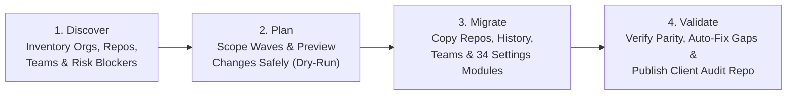

# GHEC Consultant Suite

The **GHEC Consultant Suite** is our automated platform for delivering **GitHub Enterprise Cloud (GHEC)** and **Enterprise Managed Users (GHEC-EMU)** migration contracts. It helps our consulting teams move a client's repositories, engineering history, teams, security rules, and automation settings into a new GitHub organization safely, repeatably, and on schedule.

Instead of relying on manual scripts or spreadsheets during a client engagement, our team uses the **GHEC Consultant CLI** (`ghec-consultant-cli`)—triggered directly from **GitHub Actions** or the **Operations Web UI**—to discover what the client has, build a migration plan, move data in parallel waves, and validate that every item arrived cleanly.

---

## How this platform helps our migration contracts

By default, every migration run is designed to protect the client's existing work while giving our project managers, operators, and customer leads clear visibility from kickoff to final sign-off:

- **100% read-only on the client's source organization:** During discovery, planning, and migration waves, the tool only reads from the client's existing GitHub organization. Nothing is deleted, altered, or locked until the client approves final cutover.
- **Zero exposure of client secrets:** The tool never reads, exports, or logs raw password or secret values. Instead, it creates safe blank placeholders in the new organization so the client's security team can fill in their secrets using a clean checklist.
- **Built for organizations of any size:** Whether a client has 10 repositories or 5,000, the tool automatically splits the work across parallel GitHub Actions runners and adjusts its transfer method for massive repositories (> 40 GiB), Git LFS files, and large release attachments (> 10 GiB).
- **Automatic validation and client handoff:** At the end of every wave, the tool checks the new organization against the plan, fixes temporary rate-limit misses automatically, and creates a private **`migration-audit-results`** repository with an interactive Web UI dashboard and spreadsheet-ready post-care checklists.

---

## How the CLI tool works: Discover, Plan, Migrate, and Validate

At the heart of the suite is **`ghec-consultant-cli`**, an automated command-line engine that operators run through the **GitHub Actions Web UI**, the **GitHub CLI (`gh`)**, or the **Migration Operations Web UI**. It guides every client contract through four clear stages:

### 1. Discover (`discover` & `preflight`)

Before moving any data, the CLI scans the client's existing GitHub organizations in read-only mode.

- **What it does:** Counts every repository, branch, team, user, ruleset, webhook, package, and GitHub App, and checks that access tokens have the right permissions.
- **What you get:** A complete readiness report and an interactive **Web UI Dashboard** that highlights oversized repositories, Git LFS storage, and potential blockers weeks before cutover.

### 2. Plan (`generate-scope`, `validate-scope` & `plan`)

Next, the CLI defines which organizations and repositories belong in each migration wave and checks what needs to be created in the destination organization.

- **What it does:** Builds a migration wave scope (for all repositories, specific business units, or only `public`, `private`, or `internal` repositories) and runs a **Dry-Run Preview** (`dry_run: true`) against the target organization without making any live changes.
- **What you get:** A step-by-step migration plan showing every repository, team, variable, secret placeholder, and security rule that will be created during the cutover window.

### 3. Migrate (`migrate` & `cutover`)

During the scheduled migration window (or a sandbox rehearsal), the CLI copies the client's repositories and organization settings into the new GHEC or GHEC-EMU organization.

- **What it does:** Runs **34 specialized migration modules** in the right order—moving Git history, pull requests, issues, discussions, releases, teams, custom roles, branch rulesets, environments, variables, and packages in parallel batches.
- **What you get:** If a network drop or GitHub rate limit pauses a run, the CLI saves a checkpoint after every step so operators can resume right where it left off without creating duplicates.

### 4. Validate (`verify`, `agent-review` & `publish-results`)

Immediately after the migration finishes, the CLI audits the new organization item-by-item to prove that everything in the plan succeeded.

- **What it does:** Compares the destination organization against the migration plan, runs up to 3 automatic self-healing passes to fix any missed items, and publishes the final audit package.
- **What you get:** A private **`migration-audit-results`** repository in the client's new organization containing an Executive Scorecard, an interactive **Private GitHub Pages Dashboard**, CSV spreadsheets, and a plain-English **Post-Care Checklist** with 1-click links.

---

## Platform capabilities overview

By default, the CLI and GitHub Actions workflows automate **34 migration modules** (15 organization-level modules and 19 repository-level modules) along with specialized cutover and rehearsal tools:

| Capability Category                     | What the Tool Automates                                                                                                                                                                   | How It Helps Our Clients & Consultants                                                                        |
| :-------------------------------------- | :---------------------------------------------------------------------------------------------------------------------------------------------------------------------------------------- | :------------------------------------------------------------------------------------------------------------ |
| **Repositories & Git History**          | Copies all branches, tags, commit history, wikis, issues, comments, labels, milestones, and pull requests using GitHub Enterprise Importer (`gei-repo`).                                  | Preserves years of engineering history and code review audit trails without manual scripts.                   |
| **Massive Repos, Git LFS & Releases**   | Automatically detects repositories over 40 GiB, releases over 10 GiB, and Git Large File Storage (`git-lfs`) objects, switching to streaming transfer modes (`modules: auto`).            | Prevents weekend cutover failures on large monorepos and multi-gigabyte binary files.                         |
| **Teams, Roles & EMU Identities**       | Recreates nested parent/child teams, custom roles, repository permission levels, SCIM Identity Provider (IdP) group links, and EMU user mapping spreadsheets (`mannequins`).              | Saves days of rebuilding complex team trees and user permissions by hand in GHEC-EMU.                         |
| **Security, Rulesets & Governance**     | Migrates organization and repository rulesets, classic branch protection rules, custom property schemas/values, `CODEOWNERS` checks, Dependabot, Secret Scanning, and Push Protection.    | Ensures the client's security and compliance controls are active on Day 1.                                    |
| **GitHub Actions, Secrets & Variables** | Copies Actions policies, runner groups, larger hosted runners, deployment environments, plaintext variables (`vars.*`), and sealed blank placeholder secret names.                        | CI/CD pipelines and environments are ready immediately without ever exposing client secret values.            |
| **Discussions, Projects & Packages**    | Rebuilds GitHub Discussions categories/threads/answers, Projects v2 boards and custom fields, and npm, Maven, NuGet, RubyGems, and Docker/OCI container packages.                         | Moves engineering collaboration boards and package registries alongside source code.                          |
| **GitHub Apps, Webhooks & Autolinks**   | Exports app manifests, builds **1-click install/recreate links**, automatically binds selected repositories via API, copies autolinks, and creates webhooks in safe paused mode.          | Eliminates clicking 50+ repositories by hand when reinstalling GitHub Apps in the new org.                    |
| **Multi-Org Public Consolidation**      | Consolidates `public` (or selected) repositories from several source organizations into one shared destination org while copying only associated teams, secrets, variables, and rulesets. | Solves GHEC-EMU's requirement to separate public repositories from managed EMU organizations.                 |
| **Sandbox Rehearsal Mode**              | Copies live repositories and settings into a test organization while keeping all target Webhooks and GitHub Actions turned off (`sandbox_rehearsal: true`).                               | Lets consultants show the client their migrated repositories in a live sandbox with zero background activity. |
| **Go-Live Cutover & Source Freeze**     | Detaches globally unique SSH deploy keys and GitHub Pages custom domains from old repositories, attaches them to the new repositories, and archives the old repositories.                 | Automates the final go-live switchover steps in a single workflow (`post-migration-cutover.yml`).             |

---

## Documentation directory by role

We organize our documentation by role so project managers, migration operators, customers, and software developers can jump straight to what they need:

### 1. For Project Managers, Leaders & Customers

Plain-English guides for planning client engagements, preparing organizations, and reviewing post-migration results:

- **[Project Manager & Engagement Lead Playbook](docs/guides/customers-and-pms/pm-engagement-playbook.md):** How to structure migration waves, track client prerequisites, estimate timelines, and review executive scorecards.
- **[Customer Migration Handbook](docs/guides/customers-and-pms/customer-migration-handbook.md):** Shareable client guide covering how data stays safe, token and SSO setup checklists, what moves automatically vs. post-care, and Day-1 developer instructions.

### 2. For Migration Operators (Delivery Consultants)

Step-by-step operational guides for running migrations using **only the GitHub Web UI, the Dashboard Web UI, and the `gh` CLI** (no developer setup or `npm` commands needed):

- **[Consultant Operator's Manual](docs/guides/operators/consultant-operators-manual.md):** Complete guide to installing the Release Kit and running same-day scopes, dry-runs, parallel migration waves, and cutovers via the GitHub Actions Web UI or `gh workflow run`.
- **[Generating and Validating Migration Scopes](docs/guides/operators/generating-migration-scopes.md):** How to slice waves by visibility (`public`, `private`, `internal`), repository lists, or multi-organization consolidation.
- **[Discovery Scans & Using the Assessment Web UI](docs/guides/operators/discovery-and-dashboard-webui.md):** How to run read-only discovery scans and explore readiness scores, dependency maps, and PDF/CSV reports in the Web UI.
- **[Verifying Migrations & Fixing Missing Items](docs/guides/operators/verification-and-remediation.md):** How to review the `migration-audit-results` repository, run automatic self-healing workflows, and map EMU user history.
- **[Setting Up a Sandbox Rehearsal or Live Demo](docs/guides/operators/sandbox-and-demo-setup.md):** How to populate a test organization with 34 realistic sample items and run a safe sandbox rehearsal.

### 3. For Platform Developers & Software Engineers

Technical guides for engineers building the TypeScript monorepo, testing CLI commands locally with `npm`, packaging the Release Kit, or adding new migration modules:

- **[Local Development & Running the CLI with npm](docs/guides/developers/local-development-and-cli.md):** Setting up Node.js and `npm` workspaces, running `npm run dev:cli` and `npm run dev`, and executing the 800+ offline unit tests (`npm run check`).
- **[Building and Publishing the Customer Release Kit](docs/guides/developers/building-the-release-kit.md):** How to bundle the zero-source `ghec-migration-kit` archive for client engagements.
- **[Adding and Testing Migration Modules](docs/guides/developers/adding-migration-modules.md):** How to scaffold a new 4-stage module (`discover`, `plan`, `apply`, `verify`) and write offline tests.
- **[Contributing Guide](CONTRIBUTING.md) & [Architecture & Specifications](docs/README.md):** Monorepo packages ([`apps/cli`](apps/cli/README.md), [`apps/dashboard`](apps/dashboard/README.md), [`packages/migration`](packages/migration/README.md), [`packages/discovery`](packages/discovery/README.md), [`packages/analysis`](packages/analysis/README.md), [`packages/github-client`](packages/github-client/README.md), [`packages/contracts`](packages/contracts/README.md)), [Architectural Decisions](docs/architecture/decisions.md), and [Engineering Specs](docs/specs/README.md).

### 4. Support, Roles & Security

- **[Support & Troubleshooting Guide](SUPPORT.md):** Quick fixes for common operator issues (SAML SSO authorization, token rules, resuming paused runs) and developer build tips.
- **[Collaborators & Team Roles](COLLABORATORS.md):** Team permissions, reviewing migration wave Pull Requests, and using GitHub Copilot agents.
- **[Security Policy](SECURITY.md) & [Code of Conduct](CODE_OF_CONDUCT.md):** Zero-exposure secret rules and team standards.
