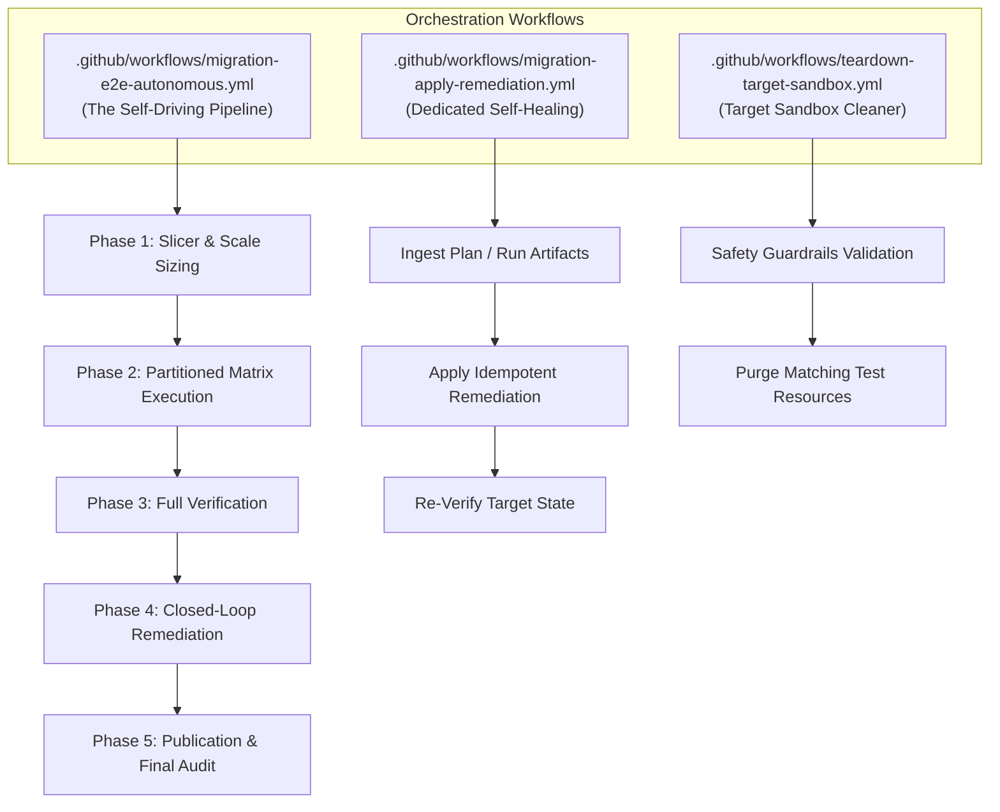

# Architecture: Autonomous Scale-Adaptive Migration & Automated Remediation

**Specification**: [`specs/003-autonomous-migration-orchestration/spec.md`](../../specs/003-autonomous-migration-orchestration/spec.md)  
**Status**: Implemented  
**Date**: 2026-10-14

---

## 1. Overview & Objective

The Autonomous Scale-Adaptive Migration Orchestration system enables unattended, zero-touch migration of GitHub Enterprise Cloud (GHEC) organizations to GHEC with Enterprise Managed Users (GHEC-EMU) across 34 distinct migration modules.

When running in autonomous execution environments (such as an agentic continuous goal or scheduled execution), the system diagnoses repository characteristics, dynamically provisions proper runner pools and transfer mechanisms, monitors runner scratch space headroom, records atomic stage checkpoints, and executes an automated closed-loop self-healing remediation cycle until zero actionable discrepancies remain.

---

## 2. Core Workflows

The orchestration platform delivers three unified GitHub Actions automation workflows:

### 1. Unified Autonomous Pipeline (`migration-e2e-autonomous.yml`)

- **Phase 1 (Slicer)**: Evaluates repository disk sizes, release asset byte volumes, and Git LFS objects to partition scopes into parallel cohorts mapped to appropriate runner pools.
- **Phase 2 (Matrix Execution)**: Dispatches cohorts across `matrix.runnerLabels`, performs runner scratch disk headroom checks (`checkScratchDiskSpace`), executes migration strategies, restores original repository visibility (`internal`/`public`), and saves atomic checkpoints (`.checkpoint-*`).
- **Phase 3 (Verification)**: Audits target tenant across all 34 modules via `ghec-consultant-cli verify`, producing `verification-report.json`.
- **Phase 4 (Autonomous Closed-Loop Remediation)**: If discrepancies exist and `auto_remediate: true`, invokes `agent-review`, runs `remediation.sh` using target credentials (`GHEC_TARGET_TOKEN`), and loops until 0 discrepancies or `max_remediation_rounds` (default: 3) is reached.
- **Phase 5 (Audit Publication)**: Compiles metrics and publishes summary to `$GITHUB_STEP_SUMMARY`.

### 2. Standalone Remediation Trigger (`migration-apply-remediation.yml`)

- Ingests pre-existing `remediation-plan.json` or downloads artifacts from a specific `workflow_run_id`.
- Executes remediation commands with anti-collision guards and DEC-004 sealed blank placeholders.
- Re-runs target verification and publishes a differential comparison of resolved vs remaining discrepancies.

### 3. Target Sandbox Teardown (`teardown-target-sandbox.yml`)

- Safety-guarded cleanup utility for test organizations (`dummy-*`, `demo-*`).
- Requires explicit `confirm_teardown: true` and validates prefix length >= 3 characters.
- Rejects wildcards (`*`, `%`, `all`) to protect enterprise assets.
- Discovers and purges matching repositories, teams, custom roles, and rulesets, eliminating HTTP 409 collisions.

---

## 3. Scale-Adaptive Classification Matrix

The slicer categorizes repositories into four discrete operational tiers based on remote API heuristics:

| Classification Tier     | Criteria                                       | Strategy Assignment                                      | Runner Pool                                                       | Rationale                                                                                                                 |
| :---------------------- | :--------------------------------------------- | :------------------------------------------------------- | :---------------------------------------------------------------- | :------------------------------------------------------------------------------------------------------------------------ |
| **Standard Repo**       | Git size <10 GiB, metadata <40 GiB             | Standard GEI (`gei-repo`) + API rehydration              | `default_runner_labels` (`ubuntu-latest`)                     | Fast, efficient, preserves full PR and commit history via importer.                                                       |
| **Large Releases Repo** | Release assets >10 GiB                         | GEI `--skip-releases` + `LargeReleasesMigrationStrategy` | `default_runner_labels` (or high-disk)                        | Prevents runner disk exhaustion (`ENOSPC`) by streaming release binaries in chunks via REST.                              |
| **Git LFS Repo**        | Tracked LFS objects present                    | Dual-Remote Streamer (`GitLfsMigrationStrategy`)         | `default_runner_labels` (or high-disk)                        | Direct LFS batch streaming without local worktree checkouts.                                                              |
| **Massive Repo**        | Git size >40 GiB or archive threshold exceeded | GEI Bypass (`useGei: false`), `GitMirrorPushExecutor`    | `large_repo_runner_labels` (`self-hosted,high-disk` >=100 GB) | Bypasses 40 GiB GEI archive threshold. Executes bare mirror-push directly to target bare repository with 1.5x disk check. |

---

## 4. Operational Invariants & Safeguards

1. **Headroom Verification (`checkScratchDiskSpace`)**:
   - Before executing `git clone --bare`, runners inspect local scratch disk via `statfsSync`.
   - Requires available bytes >= 1.5x estimated repository size. Fails fast in milliseconds if capacity is insufficient.
2. **Post-GEI Target Visibility Reconciliation**:
   - GEI forces all migrated repositories to `private`.
   - The post-GEI reconciliation step restores the original visibility (`internal` or `public`) at the destination.
3. **Resilient Atomic Checkpointing**:
   - Every module stage records atomic JSON files (`./migrations/.checkpoint-<cohort>-<module>.json`).
   - Checkpoints persist across matrix jobs via artifact upload/download, allowing interrupted migrations to resume without re-cloning 40 GiB Git trees.
4. **DEC-004 Zero-Exposure Security**:
   - Plaintext source secrets are write-only and never logged.
   - Missing target secrets default to sealed blank strings (`""`).
   - All diagnostic outputs pass through `sanitizeDiagnostics` to scrub tokens and credentials.
