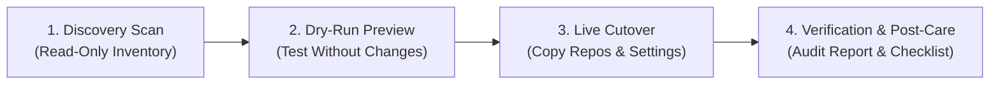

# Customer Migration Handbook: Moving to GitHub Enterprise Managed Users (GHEC-EMU)

This handbook explains how your move to **GitHub Enterprise Cloud with Enterprise Managed Users (GHEC-EMU)** works, what stays safe in your existing organization, what we need from your team at each step, and what your developers will do on Day 1.



---

## Understanding how your migration works and keeps your data safe

By default, the migration tool **only reads** from your existing GitHub organization and **copies** your repositories, history, teams, and settings into your new GHEC-EMU organization. Your existing organization is never deleted or modified during the migration.

Every migration follows four predictable stages:

1. **Stage 1 — Discovery Scan (Read-Only):** We scan your current organization to count your repositories, branches, teams, rulesets, packages, and integrations. Zero changes are made to either organization.
2. **Stage 2 — Dry-Run Preview:** We test the migration plan against your new GHEC-EMU organization in preview mode (`dry_run: true`). This confirms that access tokens and permissions work before moving any real data.
3. **Stage 3 — Live Cutover:** During your scheduled cutover window, our workflows copy your repositories, teams, settings, variables, and rulesets into your new GHEC-EMU organization in parallel batches.
4. **Stage 4 — Automatic Verification & Post-Care Delivery:** Immediately after copying your data, the tool compares your old and new organizations item-by-item and creates a private **`migration-audit-results`** repository in your new organization with a plain-English checklist of post-migration tasks.

> [!NOTE]
> Because your source organization is never altered, your old repositories remain intact as a backup until your team verifies the new organization and chooses to archive or lock the old one.
>
> **Moving public repositories from several organizations into one public organization:**
> Because Enterprise Managed Users (GHEC-EMU) organizations only allow `private` and `internal` repositories, many companies move their `public` repositories from several existing organizations into one shared public GitHub organization. When we do this, the tool automatically copies **only** the teams, secrets, variables, rulesets, and packages that belong to those `public` repositories, and skips global organization settings so none of your old organizations overwrite each other.

---

## Preparing for each stage of the migration

By default, your consultant runs the migration workflows for you inside GitHub Actions. Below is what we need from your team before each stage begins.

### Checklist 1: Before the Discovery Scan

We only need read-only access to inspect your current GitHub organization:

- [ ] **Source Organization Name:** The exact URL name of your current GitHub organization (for example, `acme-corp`).
- [ ] **Read-Only Source Token (`GHEC_SOURCE_TOKEN`):** A Classic Personal Access Token (`ghp_...`) created by an Organization Owner in your current organization with these four scopes checked:
  - `repo` (Full control of private repositories — needed by GitHub's export API to read repository settings and metadata)
  - `read:org` (Read organization and team membership)
  - `read:org_hook` and `read:repo_hook` (Read webhook configurations)
- [ ] **SAML Single Sign-On (SSO) Authorization:** If your current organization uses SAML SSO, click **Configure SSO** next to the token in GitHub Settings and click **Authorize**.

### Checklist 2: Before the Dry-Run Preview

Before we can test against your new GHEC-EMU destination, your Identity Provider (such as Okta, Microsoft Entra ID, or PingFederate) and target organization must be ready:

- [ ] **Target GHEC-EMU Organization Created:** An empty organization created inside your new GitHub Enterprise Managed Users account (for example, `acme-emu`).
- [ ] **SSO and SCIM User Provisioning Active:** Your Identity Provider is connected to the new enterprise so your employees have managed accounts (such as `jdoe_acme`) synced via SCIM.
- [ ] **Target Owner Token (`GHEC_TARGET_TOKEN`):** A Classic Personal Access Token (`ghp_...`) created by an EMU Organization Owner in your new organization with these scopes checked:
  - `repo`
  - `admin:org`
  - `admin:org_hook` and `admin:repo_hook`
  - `workflow`
  - `write:packages` and `read:packages` (if migrating GitHub Packages)
- [ ] **SAML SSO Authorized on the Target Token:** Click **Configure SSO** next to the target token and click **Authorize** for the new GHEC-EMU organization.

### Checklist 3: Before the Live Cutover Window

To make sure no new code commits or pull requests are left behind while repositories are copying:

- [ ] **Schedule a Cutover Freeze Window:** Pick a maintenance window (such as Friday evening or a weekday afternoon for smaller waves) when developers pause pushing commits, opening pull requests, or editing issues in the repositories being moved.
- [ ] **Ask Developers to Push Local Work Early:** Have developers push any unpushed branches to GitHub before the freeze window starts so those branches are included in the copy.
- [ ] **Pause Automated CI/CD Deployments:** Temporarily pause external build servers (such as Jenkins, CircleCI, or Azure DevOps) that push tags or trigger deployments against the repositories in the wave.

---

## What moves automatically vs. what needs your team's post-care

By default, the migration tool moves **all code, history, pull requests, issues, discussions, releases, teams, variables, and security rules** automatically. However, GitHub's security design never allows anyone—including administrators—to export raw secret values or private SSH keys out of GitHub.

Here is exactly what moves automatically and what your team will finish using our generated post-care checklist:

| Item Category                                 | Moves Automatically? | What the Tool Does for You                                                                                               | What Your Team Does After Cutover                                                                                     |
| :-------------------------------------------- | :------------------: | :----------------------------------------------------------------------------------------------------------------------- | :-------------------------------------------------------------------------------------------------------------------- |
| **Git Code, Branches, Tags & Commit History** |      ✅ **Yes**      | Copies every branch, tag, and commit with full history.                                                                  | Developers update their local `git remote` URL to point to the new organization.                                      |
| **Pull Requests, Code Reviews & Issues**      |      ✅ **Yes**      | Copies all open and closed pull requests, comments, milestones, and labels.                                              | Re-link author names ("mannequins") to your employees' new EMU usernames using our pre-built CSV file.                |
| **GitHub Discussions & Releases**             |      ✅ **Yes**      | Rebuilds Discussion categories, threads, answers, and copies all Releases and binary assets (even files over 2 GB).      | None — ready to use immediately.                                                                                      |
| **Git LFS Files & GitHub Packages**           |      ✅ **Yes**      | Transfers Git Large File Storage (`git-lfs`) objects and container/npm/Maven/NuGet packages.                             | Update package registry URLs in your build scripts if they reference the old organization name.                       |
| **Organization Settings, Teams & Roles**      |      ✅ **Yes**      | Creates parent and child teams, custom repository roles, custom property schemas, and repository permission bindings.    | Confirm that your Identity Provider (IdP) SCIM groups are linked to the migrated teams.                               |
| **Branch Protection, Rulesets & Security**    |      ✅ **Yes**      | Copies branch protection rules, rulesets, Dependabot alerts, Secret Scanning, Push Protection, and `CODEOWNERS` files.   | None — security settings are verified automatically.                                                                  |
| **GitHub Actions Variables & Environments**   |      ✅ **Yes**      | Copies all organization, repository, and environment configuration variables (`vars.*`) with their exact values.         | None — plaintext variables work right away.                                                                           |
| **GitHub Actions & Dependabot Secrets**       |  🔒 **Names Only**   | Creates every secret name in the new organization with a safe blank encrypted placeholder (`""`) so workflows are ready. | Paste the real secret values into the listed secret names from your password vault (1Password, Vault, AWS, or Azure). |
| **Organization & Repository Webhooks**        | ⏸️ **Created Safe**  | Copies every webhook URL and event filter in **inactive (paused)** mode so external systems are not spammed during copy. | Re-enter any webhook shared secret tokens and check the **Active** box when you are ready to go live.                 |
| **IP Allow Lists**                            | ⏸️ **Created Safe**  | Copies your IP address ranges in **disabled** mode so cloud migration runners are not locked out mid-run.                | Enable the IP allow list in Organization Settings once the migration finishes.                                        |
| **SSH Deploy Keys**                           |  📋 **Inventoried**  | Lists every repository SSH deploy key (`title`, `read_only`, and repository name) in your post-care CSV file.            | Generate a fresh SSH key pair on your deployment server and upload the new public key.                                |
| **Installed GitHub Apps**                     |  📋 **Inventoried**  | Lists every installed GitHub App (such as Slack, Jira, SonarQube, or Vercel) and which repositories it had access to.    | Click **Install** on each required GitHub App in the new organization and authorize it.                               |
| **Self-Hosted Runner Groups**                 |  ⚙️ **Groups Only**  | Creates all runner group names, visibility settings, and repository access lists.                                        | Re-register your physical or cloud runner machines (`./config.sh`) against the new organization URL.                  |

> [!WARNING]
> **Why aren't secret values copied automatically?**
> For your security, GitHub encrypts Actions, Dependabot, and Codespaces secrets one-way. Even GitHub's own APIs cannot read a secret value back out once it is saved. Our tool creates the exact secret names in every repository and environment for you, and gives you a simple checklist (`post-care/secrets-to-populate.csv`) so your security team knows exactly which secrets to fill in.

---

## Using your post-care checklist after cutover (`migration-audit-results`)

When your live migration finishes, the workflow automatically creates a private repository named **`migration-audit-results`** inside your new GHEC-EMU organization. You do not need to dig through technical log files—everything your team needs is organized in plain English and spreadsheet-ready CSV files.

```text
migration-audit-results/
├── README.md                              # Executive summary & verification scorecard
├── POST-CARE-CHECKLIST.md                 # Step-by-step customer post-care guide
├── post-care/
│   ├── secrets-to-populate.csv            # Every org, repo, and environment secret name to fill in
│   ├── apps-to-reinstall.csv              # Every GitHub App to re-install in the new org
│   ├── webhooks-to-enable.csv             # Every webhook to review and activate
│   ├── deploy-keys-to-rotate.csv          # Every SSH deploy key to replace
│   ├── runner-groups-to-register.csv      # Self-hosted runner groups needing machine registration
│   └── mannequin-mappings.csv             # Author mapping table to link history to EMU users
└── evidence/                              # Full JSON audit reports for compliance records
```

In addition to the files above, the workflow automatically opens **GitHub Issues** with checkboxes inside the `migration-audit-results` repository (for example, `Post-Care: Populate 14 Sealed Secrets`) so you can assign tasks directly to your DevOps, Security, or Identity leads and track completion in GitHub.

### How to re-link pull request and issue authors ("Mannequins")

When GitHub copies pull requests and issues from your old organization, it attaches historical comments to placeholder profiles called **mannequins** until you map each old username to the employee's new EMU username.

To map all historical pull requests and issues to your real employees:

1. Open `post-care/mannequin-mappings.csv` from the `migration-audit-results` repository in Excel or Google Sheets.
2. Fill in the `target-user` column with each person's new EMU username (for example, `jsmith_acme`).
3. Run the GitHub Enterprise Importer reclaim command (or ask your consultant to run it for you):

```bash
gh gei reclaim-mannequin \
  --github-target-org "acme-emu" \
  --csv ./mannequin-mappings.csv \
  --skip-invitation
```

> [!TIP]
> Because Enterprise Managed Users are controlled by your company's Identity Provider, `--skip-invitation` links the user's history immediately without sending hundreds of confirmation emails to your staff.

---

## What changes for your developers on Day 1 in GHEC-EMU

Share the quick instructions below with your engineering teams before they log into the new organization on Day 1:

1. **Log in with your new company EMU username:**
   In GHEC-EMU, personal GitHub accounts are separate from work accounts. Your work username now ends with your company's shortcode (for example, `jane-doe_acme`) and logs in through your company's Single Sign-On portal.
2. **Create a new Personal Access Token or SSH key for your work account:**
   Because your EMU account is a brand-new GitHub identity, add your SSH key (`Settings -> SSH and GPG keys`) or create a new Personal Access Token (`Settings -> Developer settings`) while signed into your `..._acme` account, and click **Configure SSO $\rightarrow$ Authorize**.
3. **Point your local Git folders to the new organization URL:**
   You do not need to re-clone your repositories from scratch. Inside each project folder on your computer, run one command to point Git to the new organization:

```bash
git remote set-url origin https://github.com/<new-emu-org>/<repository-name>.git
```

To verify that your local folder now points to the new organization:

```bash
git remote -v
```
