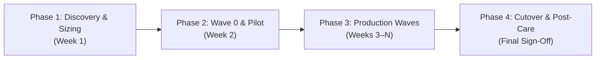

# Project Manager & Engagement Lead Playbook

This playbook helps project managers, practice leads, and engagement leads plan, track, and sign off on **GitHub Enterprise Cloud (GHEC)** and **Enterprise Managed Users (GHEC-EMU)** migration engagements from kickoff to client handoff.

---

## Structuring a standard migration engagement

By default, our consulting teams deliver GHEC and GHEC-EMU migrations in four structured phases so the client's engineering teams experience zero unexpected downtime:

| Engagement Phase                         | What Our Team Does                                                                                                                                              | What the Client Delivers                                                                                            | Key Deliverable / Milestone                                                                           |
| :--------------------------------------- | :-------------------------------------------------------------------------------------------------------------------------------------------------------------- | :------------------------------------------------------------------------------------------------------------------ | :---------------------------------------------------------------------------------------------------- |
| **Phase 1: Discovery & Sizing**          | Installs the Release Kit and runs a read-only discovery scan across the client's existing GitHub organizations.                                                 | Provides a read-only `GHEC_SOURCE_TOKEN` and authorizes SAML Single Sign-On (SSO).                                  | **Readiness Assessment Report** (PDF/CSV exported from the Assessment Web UI) & Wave Plan.            |
| **Phase 2: Wave 0 & Pilot Rehearsal**    | Verifies the new Enterprise settings, runs a **Dry-Run Preview**, and executes a **Sandbox Rehearsal** (`sandbox_rehearsal: true`) or small pilot wave.         | Connects their Identity Provider (Okta/Entra ID) for SCIM user sync and provides `GHEC_TARGET_TOKEN`.               | **Pilot Verification Scorecard** with zero blockers before production waves begin.                    |
| **Phase 3: Production Migration Waves**  | Moves shared platform repositories first (Wave 1), followed by business unit repositories (Waves 2+) and public repository consolidation if needed.             | Schedules brief freeze windows for each wave and pauses external CI/CD deployments during the copy.                 | **Migrated Organizations & Repositories** verified automatically at the end of each wave.             |
| **Phase 4: Cutover & Post-Care Handoff** | Runs `post-migration-cutover.yml` to move unique SSH deploy keys and custom domains, freezes old repos, and walks the client through `migration-audit-results`. | Populates secret values from their password vault, clicks 1-click GitHub App install links, and re-links EMU users. | **`migration-audit-results` Repository** & signed **Post-Care Checklist** (`POST-CARE-CHECKLIST.md`). |

---

## Tracking client prerequisites before kickoff

Most migration delays happen when Identity Provider (SCIM) groups or token SAML authorizations are not ready before the first wave. Track these five client action items with the client's project manager during Week 1:

- [ ] **1. Source Read-Only Token (`GHEC_SOURCE_TOKEN`):** Created by a current Organization Owner (`repo`, `read:org`, `read:org_hook`, `read:repo_hook`) with **SAML SSO Authorized**.
- [ ] **2. Target GHEC-EMU Organization & SCIM Sync:** The client's Identity team (Okta, Microsoft Entra ID, or PingFederate) has provisioned managed accounts (`<username>_<shortcode>`) and SCIM groups in the new enterprise.
- [ ] **3. Target Owner Token (`GHEC_TARGET_TOKEN`):** Created by an EMU Organization Owner (`repo`, `admin:org`, `admin:org_hook`, `admin:repo_hook`, `workflow`, `write:packages`, `read:packages`) with **SAML SSO Authorized**.
- [ ] **4. Enterprise Policy Delegation (During Migration):** Enterprise-level repository visibility and Actions policies are temporarily set to **"No policy"** (delegated to organizations), and any Enterprise-level rulesets are set to **`Evaluate`** or **`Disabled`** until all waves complete.
- [ ] **5. Public Repository Destination (For EMU Contracts Only):** Because GHEC-EMU organizations only allow `private` and `internal` repositories, confirm whether the client has `public` repositories that need to be consolidated into a separate standard GHEC organization.

> [!TIP]
> Share the **[Customer Migration Handbook](customer-migration-handbook.md)** directly with your client's IT, Security, and Engineering leads at kickoff—it includes step-by-step checklists written specifically for their teams.

---

## Estimating wave timelines and spotting risk factors

When reviewing the **Migration Readiness** tab in the Assessment Web UI after Phase 1 Discovery, look for these four items that affect wave scheduling:

| Discovery Finding                    | Why It Matters for Scheduling                                                                   | How Our Platform Handles It Automatically                                                                                                                     |
| :----------------------------------- | :---------------------------------------------------------------------------------------------- | :------------------------------------------------------------------------------------------------------------------------------------------------------------ |
| **Standard Repositories (< 10 GiB)** | Most repositories finish copying in 2 to 10 minutes per repository across parallel runners.     | Moves up to 5–10 cohorts in parallel using GitHub Enterprise Importer (`gei-repo`).                                                                           |
| **Large Releases (> 10 GiB)**        | GitHub's standard importer rejects repositories when total release attachments exceed 10 GiB.   | `modules: auto` automatically skips releases during the initial import and streams large release assets separately.                                           |
| **Massive Repositories (> 40 GiB)**  | GitHub's importer cannot export repositories larger than 40 GiB.                                | `modules: auto` switches to high-speed `mirror-push` plus standalone issue, PR, release, and Git LFS streaming. Recommend self-hosted or larger runners.      |
| **Installed GitHub Apps**            | GitHub security rules require a human admin to click **Install** in their browser for each app. | The tool builds **1-click install/recreate links** in `POST-CARE-CHECKLIST.md` and automatically re-attaches all selected repositories via API in 15 seconds. |

---

## Reviewing the final audit scorecard with the client

At the end of every migration wave, the workflow automatically creates or updates a private **`migration-audit-results`** repository inside the client's target organization.

As an Engagement Lead or Project Manager, you can open `migration-audit-results` in your browser to review and sign off on the contract deliverables:

1. **Executive Scorecard (`README.md`):** Shows the exact count of migrated repositories, teams, rulesets, variables, and secrets, along with the **Verification Pass Rate** across all 34 modules.
2. **Interactive Web UI (`Open Interactive Dashboard` link):** Opens the Private GitHub Pages dashboard where stakeholders can filter migrated items, inspect verification status, and download PDF summaries.
3. **Client Post-Care Checklist (`POST-CARE-CHECKLIST.md` & `exports/*.csv`):** Gives the client's Security, DevOps, and Identity leads clear spreadsheets of secret names to fill in (`secrets-to-populate.csv`), webhooks to activate (`webhooks-reconfiguration.csv`), 1-click GitHub App links (`github-apps-reinstall.csv`), and EMU user mappings (`mannequins-reclaim.csv`).
