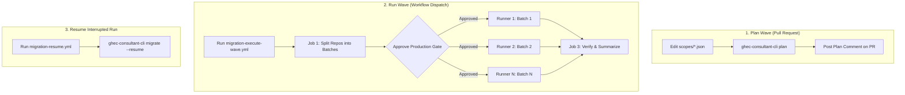

# Running migrations with GitHub Actions

You can use the GitHub Actions workflows in this repository to plan, run, and verify large migrations from **GitHub Enterprise Server (GHES)** or **GitHub Enterprise Cloud (GHEC)** to **GHEC Enterprise Managed Users (EMU)**. Instead of running commands on your laptop for hours, GitHub Actions divides the repositories across multiple runners in parallel.



---

## Setting up your migration tokens

By default, all GitHub Actions migration workflows read two separate secrets from your repository settings:

- `GHEC_SOURCE_TOKEN`: Read-only Personal Access Token (or GitHub App token) for your source organization.
- `GHEC_TARGET_TOKEN`: Organization Owner Personal Access Token for your target GHEC-EMU organization.

To save both tokens securely in your repository's GitHub Actions secrets using the GitHub CLI:

```bash
gh secret set GHEC_SOURCE_TOKEN
gh secret set GHEC_TARGET_TOKEN
```

> [!WARNING]
> Never use the same token for both `GHEC_SOURCE_TOKEN` and `GHEC_TARGET_TOKEN`. Also remember that GitHub Actions secrets are write-only—the tool creates blank encrypted placeholders (`""`) at the target so secret values are never printed in logs.

---

## Choosing a runner size for your migration

For small test runs, GitHub's standard `ubuntu-latest` runners work out of the box. For large weekend migrations with hundreds of repositories or multi-gigabyte Git LFS files, we recommend **self-hosted Linux runners** so jobs do not hit GitHub's 6-hour time limit and can save checkpoints on local disk (`/mnt/ghec-checkpoints`).

| Migration Size            | Parallel Runners | CPU per Runner | RAM per Runner | Disk per Runner |
| :------------------------ | :--------------: | :------------: | :------------: | :-------------: |
| **Small (< 50 Repos)**    |       2–4        |     4 vCPU     |     16 GB      |   100 GB NVMe   |
| **Medium (50–250 Repos)** |       4–8        |     8 vCPU     |     32 GB      |   250 GB NVMe   |
| **Large (> 250 Repos)**   |       8–16       |    16 vCPU     |     64 GB      |   500 GB NVMe   |

---

## Generating a migration scope (Artifact Mode or Pull Request Mode)

By default, `generate-scope.yml` builds your migration scope from your latest discovery scan and uploads it as a **GitHub Actions Artifact** (`commit_to_branch: false`) so you do not have to commit scope files to git. If your team prefers a Pull Request review gate, you can also save scope files inside the `scopes/` folder.

```text
scopes/
├── wave-1.json
└── wave-2.json
```

To generate a scope artifact automatically in GitHub Actions from your latest discovery scan without committing to git:

```bash
gh workflow run generate-scope.yml \
  -f wave_name="wave-1" \
  -f source_org="source-enterprise-org" \
  -f target_org="target-emu-org" \
  -f discovery_run_id="latest"
```

To define a migration wave for three specific repositories by hand instead, create `scopes/wave-1.json`:

```json
{
  "schemaVersion": "1.0.0",
  "sourceOrg": "source-enterprise-org",
  "targetOrg": "target-emu-org",
  "repositories": ["service-api", "frontend-app", "data-pipeline"],
  "modules": ["all"]
}
```

If you want to trigger an automatic plan comment on a Pull Request, commit `scopes/wave-1.json` to a branch:

```bash
git checkout -b plan-wave-1
git add scopes/wave-1.json
git commit -m "docs(scope): add wave 1 scope"
git push -u origin plan-wave-1
gh pr create --fill
```

---

## Running a parallel migration wave

By default, `.github/workflows/migration-execute-wave.yml` runs in **dry-run mode** (`dry_run: true`) so you can safely preview every batch before making live changes. For a complete list of workflow inputs and module IDs, see the [Consultant Operator's Manual](consultant-operators-manual.md).

```text
Friday 09:00 UTC ──▶ 1. Run Discovery Scan
Friday 14:00 UTC ──▶ 2. Generate Scope Artifact (or Open Scope PR)
Saturday 00:00 UTC ─▶ 3. Run Parallel Migration Wave
Saturday 08:00 UTC ─▶ 4. Review migration-audit-results Repo
Saturday 12:00 UTC ─▶ 5. Map Mannequins to EMU Users
```

To run a dry-run preview using the latest scope artifact (`scope_run_id="latest"`):

```bash
gh workflow run migration-execute-wave.yml \
  -f scope_run_id="latest" \
  -f batch_size="5" \
  -f modules="all" \
  -f dry_run="true"
```

To migrate specific repositories in one click without generating a scope file first:

```bash
gh workflow run migration-execute-wave.yml \
  -f source_org="source-enterprise-org" \
  -f target_org="target-emu-org" \
  -f repositories="service-api,frontend-app" \
  -f dry_run="true"
```

Once your dry-run succeeds and your team is ready for cutover, run the live migration wave by setting `dry_run` to `false`:

```bash
gh workflow run migration-execute-wave.yml \
  -f scope_run_id="latest" \
  -f batch_size="5" \
  -f modules="all" \
  -f dry_run="false"
```

To watch the workflow progress live in your terminal:

```bash
RUN_ID=$(gh run list --workflow=migration-execute-wave.yml --limit 1 --json databaseId --jq '.[0].databaseId')
gh run watch "$RUN_ID"
```

Once the repositories finish moving, map the placeholder mannequin accounts to your real EMU users (`--skip-invitation` is required for EMU accounts):

```bash
gh gei reclaim-mannequin \
  --github-target-org "target-emu-org" \
  --csv ./mannequin-mapping.csv \
  --skip-invitation
```

If you clicked any GitHub App install or create links in `POST-CARE-CHECKLIST.md` after the wave finished, run `apps-inventory` by itself to attach those apps to their specific repositories:

```bash
gh workflow run migration-execute-wave.yml \
  -f source_org="source-enterprise-org" \
  -f target_org="target-emu-org" \
  -f repositories="org_only" \
  -f modules="apps-inventory" \
  -f dry_run="false"
```

---

## Resuming a paused or failed migration

By default, the migration runner saves a checkpoint file in `./migrations/.checkpoint-<runId>/` after every completed step. If a network drop or temporary GitHub rate limit interrupts a worker, you can pick up right where it left off.

```text
migrations/
└── .checkpoint-migration-20261004-123456/
    └── checkpoint.json
```

To resume an interrupted migration run in GitHub Actions using its `run_id`:

```bash
gh workflow run migration-resume.yml \
  -f run_id="migration-20261004-123456"
```

To resume the most recent interrupted run locally from the command line:

```bash
npm run dev:cli -- migrate --resume latest --output-dir ./scans
```

> [!NOTE]
> Resuming a wave is safe to run more than once. The runner automatically skips repositories and steps that already finished in the checkpoint file, so no duplicate items are created.
