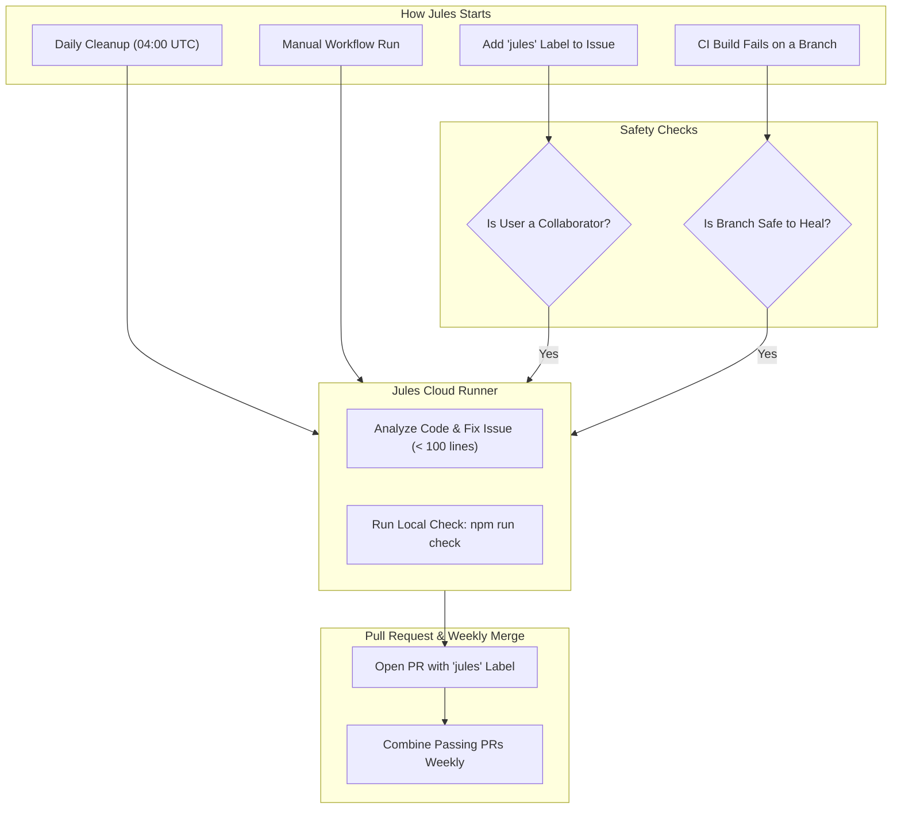

# Setting up Jules automated maintenance and CI healing

You can use **Jules** (`google-labs-code/jules-action@v1.0.0`) in this repository to fix broken CI builds automatically, solve small GitHub issues, and clean up unused code every morning. Jules works in a cloud virtual machine, runs `npm run check` to test its own changes, and opens a Pull Request for you to review.



---

## Saving your Jules API key in GitHub Secrets

By default, all Jules workflows authenticate using a repository secret named `JULES_API_KEY`.

First, get an API key from Google Jules:

1. Sign in to [jules.google.com](https://jules.google.com) with your GitHub account.
2. Click your profile picture in the top-right corner and open **Account Settings**.
3. Under **API Keys**, click **Create New API Key** and copy the token.

To save your `JULES_API_KEY` in your repository's GitHub Actions secrets using the GitHub CLI:

```bash
gh secret set JULES_API_KEY
```

To also set an optional Personal Access Token for combining weekly Jules Pull Requests (if you do not want to use the default `GITHUB_TOKEN`):

```bash
gh secret set COMBINE_PRS_PAT
```

---

## Asking Jules to fix a GitHub Issue

By default, `.github/workflows/jules-agent.yml` watches for the `jules` label on issues. When a maintainer or collaborator adds that label, Jules adds an `:eyes:` reaction, fixes the problem, runs `npm run check`, and opens a Pull Request.

To assign a GitHub Issue to Jules from the command line:

```bash
gh issue edit 42 --add-label "jules"
```

To start a Jules task manually from the command line with custom instructions:

```bash
gh workflow run jules-agent.yml \
  -f task_type="custom" \
  -f custom_prompt="Add unit tests for formatDuration in packages/analysis" \
  -f base_branch="main"
```

To ask Jules to fix a specific issue number using a manual workflow run:

```bash
gh workflow run jules-agent.yml \
  -f task_type="issue-fix" \
  -f issue_number="42" \
  -f base_branch="main"
```

> [!NOTE]
> Only repository `OWNER`, `MEMBER`, or `COLLABORATOR` accounts can trigger Jules. If an outside user adds the `jules` label, the workflow posts a polite note and stops so your API quota is protected.

---

## How automatic CI healing and daily cleanup work

In addition to issue fixes, Jules runs two background workflows automatically:

1. **Fixing broken branch builds (`jules-ci-healer.yml`):** When a feature branch fails the `Monorepo quality` check (such as a lint error, Prettier formatting issue, or TypeScript error), Jules reads the failed log and pushes a fix. To prevent infinite loops, auto-healing never runs on `main`, `combined-jules-prs`, or branches created by Jules (`jules/*`).
2. **Daily code cleanup (`04:00 UTC`):** Every morning at 04:00 UTC, Jules runs a small cleanup sweep (under 100 lines) to remove unused variables, tighten TypeScript types, and add unit tests.

To trigger a daily code cleanup sweep on demand from your terminal:

```bash
gh workflow run jules-agent.yml \
  -f task_type="hygiene-sweep" \
  -f base_branch="main"
```

---

## Combining and merging Jules Pull Requests

To keep your Pull Request list tidy, `.github/workflows/combine-jules-prs.yml` automatically labels every new Jules PR with `jules` and combines all passing `jules` PRs into a single `combined-jules-prs` branch every Sunday at 00:00 UTC.

To combine all open, passing Jules Pull Requests right now instead of waiting until Sunday:

```bash
gh workflow run combine-jules-prs.yml
```

---

## Checking Jules workflow logs and YAML syntax

If a Jules workflow does not start or fails to open a Pull Request, you can check the workflow syntax and logs from your terminal.

To verify that all `.github/workflows/*.yml` files have valid YAML syntax:

```bash
python3 -c "
import yaml, glob
for f in sorted(glob.glob('.github/workflows/*.yml')):
    with open(f) as fp:
        yaml.safe_load(fp)
print('All workflows have valid YAML syntax.')
"
```

To inspect the latest Jules Agent workflow run and find the link to its remote cloud session:

```bash
RUN_ID=$(gh run list --workflow=jules-agent.yml --limit 1 --json databaseId --jq '.[0].databaseId')
gh run view "$RUN_ID" --log
```
