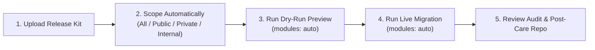

# Consultant Operator's Manual: Running Migrations in GitHub Actions

You can run an entire GitHub Enterprise Cloud (GHEC) to Enterprise Managed Users (GHEC-EMU) migration directly from the **Actions** tab in your browser or with the `gh workflow run` command. You do not need to upload our TypeScript source code to the customer's environment, memorize internal CLI commands, or wait hours for an upfront discovery scan before migrating.



---

## Installing the Customer Release Kit in the customer's environment

By default, the **Customer Migration Release Kit** (`ghec-migration-kit-vX.Y.Z.tar.gz`) contains only the pre-built CLI bundle (`bin/ghec-consultant-cli.mjs`), the pre-built Web UI dashboard (`apps/dashboard/dist/`), the GitHub Actions workflows (`.github/workflows/`), and these operator and customer guides. None of our internal TypeScript source code or developer test files are included.

```text
ghec-migration-kit/
├── bin/
│   └── ghec-consultant-cli.mjs       # Pre-built CLI engine used by GitHub Actions
├── apps/dashboard/dist/              # Pre-built Assessment & Operations Web UI
├── .github/
│   ├── actions/setup-suite/action.yml
│   └── workflows/                    # Ready-to-run GitHub Actions workflows
├── scopes/                           # Sample scope templates
├── docs/guides/                      # Operator & Customer handbooks
└── package.json
```

To download the latest Release Kit archive using the GitHub CLI (or download it from the **Releases** page in your browser):

```bash
gh release download --pattern "ghec-migration-kit-*.tar.gz"
```

To unpack the release kit and push it to a private control repository inside the customer's GHEC environment:

```bash
mkdir customer-migration-control && tar -xzf ghec-migration-kit-v0.1.0.tar.gz -C customer-migration-control
git -C customer-migration-control init -b main
git -C customer-migration-control add .
git -C customer-migration-control commit -m "chore: install GHEC migration release kit"
git -C customer-migration-control remote add origin https://github.com/<customer-org>/migration-control.git
git -C customer-migration-control push -u origin main
```

Next, save the customer's source and target Classic Personal Access Tokens into the control repository's GitHub Actions secrets:

- **In the GitHub Web UI:** Open your control repository on GitHub, click **Settings** $\rightarrow$ **Secrets and variables** $\rightarrow$ **Actions**, and click **New repository secret** to add `GHEC_SOURCE_TOKEN` and `GHEC_TARGET_TOKEN`.
- **With the GitHub CLI (`gh`):**

```bash
gh secret set GHEC_SOURCE_TOKEN --repo <customer-org>/migration-control
gh secret set GHEC_TARGET_TOKEN --repo <customer-org>/migration-control
```

> [!WARNING]
> Always use two separate Classic Personal Access Tokens (`ghp_...`). After creating both tokens, open **GitHub Settings $\rightarrow$ Developer settings $\rightarrow$ Personal access tokens**, click **Configure SSO** next to each token, and click **Authorize** for the customer's organizations.

---

## Choosing a runner size for your migration

For small test waves or organizations under 50 repositories, GitHub's standard `ubuntu-latest` runners work out of the box. For large weekend migrations with hundreds of repositories or multi-gigabyte Git LFS files, we recommend **self-hosted Linux runners** or **GitHub Larger Runners** so jobs do not hit GitHub's 6-hour time limit:

| Migration Size            | Parallel Runners | CPU per Runner | RAM per Runner | Disk per Runner |
| :------------------------ | :--------------: | :------------: | :------------: | :-------------: |
| **Small (< 50 Repos)**    |       2–4        |     4 vCPU     |     16 GB      |   100 GB NVMe   |
| **Medium (50–250 Repos)** |       4–8        |     8 vCPU     |     32 GB      |   250 GB NVMe   |
| **Large (> 250 Repos)**   |       8–16       |    16 vCPU     |     64 GB      |   500 GB NVMe   |

---

## Scoping and migrating on the same day (no discovery scan needed)

By default, you **do not** need to run the multi-hour **GHEC Discovery Scan** (`discovery-scan.yml`) before generating a scope or running a migration. When you run a migration workflow from the **Actions** tab or with `gh workflow run`, it lists your repositories in seconds and uses **`modules: auto`** to inspect and migrate each batch of repositories on the fly.

> [!NOTE]
> **How `modules: auto` works automatically:**
> When `modules` is set to `auto` (the default), the workflow checks each repository's size, Git LFS objects, and release asset sizes right before moving it:
>
> - **Standard repositories (< 10 GiB):** Uses GitHub Enterprise Importer (`gei-repo`) to copy code, issues, pull requests, and releases, and automatically runs all settings, security, rulesets, environments, variables, secrets, and discussions modules.
> - **Repositories with large releases (> 10 GiB):** Automatically skips releases during GEI import and turns on the `releases` streaming module so large binary assets never fail.
> - **Repositories with Git LFS objects:** Automatically turns on the `lfs` streaming module.
> - **Massive repositories (> 40 GiB):** Automatically switches from GEI to `mirror-push` and turns on the standalone `issues`, `pull-requests`, `releases`, and `lfs` modules.

### Option 1: One-click same-day migration (auto-scopes on the fly)

If you want to preview or migrate an entire organization—or all `public`, `private`, or `internal` repositories—in a single step without running `generate-scope.yml` first, run **Autonomous Scale-Adaptive Migration & Remediation** (`migration-e2e-autonomous.yml`) directly:

- **In the GitHub Web UI:**
  1. Open the **Actions** tab in your control repository and click **Autonomous Scale-Adaptive Migration & Remediation** on the left.
  2. Click the **Run workflow** dropdown button on the right.
  3. Enter your **Source organization** (`acme-source`), **Target organization** (`acme-emu`), **Target tenant type** (`emu`), and **EMU shortcode** (`acme`).
  4. Check **Execute in dry-run mode** (`true`) to preview first, or leave it unchecked (`false`) for live cutover, then click the green **Run workflow** button.

- **With the GitHub CLI (`gh`):**

To preview migrating all repositories and organization settings in one click (`dry_run: true`):

```bash
gh workflow run migration-e2e-autonomous.yml \
  -f source_org="acme-source" \
  -f target_org="acme-emu" \
  -f target_type="emu" \
  -f emu_shortcode="acme" \
  -f source_visibility="all" \
  -f dry_run="true"
```

To run the live cutover for all repositories and organization settings in one click (`dry_run: false`):

```bash
gh workflow run migration-e2e-autonomous.yml \
  -f source_org="acme-source" \
  -f target_org="acme-emu" \
  -f target_type="emu" \
  -f emu_shortcode="acme" \
  -f source_visibility="all" \
  -f dry_run="false"
```

### Option 2: Two-step artifact handoff (generate scope artifact first, then migrate)

If you want to inspect the generated repository list before starting the migration wave, run **Generate Migration Scope** (`generate-scope.yml`) first from the **Actions** tab (or with `gh`). It finishes in ~5 seconds and uploads the scope as a GitHub Actions artifact (`migration-scopes`) without committing files to git.

To generate a scope artifact for all repositories in your source organization:

```bash
gh workflow run generate-scope.yml \
  -f source_org="acme-source" \
  -f target_org="acme-emu" \
  -f target_type="emu" \
  -f emu_shortcode="acme" \
  -f scope_type="all_repositories"
```

Once the scope artifact is ready, run your dry-run or live migration wave using `scope_run_id="latest"`:

```bash
gh workflow run migration-e2e-autonomous.yml \
  -f scope_run_id="latest" \
  -f dry_run="false"
```

### Option 3: Running a sandbox rehearsal into a dummy organization (`sandbox_rehearsal: true`)

By default, a live migration (`dry_run="false"`) leaves your source repositories unlocked and untouched, and copies your code, issues, pull requests, teams, and settings into the target organization. If you are rehearsing into a dummy or sandbox organization to show your client the migrated repositories without anything running in the background, check the **`sandbox_rehearsal`** box in the **Run workflow** menu (or pass `-f sandbox_rehearsal="true"`) so all target Webhooks and GitHub Actions stay turned off.

To copy real repositories and organization settings into a dummy target organization while keeping all target Webhooks and GitHub Actions disabled:

```bash
gh workflow run migration-e2e-autonomous.yml \
  -f source_org="acme-source" \
  -f target_org="acme-sandbox-emu" \
  -f target_type="emu" \
  -f emu_shortcode="acme" \
  -f dry_run="false" \
  -f sandbox_rehearsal="true"
```

> [!NOTE]
> **What `sandbox_rehearsal` turns off on the target organization:**
>
> - **Source repositories stay unlocked:** Your source organization is only read and is never locked or changed.
> - **All target Webhooks stay inactive (`active: false`):** Both organization and repository webhooks are created in an inactive state, even if a webhook had no secret on the source.
> - **Organization GitHub Actions stay off (`enabled_repositories: "none"`):** The `actions-policies` module disables GitHub Actions across the target organization.
> - **Repository GitHub Actions stay off (`enabled: false`):** Every migrated repository has GitHub Actions disabled right after import (and before any `mirror-push` code push) so workflows never run in the sandbox.

> [!NOTE]
> Need to filter by repository URL files or look up every `generate-scope.yml` option? See the dedicated **[Generating and Validating Migration Scopes](generating-migration-scopes.md)** guide.

---

## Migrating by repository visibility (`public`, `private`, or `internal`) or specific items

You can slice your migration into waves by repository visibility (`public`, `private`, or `internal`), pick specific repository names, or run organization settings on their own.

### Recipe A: Migrate only `public`, `private`, or `internal` repositories

Many customers prefer to move `public` or `internal` repositories in Wave 1 and `private` production repositories in Wave 2.

To migrate only **`public`** repositories in one click (and skip forked repositories):

```bash
gh workflow run migration-e2e-autonomous.yml \
  -f source_org="acme-source" \
  -f target_org="acme-emu" \
  -f source_visibility="public" \
  -f exclude_forks="true" \
  -f dry_run="false"
```

To generate a reusable scope artifact for only **`private`** repositories using `generate-scope.yml`:

```bash
gh workflow run generate-scope.yml \
  -f source_org="acme-source" \
  -f target_org="acme-emu" \
  -f scope_type="private_repositories_only" \
  -f exclude_forks="true"
```

To generate a reusable scope artifact for only **`internal`** repositories:

```bash
gh workflow run generate-scope.yml \
  -f source_org="acme-source" \
  -f target_org="acme-emu" \
  -f scope_type="internal_repositories_only"
```

### Recipe B: Migrate 1 to 10 specific repositories by name

To migrate a specific list of repositories right away without running `generate-scope.yml`:

```bash
gh workflow run migration-e2e-autonomous.yml \
  -f source_org="acme-source" \
  -f target_org="acme-emu" \
  -f repositories="payments-api,web-portal,auth-service" \
  -f dry_run="false"
```

### Recipe C: Migrate only organization-level settings, teams, and secrets (zero repositories)

To set up organization settings, teams, custom roles, and custom properties before moving any repositories:

```bash
gh workflow run migration-e2e-autonomous.yml \
  -f source_org="acme-source" \
  -f target_org="acme-emu" \
  -f repositories="org_only" \
  -f dry_run="false"
```

### Recipe D: Re-run specific categories or exclude specific modules

To update only branch rulesets, environments, and variables on two already-migrated repositories:

```bash
gh workflow run migration-e2e-autonomous.yml \
  -f source_org="acme-source" \
  -f target_org="acme-emu" \
  -f repositories="payments-api,web-portal" \
  -f modules="rulesets,environments,repo-variables,repo-secrets" \
  -f dry_run="false"
```

To run `auto` module selection across your repositories while excluding `teams` and `packages`:

```bash
gh workflow run migration-e2e-autonomous.yml \
  -f source_org="acme-source" \
  -f target_org="acme-emu" \
  -f modules="auto" \
  -f exclude_modules="teams,packages" \
  -f dry_run="false"
```

### Recipe E: Consolidate `public` repositories from several organizations into one organization (`associated-only` org items)

When a customer moves `public` repositories from several different source organizations into one shared public destination organization, you only want to copy the teams, secrets, variables, rulesets, and runner groups that belong to those `public` repositories—without letting each source organization overwrite the destination organization's global settings.

By default, when you pass a comma-separated list of source organizations (such as `org-a,org-b,org-c`), the tool automatically sets `org_items_mode` to `associated-only`.

To consolidate all `public` repositories and their associated organization items from three source organizations into one public target organization in one click:

```bash
gh workflow run migration-e2e-autonomous.yml \
  -f source_org="acme-alpha,acme-beta,acme-gamma" \
  -f target_org="acme-open-source" \
  -f target_type="ghec" \
  -f source_visibility="public" \
  -f exclude_forks="true" \
  -f org_items_mode="associated-only" \
  -f dry_run="false"
```

To generate a multi-organization consolidation scope artifact first using `generate-scope.yml` (with `{source}-` prefixing if two source organizations have repositories with the same name):

```bash
gh workflow run generate-scope.yml \
  -f source_org="acme-alpha,acme-beta,acme-gamma" \
  -f target_org="acme-open-source" \
  -f target_type="ghec" \
  -f scope_type="public_repositories_only" \
  -f org_items_mode="associated-only" \
  -f exclude_forks="true"
```

To migrate only `public` repositories from a **single** source organization while bringing over only the teams, secrets, variables, and rulesets linked to those public repositories:

```bash
gh workflow run migration-e2e-autonomous.yml \
  -f source_org="acme-source" \
  -f target_org="acme-open-source" \
  -f source_visibility="public" \
  -f org_items_mode="associated-only" \
  -f dry_run="false"
```

> [!NOTE]
> **What `org_items_mode: "associated-only"` does automatically:**
>
> - **Teams (`teams`):** Copies only the teams that have access to the repositories in your scope (plus their parent teams so the team tree stays intact).
> - **Org Secrets & Variables (`org-secrets`, `org-variables`):** Skips `private`-only secrets and variables when moving only `public` repositories, filters `selected` secrets/variables to your in-scope repositories, and converts `all`-repository secrets/variables into `selected` secrets/variables scoped only to that source organization's migrated repositories.
> - **Org Rulesets (`org-rulesets`):** Filters repository lists to your in-scope repositories and rewrites `~ALL` rulesets so each source organization's ruleset only applies to its own migrated repositories.
> - **Runner Groups, Packages, Custom Roles & Custom Properties:** Copies only runner groups and packages linked to your in-scope repositories, merges custom property allowed values without overwriting existing values, and skips global organization admin roles.
> - **Global Organization Settings Skipped Automatically:** Skips `org-settings`, `actions-policies`, `ip-allow-lists`, and `org-webhooks` so none of the source organizations overwrite your shared destination organization's global security settings.

> [!TIP]
> **When should I run `discovery-scan.yml`?**
> Only run `discovery-scan.yml` when you want an **offline readiness assessment** (for example, weeks before cutover to review repository sizes and blockers in the offline Dashboard). You never need `discovery-scan.yml` to generate scopes or run migrations.

---

## Recreating GitHub Apps and automatically binding repositories

By default, GitHub does not allow any API to copy a private `.pem` key or install a GitHub App onto a new organization without a human administrator clicking **Install** in their browser. Instead, the `apps-inventory` module builds **1-click pre-filled registration and installation links** in `POST-CARE-CHECKLIST.md` (`migration-audit-results`) and **automatically binds all selected repositories** via the GitHub API once the app is installed.

To install your apps after a migration wave and automatically attach them to the exact same repositories in 15 seconds:

1. Open `POST-CARE-CHECKLIST.md` in your `migration-audit-results` repository and click the **Marketplace Link** (for third-party apps) or **Custom Recreate Link** (for private custom apps) to install the app on your target organization.
2. If the app only had access to specific repositories (`Selection: selected`), select **"Only select repositories"** in the GitHub page and pick **just 1 repository** so the green **Install** button unlocks—you do not need to click 50 repositories by hand.
3. Run the `apps-inventory` module on its own to automatically attach every remaining repository to the app:

```bash
gh workflow run migration-e2e-autonomous.yml \
  -f source_org="acme-source" \
  -f target_org="acme-emu" \
  -f repositories="org_only" \
  -f modules="apps-inventory" \
  -f dry_run="false"
```

> [!NOTE]
> **How to handle shared Enterprise-owned GitHub Apps across multiple organizations:**
>
> - GitHub does not support App Manifests for Enterprise-owned apps, but **does** support URL query parameters at `https://github.com/enterprises/<target-enterprise>/settings/apps/new?...`.
> - If your customer has an Enterprise-owned app installed across several organizations, recreate it **once** at the target Enterprise level using the query parameters from the **Custom Recreate Link** and name it `<app-slug>-emu` (or `<app-slug>-<shortcode>`).
> - Then install that single Enterprise app onto each target organization as its wave arrives. Our tool automatically recognizes `<app-slug>`, `<app-slug>-<target-org>`, `<app-slug>-emu`, and `<app-slug>-<shortcode>` and binds the selected repositories for that organization.

---

## Planning a multi-wave Enterprise migration across multiple organizations

By default, you can migrate a large GitHub Enterprise with dozens of organizations in scheduled waves over several weeks without blocking daily engineering work. Set up your Enterprise-level foundation once in **Wave 0**, move shared platform organizations first in **Wave 1**, and move business unit organizations in **Waves 2 and beyond**.

```text
Enterprise Migration Waves
├── Wave 0: Enterprise Foundation (SCIM, Enterprise Apps, Custom Property Schemas)
├── Wave 1: Shared Platform & Tooling Orgs (Reusable Workflows & Shared Packages)
├── Wave 2: Business Unit Orgs — Cohort A
└── Wave 3: Business Unit Orgs — Cohort B + Source Cutover (post-migration-cutover.yml)
```

### Step 1: Set up the target Enterprise foundation once (Wave 0)

Before running your first organization wave, check these five Enterprise-level settings at `https://github.com/enterprises/<target-enterprise>/settings/`:

- **SCIM Users and IdP Groups:** Connect your Identity Provider (Okta, Entra ID, or PingFederate) so managed users (`<user>_<shortcode>`) and SCIM groups exist before the `teams` and `collaborators` modules run.
- **Enterprise Policies:** Leave repository visibility, base permissions, and GitHub Actions policies set to **"No policy"** (delegated to organizations) during active migration waves so organization modules are not blocked.
- **Enterprise Rulesets:** If you recreate Enterprise-level rulesets, keep their enforcement status set to **`Evaluate`** or **`Disabled`** until all organization waves finish so branch rules do not block code pushes.
- **Enterprise Custom Property Schemas & Runner Groups:** Recreate any Enterprise-wide repository custom property schemas (`/enterprises/{enterprise}/properties/schema`), Enterprise runner groups, and Actions spending limits so every organization wave can use them right away.
- **Shared Enterprise GitHub Apps:** Recreate any shared Enterprise-owned GitHub Apps once at the Enterprise level (`<app-slug>-emu`).

### Step 2: Move shared platform organizations first (Wave 1)

To migrate a shared platform or DevOps organization (such as the organization that hosts shared `.github` reusable workflows and base packages) so downstream organizations can reference it:

```bash
gh workflow run migration-e2e-autonomous.yml \
  -f source_org="acme-platform" \
  -f target_org="acme-platform-emu" \
  -f target_type="emu" \
  -f emu_shortcode="acme" \
  -f modules="auto" \
  -f dry_run="false"
```

### Step 3: Move a large organization in smaller repository sub-waves (`associated-only`)

If a single organization has hundreds of repositories and you want to move Batch 1 this week and Batch 2 next week into the same target organization, set `org_items_mode="associated-only"` so each batch copies only the teams, secrets, variables, and rulesets linked to those repositories without overwriting earlier batches:

```bash
gh workflow run migration-e2e-autonomous.yml \
  -f source_org="acme-payments" \
  -f target_org="acme-payments-emu" \
  -f target_type="emu" \
  -f emu_shortcode="acme" \
  -f repositories="payments-core,billing-api,ledger-service" \
  -f org_items_mode="associated-only" \
  -f dry_run="false"
```

### Step 4: Detach unique SSH deploy keys and custom domains at cutover

Once an organization wave passes verification and is ready to go live, run `post-migration-cutover.yml` to move globally unique SSH deploy keys and GitHub Pages custom domains from the source organization to the target organization, optionally reclaim EMU mannequins, and freeze the old repositories:

```bash
gh workflow run post-migration-cutover.yml \
  -f source_org="acme-payments" \
  -f target_org="acme-payments-emu" \
  -f include_deploy_keys="true" \
  -f include_pages_cname="true" \
  -f reclaim_mannequins="true" \
  -f deactivate_source_webhooks="true" \
  -f disable_source_actions="true" \
  -f archive_source_repos="true" \
  -f confirm_cutover="CUTOVER"
```

---

## Watching progress, resuming a paused wave, or fixing missing items

By default, every migration run saves checkpoints as it finishes each step, posts a live summary table in the **Actions** tab, and automatically runs up to 3 self-healing passes at the end of the workflow to fix any temporary rate-limit misses.

- **In the GitHub Web UI:** Open the **Actions** tab and click the running workflow to watch each parallel batch job finish and view the **Step Summary** scorecard. Once the run completes, open the **`migration-audit-results`** repository in your target organization (or click the **Interactive Dashboard** link in its `README.md`) to explore the visual report in your browser.
- **With the GitHub CLI (`gh`):**

To watch the active workflow progress live in your terminal:

```bash
RUN_ID=$(gh run list --workflow=migration-e2e-autonomous.yml --limit 1 --json databaseId --jq '.[0].databaseId')
gh run watch "$RUN_ID"
```

To resume an interrupted migration run from its checkpoint in GitHub Actions (or select **Resume Migration** in the **Actions** tab):

```bash
gh workflow run migration-resume.yml \
  -f run_id="migration-20261016-120000" \
  -f scope="scopes/wave-1.json" \
  -f dry_run="false"
```

To run an extra standalone self-healing pass against the latest migration wave without re-running the whole migration:

```bash
gh workflow run migration-apply-remediation.yml \
  -f workflow_run_id="latest" \
  -f scope_run_id="latest" \
  -f dry_run="false"
```

Once your repositories finish moving into an Enterprise Managed Users (EMU) organization, map the placeholder mannequin accounts to your real EMU users (`--skip-invitation` is required for EMU accounts):

```bash
gh gei reclaim-mannequin \
  --github-target-org "acme-emu" \
  --csv ./mannequin-mappings.csv \
  --skip-invitation
```

---

## Reference: All migration module IDs

By default, setting `modules` to `"auto"` selects the appropriate modules automatically. You can also pass any comma-separated combination of these module IDs into `modules`, `exclude_modules`, `org_modules`, or `repo_modules`.

### Organization-level modules

| Module ID                   | Category      | What It Migrates                                                                                       |
| :-------------------------- | :------------ | :----------------------------------------------------------------------------------------------------- |
| `org-settings`              | Governance    | Organization profile, default repository permissions, member privileges, and security                  |
| `teams`                     | Governance    | Team hierarchy (parent and child teams), descriptions, privacy, SCIM IdP group sync, and repo access   |
| `custom-roles`              | Governance    | Custom organization and repository roles                                                               |
| `org-custom-properties`     | Governance    | Organization custom property schemas, allowed values, and defaults                                     |
| `org-rulesets`              | Security      | Organization-level branch and tag rulesets and bypass actors                                           |
| `ip-allow-lists`            | Security      | Organization IP allow list entries (created disabled by default to avoid lockouts)                     |
| `actions-policies`          | Actions       | Allowed GitHub Actions policies, fork workflow approvals, and default `GITHUB_TOKEN` permissions       |
| `actions-runners`           | Actions       | Organization self-hosted runner groups, larger GitHub-hosted runners, and repository access lists      |
| `org-variables`             | Actions       | Organization-level GitHub Actions, Dependabot, Codespaces, and Agent configuration variables           |
| `org-secrets`               | Actions       | Organization-level Actions, Dependabot, Codespaces, and Agent secret names (sealed blank placeholders) |
| `org-webhooks`              | Integrations  | Organization webhooks (created inactive when a signing secret is required)                             |
| `apps-inventory`            | Integrations  | 1-click GitHub App installation/recreation links, manifest exports, and automatic repository binding   |
| `projects-v2`               | Collaboration | Organization Projects v2 boards, custom fields (text, number, date, single-select), and views          |
| `packages`                  | Artifacts     | Organization GitHub Packages (npm, Maven, NuGet, Docker/OCI containers, RubyGems)                      |
| `post-migration-mannequins` | Identity      | Mannequin inventory and CSV mapping generation for `gh gei reclaim-mannequin`                          |

### Repository-level modules

| Module ID                   | Category      | What It Migrates                                                                                             |
| :-------------------------- | :------------ | :----------------------------------------------------------------------------------------------------------- |
| `gei-repo`                  | Core Repo     | Full Git repository history, branches, tags, commits, issues, and PRs via GitHub Enterprise Importer         |
| `repo-settings`             | Core Repo     | Repository features, merge strategies (`squash`, `rebase`, `merge`), auto-delete branches, and visibility    |
| `repo-custom-properties`    | Governance    | Repository-assigned custom property values                                                                   |
| `collaborators`             | Governance    | Direct repository collaborators and team-to-repository permission bindings                                   |
| `environments`              | Actions       | Deployment environments, wait timers, branch policies, variables, and sealed secret placeholders             |
| `repo-variables`            | Actions       | Repository-level GitHub Actions configuration variables                                                      |
| `repo-secrets`              | Actions       | Repository-level GitHub Actions, Codespaces, and Dependabot secret names (sealed blank placeholders)         |
| `branch-protection`         | Security      | Classic branch protection rules (required reviews, status checks, admin enforcement)                         |
| `rulesets`                  | Security      | Repository branch/tag rulesets and bypass actors                                                             |
| `security`                  | Security      | GitHub Advanced Security settings, Secret Scanning, Push Protection, Dependabot, and CodeQL status           |
| `autolinks`                 | Collaboration | External ticket autolink references (such as `JIRA-<num>` or `Zendesk-<num>`)                                |
| `post-migration-codeowners` | Collaboration | Verified `CODEOWNERS` file validation and team slug remapping advisories                                     |
| `issues`                    | Collaboration | Standalone issue & milestone migration (auto-enabled by `modules: auto` when bypassing GEI)                  |
| `pull-requests`             | Collaboration | Standalone pull request metadata migration (auto-enabled by `modules: auto` when bypassing GEI)              |
| `discussions`               | Collaboration | GitHub Discussions categories, threads, comments, answers, and labels                                        |
| `releases`                  | Artifacts     | Large GitHub Releases and binary release assets (auto-enabled by `modules: auto` when skipping GEI releases) |
| `lfs`                       | Artifacts     | Git Large File Storage (`git-lfs`) objects (auto-enabled by `modules: auto` when LFS objects exist)          |
| `webhooks`                  | Integrations  | Repository webhooks (created inactive by default)                                                            |
| `deploy-keys`               | Integrations  | Repository SSH deploy key inventory and post-care rotation report                                            |

---

## Reference: All GitHub Actions workflows and inputs

Every workflow in `.github/workflows/` can be triggered from the **Actions** tab in the GitHub Web UI or via `gh workflow run <workflow-file> -f <input>=<value>`.

### 1. `generate-scope.yml` — Generate Migration Scope

| Input Name              | Default              | Required | Description                                                                                                                                                                     |
| :---------------------- | :------------------- | :------: | :------------------------------------------------------------------------------------------------------------------------------------------------------------------------------ |
| `source_org`            | —                    |   Yes    | Source GitHub organization login, or comma-separated logins for multi-org consolidation (`org-a,org-b,org-c`).                                                                  |
| `target_org`            | —                    |   Yes    | Target GHEC or GHEC-EMU organization login.                                                                                                                                     |
| `scope_type`            | `'all_repositories'` |   Yes    | Selection mode: `all_repositories`, `public_repositories_only`, `private_repositories_only`, `internal_repositories_only`, `urls_file`, `custom_list`, or `org_resources_only`. |
| `source_visibility`     | `'all'`              |    No    | Filter discovered source repositories by visibility (`all`, `public`, `private`, or `internal`).                                                                                |
| `exclude_forks`         | `false`              |    No    | Exclude forked repositories when discovering organization repositories (`true` or `false`).                                                                                     |
| `org_items_mode`        | `'auto'`             |    No    | Organization items mode: `'auto'` (`all` for 1:1, `associated-only` for multi-org), `'associated-only'` (only items linked to in-scope repos), `'all'`, or `'none'`.            |
| `include_archived`      | `false`              |    No    | Include archived repositories in scope (`true` or `false`).                                                                                                                     |
| `repositories_list`     | `''`                 |    No    | Comma- or newline-separated repository names or URLs (when `scope_type` is `custom_list`).                                                                                      |
| `repos_file_path`       | `''`                 |    No    | Path to repository URLs file in git (when `scope_type` is `urls_file`).                                                                                                         |
| `scope_name`            | `''`                 |    No    | Custom scope filename (without `.json`).                                                                                                                                        |
| `target_type`           | `'ghec'`             |    No    | Target tenant type (`'ghec'` or `'emu'`).                                                                                                                                       |
| `emu_shortcode`         | `''`                 |    No    | Enterprise Managed Users shortcode suffix (for example, `'acme'`).                                                                                                              |
| `target_visibility`     | `'preserve'`         |    No    | Override target repository visibility (`preserve`, `public`, `private`, or `internal`).                                                                                         |
| `target_repo_prefix`    | `''`                 |    No    | Optional prefix for target repository names (supports `'{source}-'` placeholder).                                                                                               |
| `include_org_resources` | `true`               |    No    | Include organization-level settings, teams, custom roles, and secrets (`true` or `false`).                                                                                      |
| `org_modules`           | `''` (`auto`)        |    No    | Optional comma-separated organization module IDs (leave blank for `auto`).                                                                                                      |
| `repo_modules`          | `''` (`auto`)        |    No    | Optional comma-separated repository module IDs (leave blank for `auto`).                                                                                                        |
| `sandbox_rehearsal`     | `false`              |    No    | Sandbox rehearsal mode: keep all target Webhooks and GitHub Actions disabled (`true` or `false`).                                                                               |
| `commit_to_branch`      | `false`              |    No    | Commit `scopes/<scope_name>.json` to the git branch. Keep `false` for pure artifact handoff.                                                                                    |

### 2. `migration-e2e-autonomous.yml` — Autonomous Scale-Adaptive Migration & Remediation

| Input Name                 | Default                | Required | Description                                                                                                                  |
| :------------------------- | :--------------------- | :------: | :--------------------------------------------------------------------------------------------------------------------------- |
| `scope`                    | `'scopes/wave-1.json'` |    No    | Path to scope file in git, inside the downloaded scope artifact, or inline JSON string.                                      |
| `scope_run_id`             | `''`                   |    No    | Run ID from `generate-scope.yml` (or `'latest'`) to download the `migration-scopes` artifact automatically.                  |
| `source_org`               | `''`                   |    No    | **Inline 1-Click Mode:** Source organization login, or comma-separated logins (`org-a,org-b`) for multi-org consolidation.   |
| `target_org`               | `''`                   |    No    | **Inline 1-Click Mode:** Target organization login.                                                                          |
| `repositories`             | `'all'`                |    No    | **Inline 1-Click Mode:** `'all'`, `'public'`, `'private'`, `'internal'`, `'org_only'`, or comma-separated repository names.  |
| `source_visibility`        | `'all'`                |    No    | **Inline 1-Click Mode:** Filter discovered source repositories by visibility (`all`, `public`, `private`, or `internal`).    |
| `exclude_forks`            | `false`                |    No    | **Inline 1-Click Mode:** Skip forked repositories (`true` or `false`).                                                       |
| `org_items_mode`           | `'auto'`               |    No    | Organization items mode (`'auto'`, `'associated-only'`, `'all'`, or `'none'`).                                               |
| `modules`                  | `'auto'`               |    No    | `'auto'` (strategy-aware selection across all 34 modules) or comma-separated module IDs.                                     |
| `exclude_modules`          | `''`                   |    No    | Optional comma-separated module IDs to skip (for example, `'teams,packages'`).                                               |
| `target_type`              | `'ghec'`               |    No    | Target tenant type (`'ghec'` or `'emu'`).                                                                                    |
| `emu_shortcode`            | `''`                   |    No    | Enterprise Managed Users shortcode (when `target_type` is `'emu'`).                                                          |
| `mirror_push_mode`         | `'fast-snapshot'`      |    No    | Mirror-push mode for massive (>40 GiB) repos (`'fast-snapshot'` or `'full-history'`).                                        |
| `dry_run`                  | `false`                |    No    | Set `true` for dry-run preview or `false` for live execution.                                                                |
| `sandbox_rehearsal`        | `false`                |    No    | Sandbox rehearsal mode: migrate live data while keeping all target Webhooks and GitHub Actions disabled (`true` or `false`). |
| `auto_remediate`           | `true`                 |    No    | Automatically synthesize and execute self-healing remediation rounds.                                                        |
| `max_remediation_rounds`   | `3`                    |    No    | Maximum self-healing retry iterations.                                                                                       |
| `default_runner_labels`    | `'ubuntu-latest'`      |    No    | Runner pool for standard repositories.                                                                                       |
| `large_repo_runner_labels` | `'ubuntu-latest'`      |    No    | High-capacity runner pool for massive (>40 GiB) repositories.                                                                |
| `discovery_run_id`         | `''`                   |    No    | Optional run ID from `discovery-scan.yml` (or `'latest'`) if using a pre-collected discovery bundle.                         |
| `cached_bundle`            | `''`                   |    No    | Optional path to pre-collected discovery bundle JSON file.                                                                   |

### 3. Assessment, Verification, Remediation, Cutover, and Demo Workflows

| Workflow File                     | Key Inputs                                                                                                                                           | Purpose                                                                                                             |
| :-------------------------------- | :--------------------------------------------------------------------------------------------------------------------------------------------------- | :------------------------------------------------------------------------------------------------------------------ |
| `discovery-scan.yml`              | `organization`, `modules` (`all`), `redaction_profile` (`standard`), `runner_labels` (`ubuntu-latest`)                                               | Optional deep assessment scan for offline Dashboard analysis prior to migration.                                    |
| `deploy-dashboard-pages.yml`      | `discovery_run_id` (`latest`), `audit_run_id` (`latest`)                                                                                             | Deploy the Assessment & Operations Web UI and latest discovery/audit evidence to Private GitHub Pages.              |
| `migration-plan-pr.yml`           | `scope`, `scope_run_id` (`latest`), `modules` (`auto`)                                                                                               | Generate a non-mutating migration execution plan on demand.                                                         |
| `migration-verify.yml`            | `source_org`, `target_org`, `scope_run_id` (`latest`), `modules` (`auto`), `publish_audit_repo` (`true`)                                             | Re-verify target organization parity after customer post-care and refresh `migration-audit-results`.                |
| `migration-resume.yml`            | `run_id` (`latest`), `scope` (`scopes/wave-1.json`), `dry_run` (`false`), `checkpoint_dir`                                                           | Resume a paused or interrupted migration run from its saved checkpoint.                                             |
| `migration-apply-remediation.yml` | `workflow_run_id` (`latest`), `scope_run_id` (`latest`), `remediation_plan_path`, `dry_run`, `runner_labels`                                         | Run targeted self-healing remediation scripts from a prior verification run and refresh `migration-audit-results`.  |
| `post-migration-cutover.yml`      | `source_org`, `target_org`, `include_deploy_keys`, `include_pages_cname`, `reclaim_mannequins`, `deactivate_source_webhooks`, `archive_source_repos` | Detach unique SSH deploy keys and Pages domains, reclaim EMU mannequins, and freeze source repositories at cutover. |
| `seed-demo-content.yml`           | `organization`, `repository`, `scope_level` (`both`/`organization`/`repository`), `content_type` (`all`), `dry_run`, `cleanup_existing`              | Create or clean up sample teams, repos, rulesets, LFS files, and secrets in a test org.                             |
| `teardown-target-sandbox.yml`     | `target_org`, `scope_file`, `repos`, `confirm_target_org`                                                                                            | Reset a sandbox target organization between rehearsal waves.                                                        |
