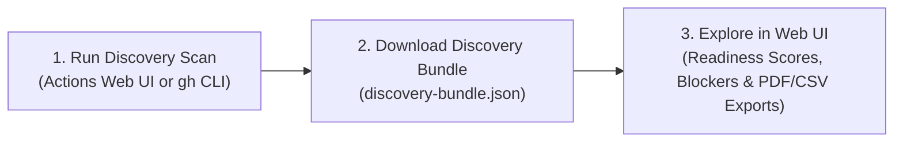

# Running Discovery Scans and Using the Assessment Web UI

You can run the **GHEC Discovery Scan** workflow to collect read-only metadata about a client's GitHub organization—including repositories, sizes, Git LFS storage, teams, branch rules, webhooks, and Actions settings—and explore the results in the **Assessment & Operations Web UI**.



---

## Collecting discovery data with GitHub Actions

By default, **GHEC Discovery Scan** (`discovery-scan.yml`) connects to the client's source organization in read-only mode using `GHEC_SOURCE_TOKEN`, replaces personal usernames with anonymous IDs (`standard` redaction profile), and uploads the finished JSON bundle as a workflow artifact.

### Option 1: Using the GitHub Actions Web UI

1. Open your control repository on GitHub and click the **Actions** tab.
2. Click **GHEC Discovery Scan** in the left sidebar, then click the **Run workflow** dropdown button.
3. Type the client's **Source organization** name (for example, `acme-source`), leave **Modules** set to `all`, and click the green **Run workflow** button.
4. When the workflow finishes, scroll to the **Artifacts** section at the bottom of the workflow summary page and click the discovery bundle artifact to download it to your computer.

### Option 2: Using the GitHub CLI (`gh`)

To trigger a full discovery scan for an organization from your terminal:

```bash
gh workflow run discovery-scan.yml \
  -f organization="acme-source" \
  -f modules="all"
```

To scan only specific categories (such as repositories, teams, Git LFS, and Actions settings):

```bash
gh workflow run discovery-scan.yml \
  -f organization="acme-source" \
  -f modules="repos,teams,lfs,actions"
```

Once the workflow finishes, download the generated discovery bundle to your computer:

```bash
RUN_ID=$(gh run list --workflow=discovery-scan.yml --limit 1 --json databaseId --jq '.[0].databaseId')
gh run download "$RUN_ID" --dir ~/offline-assessment
```

> [!NOTE]
> The discovery scan never reads secret values or source code files. It only collects settings, repository sizes, and item counts needed to assess migration readiness.

---

## Exploring discovery data and reports in the Web UI

By default, the **Assessment & Operations Web UI** runs in your browser and lets you inspect oversized repositories, Git LFS usage, team permissions, dependency maps, and post-migration verification results without exposing any tokens.

### Option 1: Opening the Private GitHub Pages Dashboard (after a migration wave)

When a migration wave finishes, the workflow automatically publishes the pre-built Web UI to Private GitHub Pages inside the target organization's **`migration-audit-results`** repository:

1. Open the **`migration-audit-results`** repository in the target organization.
2. In `README.md`, click the **Open Interactive Dashboard** link (under **Visual Dashboard (Private GitHub Pages)**).
3. Browse the **Overview**, **Repositories**, **Teams & Identities**, **Verification**, and **Post-Care Checklist** tabs directly in your browser.

### Option 2: Uploading a discovery bundle in the Web UI

When you open the Assessment Web UI in your browser:

1. Click **Upload Bundle** and select the `discovery-bundle.json` file you downloaded from the **GHEC Discovery Scan** workflow (or click **Load Sample Data** to explore a sample organization during a client demo).
2. Review the key assessment tabs with your client:
   - **Migration Readiness:** Automatically flags repositories over 40 GiB, commits over 2 GiB, Git LFS objects, and releases over 10 GiB.
   - **Repositories & Portfolio:** Search, filter, and sort thousands of repositories by size, visibility, or activity.
   - **Dependency Map & Teams:** View how teams, custom roles, and repositories connect across the organization.
   - **Export Center:** Click **Export PDF** or **Export CSV** to download client-ready executive assessment reports and spreadsheets directly from your browser.

---

## Turning your discovery findings into a migration wave

Once you have reviewed the client's repository sizes and readiness findings in the Web UI, you can generate your first migration wave scope in the **Actions** tab or with the GitHub CLI.

To generate a migration scope artifact for the client's organization using `generate-scope.yml`:

```bash
gh workflow run generate-scope.yml \
  -f source_org="acme-source" \
  -f target_org="acme-emu" \
  -f target_type="emu" \
  -f emu_shortcode="acme" \
  -f scope_type="all_repositories"
```
