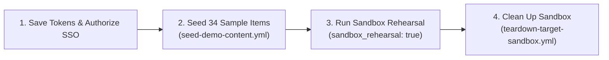

# Setting Up a Sandbox Rehearsal or Live Demo

This guide walks you through setting up tokens, populating a test organization with 34 realistic sample items (`seed-demo-content.yml`), running a safe **Sandbox Rehearsal** (`sandbox_rehearsal: true`), and cleaning up test items—using **only the GitHub Web UI and the `gh` CLI**.



---

## Saving your source and target tokens in GitHub Secrets

By default, all demo seeding and test migrations run inside GitHub Actions runners so you never have to save Personal Access Tokens on your laptop. You need two separate Classic Personal Access Tokens:

- `GHEC_SOURCE_TOKEN`: Classic PAT with read access to your source organization (`repo`, `read:org`, `read:org_hook`, `read:repo_hook`—plus `admin:org` and `workflow` if you are running **Seed Demo Content** against that test org).
- `GHEC_TARGET_TOKEN`: Classic PAT created by an **Enterprise Managed User (EMU)** Organization Owner in your target organization (`repo`, `admin:org`, `admin:org_hook`, `admin:repo_hook`, `workflow`).

### Option 1: Using the GitHub Web UI

1. Open your control repository on GitHub and click **Settings** $\rightarrow$ **Secrets and variables** $\rightarrow$ **Actions**.
2. Click **New repository secret** and add `GHEC_SOURCE_TOKEN` and `GHEC_TARGET_TOKEN`.

### Option 2: Using the GitHub CLI (`gh`)

To save your source and target tokens into your repository's GitHub Actions secrets:

```bash
gh secret set GHEC_SOURCE_TOKEN
gh secret set GHEC_TARGET_TOKEN
```

> [!WARNING]
> **Use two separate Classic PATs and authorize SAML Single Sign-On (SSO):**
>
> 1. `GHEC_SOURCE_TOKEN` and `GHEC_TARGET_TOKEN` must be two different tokens. If they are the same, the workflow stops immediately to protect your source organization.
> 2. Fine-Grained PATs do not support GitHub Enterprise Importer (`gh-gei`) or organization-level secret keys across enterprises—always use **Classic PATs**.
> 3. After creating your tokens in GitHub Settings, click **Configure SSO** next to each token and click **Authorize** for your organizations, or GitHub will block API calls with `HTTP 403`.

---

## Populating a test organization with 34 sample items (`seed-demo-content.yml`)

Before running a live demo or test migration, you can fill a test GitHub organization with 34 realistic sample items—including nested teams, repositories, branch rulesets, pull requests, Discussions, Git LFS files, releases, and Actions secrets—without clicking through the GitHub UI by hand.

By default, **Seed Demo Content** (`seed-demo-content.yml`) uses your `GHEC_SOURCE_TOKEN` secret, creates all 34 sample items (each prefixed with `demo-`), and posts a summary table when it finishes.

### Option 1: Using the GitHub Actions Web UI

1. Open the **Actions** tab in your repository and click **Seed Demo Content** on the left.
2. Click the **Run workflow** dropdown button.
3. Type your target **organization** name (for example, `acme-demo-source`) and optional **repository** name (`demo-ecommerce-monorepo`).
4. Leave **Content preset** set to `all` (or pick a specific category) and click the green **Run workflow** button.

### Option 2: Using the GitHub CLI (`gh`)

To create all 34 sample items in your test organization and repository:

```bash
gh workflow run seed-demo-content.yml \
  -f organization="acme-demo-source" \
  -f repository="demo-ecommerce-monorepo"
```

To preview what the workflow will create without making any changes on GitHub, set `dry_run="true"`:

```bash
gh workflow run seed-demo-content.yml \
  -f organization="acme-demo-source" \
  -f repository="demo-ecommerce-monorepo" \
  -f dry_run="true"
```

To create only one category of sample items (such as organization teams and settings), set `scope_level` and `content_type`:

```bash
gh workflow run seed-demo-content.yml \
  -f organization="acme-demo-source" \
  -f scope_level="organization" \
  -f content_type="core-governance"
```

You can pick from any of these `content_type` categories:

- `all`: Creates all 34 sample items. This is the default.
- `core-governance`: Organization settings, teams (`engineering`, `platform-infra`, `frontend-guild`), custom roles, IP allow lists, custom properties, and outside collaborators.
- `actions-and-security`: Actions rules, runner groups, variables, secrets, environments (`production`, `staging`), branch rules, and security settings.
- `collaboration`: Project boards, issues, milestones, labels, pull requests with comments, Discussions, Jira links, and a `CODEOWNERS` file.
- `artifacts-and-code`: Releases with attached files, Git LFS files, Packages, deploy keys, webhooks, and a list of installed GitHub Apps.

> [!NOTE]
> **How the demo workflow keeps your test organization safe:**
>
> - **Safe to run more than once:** If the sample items already exist, the workflow updates them instead of failing or making duplicates.
> - **Skips missing Enterprise features automatically:** If your test organization does not have a GitHub Enterprise plan, the workflow automatically skips Enterprise-only settings (like IP allow lists and runner groups) and prints a short note in the summary.

---

## Running a dry-run preview and a sandbox rehearsal

Once your test organization has sample data, always run a dry-run preview (`dry_run: true`) first, followed by a **Sandbox Rehearsal** (`sandbox_rehearsal: true`).

By default, turning on **`sandbox_rehearsal: true`** copies real repositories, issues, pull requests, teams, and settings into your dummy target organization while keeping **all target Webhooks and GitHub Actions turned off** so nothing runs in the background during your client demonstration.

### Option 1: Using the GitHub Actions Web UI

1. Open the **Actions** tab and click **Parallel Matrix Migration Wave** (or **Autonomous Scale-Adaptive Migration**).
2. Click **Run workflow**.
3. Enter your **Source organization** (`acme-demo-source`) and **Target organization** (`acme-sandbox-emu`).
4. To run a **Dry-Run Preview**, leave **Dry-run preview mode** checked (`true`).
5. To run a live **Sandbox Rehearsal**, uncheck **Dry-run preview mode** (`false`) and check **Sandbox rehearsal mode** (`true`), then click **Run workflow**.

### Option 2: Using the GitHub CLI (`gh`)

To run a fast dry-run preview (`dry_run="true"`):

```bash
gh workflow run migration-execute-wave.yml \
  -f source_org="acme-demo-source" \
  -f target_org="acme-sandbox-emu" \
  -f target_type="emu" \
  -f emu_shortcode="acme" \
  -f dry_run="true"
```

To run a live sandbox rehearsal into a dummy target organization (`dry_run="false"`, `sandbox_rehearsal="true"`):

```bash
gh workflow run migration-execute-wave.yml \
  -f source_org="acme-demo-source" \
  -f target_org="acme-sandbox-emu" \
  -f target_type="emu" \
  -f emu_shortcode="acme" \
  -f dry_run="false" \
  -f sandbox_rehearsal="true"
```

To watch your rehearsal run live in your terminal:

```bash
RUN_ID=$(gh run list --workflow=migration-execute-wave.yml --limit 1 --json databaseId --jq '.[0].databaseId')
gh run watch "$RUN_ID"
```

> [!NOTE]
> Remember three key rules when testing with an Enterprise Managed Users (EMU) target organization:
>
> 1. **Usernames include your enterprise shortcode:** EMU accounts look like `jdoe_acme`. Personal GitHub accounts cannot be invited to an EMU organization.
> 2. **Skip invitations when reclaiming mannequins:** Always pass `--skip-invitation` to `gh gei reclaim-mannequin` because EMU users cannot accept external email invites.
> 3. **Add your migration owner to ruleset bypass lists:** Make sure the EMU owner account is allowed to bypass branch rulesets while migrating repositories.

---

## Cleaning up demo content and resetting your sandbox

When you finish your demo or want a fresh start for your next rehearsal, you can clean up the sample items from the **Actions** tab or with the GitHub CLI. Every item created by the demo tool starts with `demo-` (or `dummy-`), and the cleanup workflows only delete items matching that prefix.

To delete existing `demo-` items and recreate a fresh set in your demo organization:

```bash
gh workflow run seed-demo-content.yml \
  -f organization="acme-demo-source" \
  -f repository="demo-ecommerce-monorepo" \
  -f cleanup_existing="true"
```

To purge test resources (`demo-*` or `dummy-*`) from your target sandbox organization using **Teardown Target Sandbox** (`teardown-target-sandbox.yml`):

```bash
gh workflow run teardown-target-sandbox.yml \
  -f target_org="acme-sandbox-emu" \
  -f resource_prefix="demo-" \
  -f dry_run="false"
```
