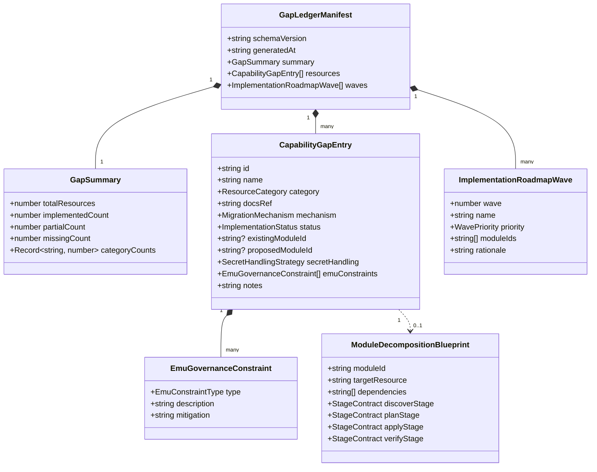

# Data Model: Comprehensive Migration Capability Gap Analysis & Implementation Roadmap

**Feature**: `001-migration-gap-analysis`
**Date**: 2026-10-12
**Status**: Draft

---

## 1. Entity Overview & Relationships

The capability gap analysis data model defines the schema for the machine-readable gap ledger, resource boundary classification, Enterprise Managed Users (EMU) governance constraints, and 4-stage module decomposition blueprints.



---

## 2. Entity Specifications

### 2.1 `GapLedgerManifest`

The root immutable artifact representing the full capability audit of the migration suite.

| Property        | Type                                       | Description                                     | Invariants                                       |
| :-------------- | :----------------------------------------- | :---------------------------------------------- | :----------------------------------------------- |
| `schemaVersion` | `string`                                   | Semantic contract version.                      | MUST equal `MIGRATION_SCHEMA_VERSION` (`1.0.0`). |
| `generatedAt`   | `string`                                   | ISO 8601 UTC timestamp of audit generation.     | Valid ISO timestamp.                             |
| `summary`       | `GapSummary`                               | Aggregate statistical breakdown.                | Counts MUST sum to `totalResources`.             |
| `resources`     | `ReadonlyArray<CapabilityGapEntry>`        | Complete catalog of audited platform resources. | Unique `id` per entry.                           |
| `waves`         | `ReadonlyArray<ImplementationRoadmapWave>` | Sequenced delivery roadmap waves.               | Ordered by `wave` ascending (1, 2, 3).           |

### 2.2 `CapabilityGapEntry`

Individual catalog entry comparing a GitHub platform resource against the suite's capabilities.

| Property           | Type                                     | Description                                                  | Invariants                                                                    |
| :----------------- | :--------------------------------------- | :----------------------------------------------------------- | :---------------------------------------------------------------------------- |
| `id`               | `string`                                 | Kebab-case resource identifier.                              | Regex: `^[a-z0-9]+(-[a-z0-9]+)*$`                                             |
| `name`             | `string`                                 | Human-readable title of the resource.                        | Non-empty string.                                                             |
| `category`         | `ResourceCategory`                       | Architectural domain.                                        | `organization` \| `repository` \| `actions` \| `security` \| `identity`       |
| `docsRef`          | `string`                                 | Relative path to documentation in `references/github-docs/`. | MUST resolve to a real file path in repo.                                     |
| `mechanism`        | `MigrationMechanism`                     | Primary avenue of data migration.                            | `gei_native` \| `rest_rehydration` \| `graphql_mutation` \| `manual_advisory` |
| `status`           | `ImplementationStatus`                   | Current state of suite capability.                           | `implemented` \| `partial` \| `missing`                                       |
| `existingModuleId` | `string?`                                | Module ID in `packages/migration` if registered.             | Present when `status` is `implemented` or `partial`.                          |
| `proposedModuleId` | `string?`                                | Module ID to be implemented.                                 | Present when `status` is `missing` or `partial`.                              |
| `secretHandling`   | `SecretHandlingStrategy`                 | Zero-Exposure Secret Boundary classification.                | `sealed_box_blank` \| `vault_hook` \| `none` \| `ephemeral_runtime`           |
| `emuConstraints`   | `ReadonlyArray<EmuGovernanceConstraint>` | Associated EMU constraints.                                  | List may be empty if no EMU impact.                                           |
| `notes`            | `string`                                 | Operational and consulting context.                          | Non-empty string.                                                             |

### 2.3 `EmuGovernanceConstraint`

Encapsulates an EMU-specific rule that restricts or alters migration behavior.

| Property      | Type                | Description                                          | Invariants                                                                                                                |
| :------------ | :------------------ | :--------------------------------------------------- | :------------------------------------------------------------------------------------------------------------------------ |
| `type`        | `EmuConstraintType` | Nature of the EMU constraint.                        | `scim_identity` \| `saml_sso` \| `mannequin_mapping` \| `visibility_policy` \| `outside_collaborator` \| `runner_network` |
| `description` | `string`            | Detailed technical restriction.                      | Declarative statement of restriction.                                                                                     |
| `mitigation`  | `string`            | Recommended architectural or operational mitigation. | Actionable advice for consultant or module.                                                                               |

### 2.4 `ModuleDecompositionBlueprint`

Architectural design pattern for scaffolding an unbuilt capability into a 4-stage lifecycle module.

| Property         | Type                    | Description                                                 | Invariants                                         |
| :--------------- | :---------------------- | :---------------------------------------------------------- | :------------------------------------------------- |
| `moduleId`       | `string`                | Unique kebab-case ID in `ModuleRegistry`.                   | Unique string matching `^[a-z0-9]+(-[a-z0-9]+)*$`. |
| `targetResource` | `string`                | Resource entity managed by this module.                     | Corresponds to `CapabilityGapEntry.id`.            |
| `dependencies`   | `ReadonlyArray<string>` | Prerequisite module IDs in topological DAG.                 | Prohibited from circular references.               |
| `discoverStage`  | `StageContract`         | Extraction rules using `SourceReadClient`.                  | Defines read-only payload schema.                  |
| `planStage`      | `StageContract`         | Diff logic producing deterministic `MigrationAction` array. | Readonly deterministic actions.                    |
| `applyStage`     | `StageContract`         | Dry-run and live mutation logic using `TargetWriteClient`.  | Dry-run MUST NOT mutate target state.              |
| `verifyStage`    | `StageContract`         | Post-mutation reconciliation query and diff logic.          | Produces diffable discrepancies.                   |

### 2.5 `ImplementationRoadmapWave`

Group of capability modules scheduled for phased implementation.

| Property    | Type                    | Description                                      | Invariants                                     |
| :---------- | :---------------------- | :----------------------------------------------- | :--------------------------------------------- |
| `wave`      | `number`                | Phase sequence number (1, 2, 3).                 | Positive integer.                              |
| `name`      | `string`                | Descriptive title of the wave.                   | Non-empty string.                              |
| `priority`  | `WavePriority`          | Priority level.                                  | `P1` \| `P2` \| `P3`                           |
| `moduleIds` | `ReadonlyArray<string>` | Capability module IDs assigned to wave.          | All IDs MUST be valid proposed module IDs.     |
| `rationale` | `string`                | Business and technical sequencing justification. | Explicit justification including dependencies. |

---

## 3. Enumerations

```typescript
export type ResourceCategory =
  'organization' | 'repository' | 'actions' | 'security' | 'identity';

export type MigrationMechanism =
  'gei_native' | 'rest_rehydration' | 'graphql_mutation' | 'manual_advisory';

export type ImplementationStatus = 'implemented' | 'partial' | 'missing';

export type SecretHandlingStrategy =
  'sealed_box_blank' | 'vault_hook' | 'none' | 'ephemeral_runtime';

export type EmuConstraintType =
  | 'scim_identity'
  | 'saml_sso'
  | 'mannequin_mapping'
  | 'visibility_policy'
  | 'outside_collaborator'
  | 'runner_network';

export type WavePriority = 'P1' | 'P2' | 'P3';
```

---

## 4. Validation Rules & State Transitions

1. **Schema Version Check**: All gap ledger instances MUST validate against `MIGRATION_SCHEMA_VERSION`.
2. **Deterministic Module IDs**: Every module referenced in `existingModuleId` MUST correspond to a registered module class in `ModuleRegistry`.
3. **Secret Boundary Invariant**: Any resource where credentials exist (e.g. `repo-secrets`, `org-secrets`, `environments`, `webhooks`) MUST have `secretHandling` set to `sealed_box_blank` or `vault_hook`. Plaintext secret storage or transfer is invalid.
4. **Topological Ordering**: In `ImplementationRoadmapWave`, all dependencies of modules in wave $N$ MUST either be `implemented` or scheduled in wave $M \le N$.
