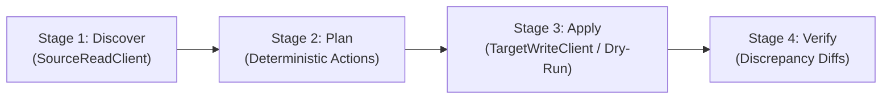
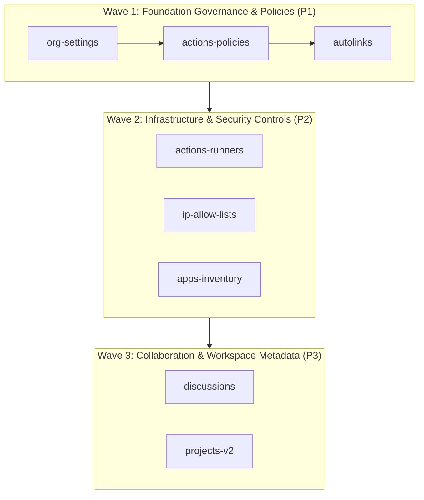

# Technical Research: Comprehensive Migration Capability Gap Analysis & Implementation Roadmap

**Feature**: `001-migration-gap-analysis`
**Date**: 2026-10-12
**Status**: Completed

---

## 1. Executive Summary & Problem Context

Enterprise migrations from GitHub Enterprise Cloud (GHEC) or GitHub Enterprise Server (GHES) to GitHub Enterprise Cloud with Enterprise Managed Users (GHEC-EMU) require coordinating native data transfer tools (GitHub Enterprise Importer / GEI) with custom API-based configuration rehydration.

While GEI migrates core Git repositories, pull requests, issues, and basic branch protections, it omits critical enterprise governance, actions policies, secret configurations, rulesets, custom properties, and runner groups. Furthermore, destination EMU enterprises enforce strict identity boundaries (IdP SCIM provisioning, SAML SSO, prohibited direct invitations, restricted outside collaborators, and prohibited public repositories).

This research reconciles the local GitHub documentation (`references/github-docs/`) with our current `@ghec/migration` module registry, establishes the architecture for a machine-readable gap ledger, and defines the blueprint for decomposing unbuilt capabilities into 4-stage migration modules.

---

## 2. GEI Native Coverage vs. API Rehydration Boundary Matrix

Based on `references/github-docs/content/migrations/` and `data/reusables/enterprise-migration-tool/`, the definitive transfer mechanism boundary is reconciled below:

| Resource Entity                   | Native Importer (GEI) Behavior               | API Rehydration Requirement                    | Suite Mechanism              | Existing Module ID                                |
| :-------------------------------- | :------------------------------------------- | :--------------------------------------------- | :--------------------------- | :------------------------------------------------ |
| **Git Source & Commit History**   | Transferred natively with full commit graph  | None                                           | GEI Native                   | `gei-repo`                                        |
| **Pull Requests & Reviews**       | Transferred natively (comments, reviews)     | Mention repair, author re-attribution          | GEI Native + API Post-Flight | `gei-repo`, `pull-requests`                       |
| **Issues, Labels, Milestones**    | Transferred natively                         | Mention repair, author re-attribution          | GEI Native + API Post-Flight | `gei-repo`, `issues`                              |
| **Repository Wikis**              | Transferred natively (excluding attachments) | None                                           | GEI Native                   | `gei-repo`                                        |
| **Releases (<10 GiB)**            | Transferred natively                         | None                                           | GEI Native                   | `gei-repo`                                        |
| **Releases (>10 GiB)**            | Dropped / causes GEI failure                 | Chunked binary streaming via REST API          | REST API Rehydration         | `releases` (DEC-010)                              |
| **Git LFS Objects**               | Dropped (only pointer files migrated)        | Dual-remote mirror push (`fetch`/`push`)       | Streamed Mirror Push         | `lfs` (DEC-011)                                   |
| **Classic Branch Protections**    | Partially migrated; drops 7 settings         | In-place PUT update for the 7 dropped rules    | REST API Rehydration         | `branch-protection` (DEC-009)                     |
| **Repository Rulesets**           | Dropped completely                           | Full extraction and recreation via REST API    | REST API Rehydration         | `rulesets`                                        |
| **Repository Variables**          | Dropped completely                           | Full extraction and creation via REST API      | REST API Rehydration         | `repo-variables`                                  |
| **Repository Secrets**            | Dropped completely                           | Sealed blank (`""`) or vault hook provisioning | REST API Rehydration         | `repo-secrets` (DEC-004)                          |
| **Environments & Secrets**        | Dropped completely                           | Recreate envs, protection rules, variables     | REST API Rehydration         | `environments`                                    |
| **Repository Webhooks**           | Migrated into **disabled** state             | Match URL, set secret from vault/env, enable   | REST API Rehydration         | `webhooks` (DEC-014)                              |
| **Repository Settings**           | Migrated with default `private` visibility   | Restore settings, reconcile visibility         | REST API Rehydration         | `repo-settings` (DEC-015)                         |
| **Custom Properties (Org/Repo)**  | Dropped completely                           | Recreate property schemas and assignments      | REST API Rehydration         | `org-custom-properties`, `repo-custom-properties` |
| **Deploy Keys**                   | Dropped completely                           | Public key recreation via REST API             | REST API Rehydration         | `deploy-keys`                                     |
| **Collaborators & Direct Access** | Dropped completely                           | Recreate collaborator access where permitted   | REST API Rehydration         | `collaborators`                                   |
| **Teams & Hierarchies**           | Migrated only during full org import         | Recreate slugs, hierarchy, and permissions     | REST API Rehydration         | `teams` (DEC-005)                                 |
| **Custom Repository Roles**       | Dropped completely                           | Recreate custom roles and base permissions     | REST API Rehydration         | `custom-roles`                                    |
| **CODEOWNERS**                    | Transferred as file; handles no EMU repair   | Regex repair for renamed teams/mannequins      | In-Place File Repair         | `codeowners`                                      |
| **GHAS / Security Settings**      | Dropped completely                           | Enable Code/Secret Scanning, Dependabot        | REST API Rehydration         | `ghas-security`                                   |
| **Packages (Registry)**           | Dropped completely                           | Download and republish package versions        | REST API Rehydration         | `packages`                                        |
| **Mannequins Reattribution**      | Migrated as unassigned mannequins            | Reclaim via GraphQL with `--skip-invitation`   | GraphQL Mutation             | `mannequins` (DEC-013)                            |

---

## 3. Comprehensive Documentation Resource Audit & Gap Inventory

Audit of `references/github-docs/` across `content/organizations/`, `content/repositories/`, and `content/actions/` identified **42 distinct manageable resources**. Cross-referencing against the 24 registered migration modules yields:

- **Implemented (24 modules)**: High parity on core repository, secrets, rulesets, teams, and security.
- **Partial (3 resources)**: `autolinks`, `topics`, `repo-templates`.
- **Missing (8 capability modules)**: Detailed below.

### 3.1 Gap Ledger Inventory

```text
1. Organization Settings & Member Privileges [MISSING]
   - Reference: content/organizations/managing-organization-settings/
   - Scope: Organization
   - Mechanism: REST API Rehydration (`PATCH /orgs/{org}`)
   - Description: Base repo permissions, repo creation limits, private forking policy, member deletion permissions, commit signoff policy.
   - Proposed Module: `org-settings`

2. Actions Organization & Repository Policies [MISSING]
   - Reference: content/actions/concepts/about-actions-policies.md
   - Scope: Organization / Repository
   - Mechanism: REST API Rehydration (`PUT /orgs/{org}/actions/permissions`)
   - Description: Allowed actions allowlists (local, verified, selected), fork PR execution approvals, workflow permissions (GITHUB_TOKEN read/write), artifact & log retention periods.
   - Proposed Module: `actions-policies`

3. Actions Self-Hosted Runner Groups & Access [MISSING]
   - Reference: content/actions/concepts/runners/runner-groups.md
   - Scope: Organization
   - Mechanism: REST API Rehydration (groups) + Operator Advisory (runner daemon re-registration)
   - Description: Runner group definitions, repository access allowlists, workflow restrictions, and Actions Runner Controller (ARC) scale-set mapping.
   - Proposed Module: `actions-runners`

4. Repository & Organization Discussions [MISSING]
   - Reference: content/repositories/enabling-features-for-your-repository/enabling-or-disabling-github-discussions-for-a-repository.md
   - Scope: Repository / Organization
   - Mechanism: GraphQL Mutation
   - Description: Discussion categories, pinned discussions, discussion comments, answer marked states.
   - Proposed Module: `discussions`

5. Projects v2 (Memex) Boards & Views [MISSING]
   - Reference: data/reusables/enterprise-migration-tool/data-not-migrated.md
   - Scope: Organization / Repository
   - Mechanism: GraphQL Mutation (`createProjectV2`, field creation, view configurations)
   - Description: Projects v2 definitions, custom fields (single select, iteration, date, number), views (table, board, roadmap), and repository/team links.
   - Proposed Module: `projects-v2`

6. GitHub Apps & Integrations Inventory [MISSING]
   - Reference: content/organizations/managing-programmatic-access-to-your-organization/reviewing-github-apps-installed-in-your-organization.md
   - Scope: Organization
   - Mechanism: REST API Discovery + Operator Advisory
   - Description: GitHub App installations, granular permission audits, webhook endpoints, and target tenant reinstallation instructions (cannot be cloned across enterprise boundaries via API).
   - Proposed Module: `apps-inventory`

7. IP Allow Lists / CIDR Restrictions [MISSING]
   - Reference: content/organizations/managing-organization-settings/
   - Scope: Enterprise / Organization
   - Mechanism: GraphQL Mutation / REST API Rehydration
   - Description: IP allow list entries, CIDR network masks, active enforcement toggles, and operator advisory on GHEC-EMU IdP conditional access boundaries.
   - Proposed Module: `ip-allow-lists`

8. Autolink References Rehydration [PARTIAL -> PROPOSED MODULE]
   - Reference: content/repositories/managing-your-repositorys-settings-and-features/managing-repository-settings/configuring-autolinks-to-reference-external-resources.md
   - Scope: Repository
   - Mechanism: REST API Rehydration (`POST /repos/{owner}/{repo}/autolinks`)
   - Description: Reconcile third-party issue tracker autolinks (e.g., JIRA-, TICKET-) dropped or inconsistent across GHES-to-GHEC migrations.
   - Proposed Module: `autolinks`
```

---

## 4. Enterprise Managed Users (EMU) Architectural Constraints

Destination enterprise environments with Enterprise Managed Users enforce strict operational invariants:

1. **IdP SCIM Authority (No Direct User Invitations)**:
   - In GHEC-EMU, direct member invitations (`POST /orgs/{org}/invitations`) and direct repository user additions are prohibited or severely restricted.
   - All users must be pre-provisioned via SCIM from Microsoft Entra ID or Okta.
   - User accounts follow normalized naming schemas: `<idp_username>_<shortcode>`.

2. **IdP Group Sync for Teams**:
   - Team membership in EMU is frequently synced via IdP groups. Direct manipulation of team membership via API (`PUT /orgs/{org}/teams/{team}/memberships/{user}`) fails or gets overridden if IdP group sync is active.
   - The suite’s `teams` module correctly decouples team structure (slugs, descriptions, parent-child DAG, repo permissions) from direct membership (DEC-005).

3. **Fast-Track Mannequin Reclamation**:
   - GEI assigns contributions of unmapped source users to mannequins.
   - In standard GHEC, reclaiming a mannequin requires sending an invitation email that the user must accept.
   - In GHEC-EMU, enterprise administrators possess central authority to reclaim mannequins directly without user confirmation using the `--skip-invitation` flag (DEC-013).

4. **Public Repository Prohibition**:
   - GHEC-EMU enterprises disable public repositories by policy.
   - Repositories migrated by GEI default to `private`. Post-migration visibility reconciliation (`repo-settings`, DEC-015) must only restore `internal` visibility where permitted by enterprise policy, and must never attempt to set `public` without explicit enterprise override.

5. **Outside Collaborator Restrictions**:
   - In EMU, outside collaborators must be provisioned as managed guest accounts within the enterprise IdP or explicitly permitted by enterprise-level policies.

---

## 5. Machine-Readable Gap Ledger Design

To enable automated compliance auditing, CLI reporting, and dashboard visualization, the gap ledger will be standardized as an authoritative JSON/YAML contract within `@ghec/contracts`.

### 5.1 Architecture & Schema Invariants

- Conforms to `schemaVersion: MIGRATION_SCHEMA_VERSION` (Principle III).
- Strictly validated with Zod (`validateGapLedger`).
- Implements immutable audit output: can be generated via CLI (`ghec-consultant-cli audit-gap-ledger`) and consumed offline.
- Every entry links:
  - `id`: Unique kebab-case resource identifier.
  - `name`: Human-readable display title.
  - `category`: `organization` | `repository` | `actions` | `security` | `identity`.
  - `docsRef`: Path to local markdown reference in `references/github-docs/`.
  - `mechanism`: `gei_native` | `rest_rehydration` | `graphql_mutation` | `manual_advisory`.
  - `status`: `implemented` | `partial` | `missing`.
  - `moduleId`: Existing or proposed module ID.
  - `emuConstraints`: Array of specific EMU identity/governance rules.
  - `secretHandling`: Declaration of Zero-Exposure Secret Boundary compliance (`sealed_box_blank`, `vault_hook`, `none`, `ephemeral_runtime`).

---

## 6. Blueprint for 4-Stage Module Decomposition

Every unbuilt capability will be scaffolded as a self-contained module in `packages/migration/src/modules/` implementing the 4-stage lifecycle:



1. **Stage 1: Discover**: Uses `SourceReadClient` to query source state via REST/GraphQL. Produces a typed `SourceDiscoveryState` with immutable metadata.
2. **Stage 2: Plan**: Computes a diff against destination state (if pre-existing) or maps desired destination state. Emits a deterministic array of `MigrationAction` items.
3. **Stage 3: Apply**:
   - Dry-Run (`dryRun: true`): Validates target endpoints, rate limits, and simulates payload submission without mutations.
   - Live (`dryRun: false`): Uses `TargetWriteClient` to execute idempotent mutations (`PUT`, `PATCH`, or `POST` with existence checks).
4. **Stage 4: Verify**: Re-queries target state using `TargetWriteClient` and compares against planned target state, emitting structured diffable discrepancies in `VerificationReport`.

---

## 7. Implementation Roadmap & Sequencing

The missing modules are sequenced into 3 logical delivery waves based on topological dependencies and enterprise risk:



- **Wave 1 (Governance Baseline)**: `org-settings`, `actions-policies`, `autolinks`. Essential for establishing baseline repository creation and Actions execution safety.
- **Wave 2 (Compute & Access Infrastructure)**: `actions-runners`, `ip-allow-lists`, `apps-inventory`. Required before migrating workflows that depend on private CI runners and enterprise network boundaries.
- **Wave 3 (Advanced Collaboration)**: `discussions`, `projects-v2`. High-complexity GraphQL data structures migrated during post-cutover workspace consolidation.

---

## 8. Technology Decisions & Alternatives Evaluated

1. **Decision**: Single machine-readable contract in `@ghec/contracts` instead of separate documentation markdown tables.
   - _Rationale_: Machine-readable schemas enable automated verification tests, dynamic CLI tabular reporting, and Primer Dashboard rendering without manual sync.
   - _Alternatives Rejected_: Static Markdown table only (rejected: prone to documentation drift and cannot be validated in CI).

2. **Decision**: Classify GitHub Apps as `apps-inventory` with manual advisory rather than attempting automated API installation.
   - _Rationale_: GitHub's security model forbids third-party tools from generating app installation tokens or creating app installations across foreign enterprise accounts without OAuth / UI consent.
   - _Alternatives Rejected_: Attempting simulated browser automation (rejected: violates DEC-004 and security invariants).

3. **Decision**: GraphQL-first for Projects v2 and Discussions.
   - _Rationale_: GitHub REST APIs for Projects v2 and Discussions are read-only or deprecated; complete manipulation of Memex fields and discussion threads requires GitHub GraphQL API mutations.
   - _Alternatives Rejected_: REST API (rejected: lacks necessary write endpoints for Projects v2 custom fields and views).
