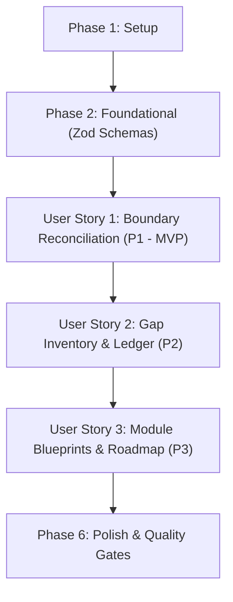

# Implementation Tasks: Comprehensive Migration Capability Gap Analysis & Implementation Roadmap

**Feature**: `001-migration-gap-analysis`
**Branch**: `001-migration-gap-analysis`
**Date**: 2026-10-12
**Status**: Ready for Implementation

---

## Phase 1: Setup (Shared Infrastructure)

**Purpose**: Project initialization, directory structure, and shared domain contracts.

- [x] T001 Setup gap ledger domain directory structure in `packages/contracts/src/gap-ledger/` and CLI audit command directory in `apps/cli/src/commands/audit/`
- [x] T002 [P] Define core TypeScript enums and types in `packages/contracts/src/gap-ledger/types.ts` (`ResourceCategory`: `'organization' | 'repository' | 'actions' | 'security' | 'identity'`, `MigrationMechanism`: `'gei_native' | 'rest_rehydration' | 'graphql_mutation' | 'manual_advisory'`, `ImplementationStatus`: `'implemented' | 'partial' | 'missing'`, `SecretHandlingStrategy`: `'sealed_box_blank' | 'vault_hook' | 'none' | 'ephemeral_runtime'`, `EmuConstraintType`: `'scim_identity' | 'saml_sso' | 'mannequin_mapping' | 'visibility_policy' | 'outside_collaborator' | 'runner_network'`, `WavePriority`: `'P1' | 'P2' | 'P3'`)
- [x] T003 [P] Scaffold unit test suite fixtures in `packages/contracts/tests/gap-ledger.test.ts` for schema validation and invariant assertions

---

## Phase 2: Foundational (Blocking Prerequisites)

**Purpose**: Core Zod schemas and validation infrastructure that MUST be complete before ANY user story can be implemented.

**⚠️ CRITICAL**: No user story work can begin until this phase is complete.

- [x] T004 Implement authoritative Zod schema for `CapabilityGapEntry` in `packages/contracts/src/gap-ledger/entry.schema.ts` (`id` matching `^[a-z0-9]+(-[a-z0-9]+)*$`, non-empty `name`, valid enum `category`, valid `docsRef`, enum `mechanism`, enum `status`, enum `secretHandling`, array of `emuConstraints`, non-empty `notes`)
- [x] T005 [P] Implement authoritative Zod schema for `ModuleDecompositionBlueprint` in `packages/contracts/src/gap-ledger/blueprint.schema.ts` (`moduleId` matching `^[a-z0-9]+(-[a-z0-9]+)*$`, non-empty `targetResource`, `dependencies` array, `discoverStage`, `planStage`, `applyStage` with `dryRunSupported: true`, `verifyStage` with `discrepancySeverity` enum `CRITICAL | HIGH | MEDIUM | LOW`)
- [x] T006 [P] Implement authoritative Zod schema for `GapLedgerManifest` in `packages/contracts/src/gap-ledger/manifest.schema.ts` (`schemaVersion` const `1.0.0`, `generatedAt` ISO date-time, `summary` object with `totalResources`, `implementedCount`, `partialCount`, `missingCount`, `categoryCounts`, `resources` array, and `waves` array)
- [x] T007 Re-export gap ledger schemas, types, and validator functions (`validateGapLedger`, `validateModuleBlueprint`) from `packages/contracts/src/index.ts`
- [x] T008 Add synthetic test fixtures for gap ledger manifests in `fixtures/synthetic/gap-ledger/valid-manifest.json` and `fixtures/synthetic/gap-ledger/invalid-manifest.json`

**Checkpoint**: Foundation ready - user story implementation can now begin.

---

## Phase 3: User Story 1 - Reconcile Native Importer vs. Rehydration Boundaries (Priority: P1) 🎯 MVP

**Goal**: Establish the definitive reconciliation matrix partitioning GitHub data entities into GEI Native, REST API Rehydration, GraphQL Mutation, or Manual Advisory, accounting for GEI's 7 omitted branch protection rules, disabled webhooks, and >10GB release streaming.

**Independent Test**: Can be tested independently via offline unit tests in `packages/contracts/tests/boundary-reconciliation.test.ts` verifying that each of the 42 platform data assets is mapped to an unambiguous mechanism with zero unclassified entities.

### Tests for User Story 1

- [x] T009 [P] [US1] Author boundary reconciliation contract test in `packages/contracts/tests/boundary-reconciliation.test.ts` asserting mechanism categorization across all 42 platform entities

### Implementation for User Story 1

- [x] T010 [P] [US1] Implement native importer capability matrix in `packages/contracts/src/gap-ledger/boundary-matrix.ts` defining GEI native coverage rules, dropped attributes, and fallback triggers
- [x] T011 [US1] Implement branch protection dropped-setting reconciliation rules in `packages/migration/src/modules/branch-protection/dropped-settings.ts` validating the 7 omitted settings (bypass actors, last push approval, deployment levels, branch lock, block creations, force push restrictions, dismissal exemptions) per DEC-009
- [x] T012 [US1] Implement webhook disabled-state reconciliation rules in `packages/migration/src/modules/webhooks/reconciliation.ts` matching target URLs, re-enabling `active: true`, and assigning vault-backed secrets per DEC-014
- [x] T013 [US1] Integrate GEI boundary matrix validation and helper lookup functions into `packages/contracts/src/gap-ledger/index.ts`

**Checkpoint**: At this point, User Story 1 should be fully functional and testable independently.

---

## Phase 4: User Story 2 - Resource Gap Inventory & Classification Ledger (Priority: P2)

**Goal**: Generate the comprehensive machine-readable gap ledger auditing all 42 resources against the suite's 24 migration modules, recording Enterprise Managed User (EMU) identity and governance constraints.

**Independent Test**: Can be tested independently via `packages/contracts/tests/gap-ledger-inventory.test.ts` verifying that 100% of documented resources from `references/github-docs/` are cataloged with valid status (`implemented`, `partial`, `missing`) and accurate EMU constraints.

### Tests for User Story 2

- [x] T014 [P] [US2] Author offline documentation citation and ledger completeness test in `packages/contracts/tests/gap-ledger-inventory.test.ts` validating that each `docsRef` path exists in `references/github-docs/`
- [x] T015 [P] [US2] Author module registry alignment test in `packages/migration/tests/core/gap-registry-alignment.test.ts` verifying that all 24 registered modules in `packages/migration/src/core/registry.ts` align with ledger `existingModuleId` entries

### Implementation for User Story 2

- [x] T016 [US2] Compile the authoritative 42-resource catalog in `packages/contracts/src/gap-ledger/catalog.ts` with exact documentation citations, module IDs, and status classifications (`implemented`: 24, `partial`: 3, `missing`: 8)
- [x] T017 [US2] Encode Enterprise Managed Users (EMU) constraint profiles in `packages/contracts/src/gap-ledger/emu-constraints.ts` covering SCIM provisioning, IdP group sync, fast-track mannequin reclamation (`--skip-invitation` per DEC-013), and prohibited public repository visibility
- [x] T018 [US2] Implement the `GapLedgerGenerator` engine in `packages/contracts/src/gap-ledger/generator.ts` producing validated `GapLedgerManifest` instances with computed statistical summaries
- [x] T019 [US2] Implement the CLI audit command `audit-gap-ledger` in `apps/cli/src/commands/audit/gap-ledger.ts` providing tabular reporting and JSON artifact export (`--format=json|table|markdown`)
- [x] T020 [US2] Register `audit-gap-ledger` command into `apps/cli/src/index.ts`

**Checkpoint**: At this point, User Stories 1 AND 2 should both work independently.

---

## Phase 5: User Story 3 - 4-Stage Module Decomposition Blueprint & Expansion Roadmap (Priority: P3)

**Goal**: Define architectural blueprints decomposing all 8 missing capabilities into standard 4-stage lifecycle modules (`discover`, `plan`, `apply` [with dry-run support], `verify`), scheduled into 3 delivery waves with topological DAG dependencies.

**Independent Test**: Can be tested independently via `packages/migration/tests/core/roadmap-dag.test.ts` verifying that all 8 proposed module blueprints resolve in topological order without circular dependencies.

### Tests for User Story 3

- [x] T021 [P] [US3] Author topological DAG roadmap sequencing test in `packages/migration/tests/core/roadmap-dag.test.ts` validating Wave 1, 2, and 3 dependency resolution

### Implementation for User Story 3

- [x] T022 [P] [US3] Create module decomposition blueprints in `packages/migration/src/blueprints/wave1-governance.ts` for Wave 1 modules: `org-settings`, `actions-policies`, and `autolinks`
- [x] T023 [P] [US3] Create module decomposition blueprints in `packages/migration/src/blueprints/wave2-infrastructure.ts` for Wave 2 modules: `actions-runners`, `ip-allow-lists`, and `apps-inventory`
- [x] T024 [P] [US3] Create module decomposition blueprints in `packages/migration/src/blueprints/wave3-collaboration.ts` for Wave 3 modules: `discussions` and `projects-v2`
- [x] T025 [US3] Implement roadmap wave definitions and topological validator in `packages/contracts/src/gap-ledger/roadmap.ts` assigning priority levels (`P1`, `P2`, `P3`) and rationale per wave
- [x] T026 [US3] Integrate blueprint specifications and wave definitions into `GapLedgerManifest` generation in `packages/contracts/src/gap-ledger/generator.ts`

**Checkpoint**: All user stories should now be independently functional.

---

## Phase 6: Polish & Cross-Cutting Concerns

**Purpose**: Offline verification scripts, quality gate enforcement, and final integration checks.

- [x] T027 [P] Implement documentation verification script in `scripts/verify-doc-references.ts` ensuring all `docsRef` citations resolve against `references/github-docs/`
- [x] T028 [P] Implement gap ledger schema validation script in `scripts/validate-gap-ledger.ts` conforming to `quickstart.md` Scenario 1
- [x] T029 Add gap ledger audit checks to primary quality gate script `scripts/validate-fixtures.ts`
- [x] T030 Execute full quality verification suite: `npm run check` (linting, typechecking, app builds, and unit tests with `--test-concurrency=8`)

---

## Dependencies & Execution Order

### Phase Dependencies

- **Setup (Phase 1)**: No dependencies - can start immediately.
- **Foundational (Phase 2)**: Depends on Setup completion - BLOCKS all user stories.
- **User Story 1 (Phase 3)**: Depends on Foundational completion.
- **User Story 2 (Phase 4)**: Depends on Foundational and User Story 1 completion.
- **User Story 3 (Phase 5)**: Depends on Foundational and User Story 2 completion.
- **Polish (Phase 6)**: Depends on all user stories being complete.

### User Story Dependencies



### Parallel Opportunities

- **Phase 1**: `T002` (types) and `T003` (test fixtures) can run in parallel.
- **Phase 2**: `T005` (blueprint schema) and `T006` (manifest schema) can run in parallel after `T004`.
- **Phase 3 (US1)**: `T009` (test) and `T010` (matrix) can run in parallel.
- **Phase 4 (US2)**: `T014` (doc test) and `T015` (registry test) can run in parallel.
- **Phase 5 (US3)**: `T021` (DAG test), `T022` (Wave 1 blueprints), `T023` (Wave 2 blueprints), and `T024` (Wave 3 blueprints) can run in parallel.
- **Phase 6**: `T027` (doc script) and `T028` (ledger script) can run in parallel.

---

## Parallel Example: User Story 1

```bash
# Launch test and boundary matrix implementation in parallel:
Task: "Author boundary reconciliation contract test in packages/contracts/tests/boundary-reconciliation.test.ts"
Task: "Implement native importer capability matrix in packages/contracts/src/gap-ledger/boundary-matrix.ts"
```

---

## Implementation Strategy

### MVP First (User Story 1 Only)

1. Complete Phase 1: Setup (`T001`..`T003`)
2. Complete Phase 2: Foundational (`T004`..`T008`)
3. Complete Phase 3: User Story 1 (`T009`..`T013`)
4. **STOP and VALIDATE**: Run `node --import tsx --test packages/contracts/tests/boundary-reconciliation.test.ts`
5. Verify boundary reconciliation matrix operates 100% offline.

### Incremental Delivery

1. Foundation ready $\rightarrow$ `packages/contracts` exports authoritative schemas.
2. US1 complete $\rightarrow$ Clear boundary between GEI native transfer and API rehydration.
3. US2 complete $\rightarrow$ Machine-readable audit ledger and CLI command `audit-gap-ledger`.
4. US3 complete $\rightarrow$ Architectural 4-stage blueprints and sequenced delivery roadmap.
5. Polish complete $\rightarrow$ Offline scripts and `npm run check` green.
