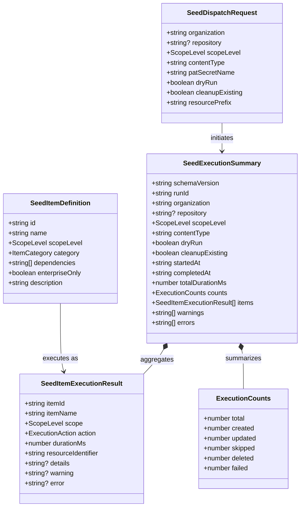
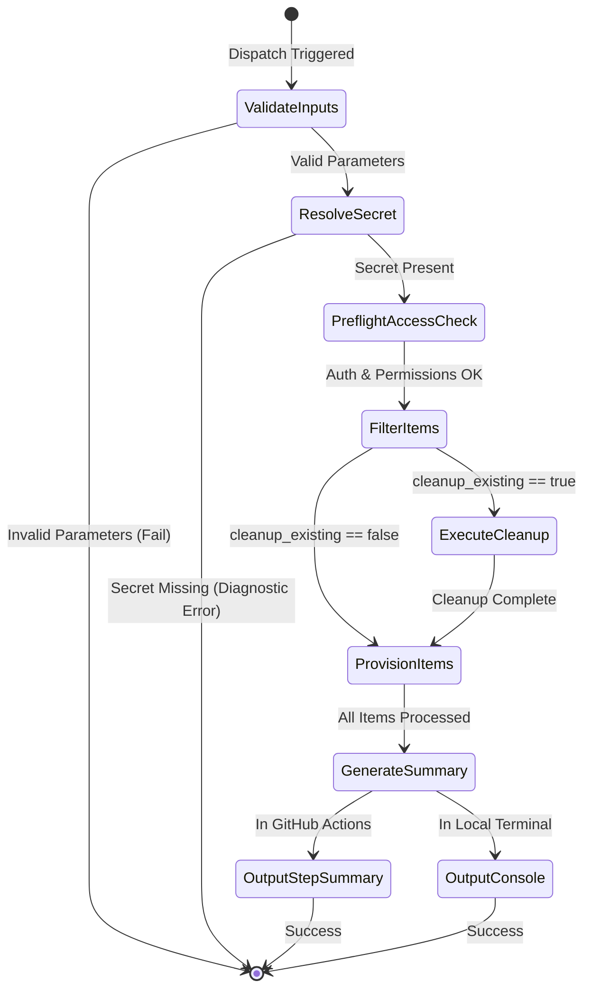

# Data Model: Comprehensive Synthetic Demo Content Seeder

**Feature**: `002-seed-demo-content`
**Date**: 2026-10-14
**Status**: Draft

---

## 1. Entity Overview & Relationships

The synthetic demo content seeder data model defines the schema for execution requests, modular resource definitions, per-item execution records, and the final aggregated execution summary.

---

## 2. Core Entities

### 2.1 `SeedDispatchRequest`

Represents the parsed, validated configuration provided via GitHub Actions `workflow_dispatch` inputs or local CLI arguments:

| Field             | Type                                       | Required |        Default        | Description                                                                                                                          |
| :---------------- | :----------------------------------------- | :------: | :-------------------: | :----------------------------------------------------------------------------------------------------------------------------------- |
| `organization`    | `string`                                   |   Yes    |           -           | Target GitHub organization name (e.g. `octodemo-migration`).                                                                         |
| `repository`      | `string`                                   |    No    |      `undefined`      | Target repository name (e.g. `demo-ecommerce-monorepo`). Auto-created if missing.                                                    |
| `scopeLevel`      | `'both' \| 'organization' \| 'repository'` |   Yes    |       `'both'`        | The target scope to seed.                                                                                                            |
| `contentType`     | `string`                                   |   Yes    |        `'all'`        | Preset name (`all`, `core-governance`, `actions-and-security`, `collaboration`, `artifacts-and-code`) or comma-separated module IDs. |
| `patSecretName`   | `string`                                   |   Yes    | `'GHEC_SOURCE_TOKEN'` | Name of secret containing the GitHub Personal Access Token.                                                                          |
| `dryRun`          | `boolean`                                  |   Yes    |        `false`        | When true, validates access and previews operations without mutating remote state.                                                   |
| `cleanupExisting` | `boolean`                                  |   Yes    |        `false`        | When true, deletes existing resources matching `resourcePrefix` before provisioning.                                                 |
| `resourcePrefix`  | `string`                                   |   Yes    |       `'demo-'`       | Prefix applied to created entities to ensure safe, isolated namespace management.                                                    |

### 2.2 `SeedItemDefinition`

Defines the metadata, category, and dependencies for each of the 32 migration items:

| Field            | Type                                                                                     | Description                                                                                |
| :--------------- | :--------------------------------------------------------------------------------------- | :----------------------------------------------------------------------------------------- |
| `id`             | `string`                                                                                 | Unique module identifier (e.g. `rulesets`, `teams`, `org-secrets`).                        |
| `name`           | `string`                                                                                 | Human-readable display name (e.g. `Repository Rulesets`).                                  |
| `scopeLevel`     | `'organization' \| 'repository'`                                                         | Scope governing this resource.                                                             |
| `category`       | `'core-governance' \| 'actions-and-security' \| 'collaboration' \| 'artifacts-and-code'` | Category preset grouping.                                                                  |
| `dependencies`   | `readonly string[]`                                                                      | IDs of prerequisite items that must be provisioned before this item.                       |
| `enterpriseOnly` | `boolean`                                                                                | Whether this item requires a GitHub Enterprise plan (allows graceful fallback if 403/404). |
| `description`    | `string`                                                                                 | Brief explanation of the synthetic content provisioned.                                    |

### 2.3 `SeedItemExecutionResult`

Represents the execution outcome of an individual item:

| Field                | Type                                                                                                                     | Description                                                                      |
| :------------------- | :----------------------------------------------------------------------------------------------------------------------- | :------------------------------------------------------------------------------- |
| `itemId`             | `string`                                                                                                                 | Identifier matching `SeedItemDefinition.id`.                                     |
| `itemName`           | `string`                                                                                                                 | Human-readable name.                                                             |
| `scope`              | `'organization' \| 'repository'`                                                                                         | Target scope of execution.                                                       |
| `action`             | `'created' \| 'updated' \| 'skipped' \| 'deleted' \| 'dry-run-create' \| 'dry-run-update' \| 'dry-run-skip' \| 'failed'` | Status of the operation.                                                         |
| `durationMs`         | `number`                                                                                                                 | Time taken to evaluate and execute the item in milliseconds.                     |
| `resourceIdentifier` | `string`                                                                                                                 | Name or slug of the provisioned asset (e.g. `demo-engineering`, `main-ruleset`). |
| `details`            | `string?`                                                                                                                | Optional context describing sub-resources (e.g. `Created 3 custom properties`).  |
| `warning`            | `string?`                                                                                                                | Optional warning (e.g. `Enterprise plan required; skipped IP allow list`).       |
| `error`              | `string?`                                                                                                                | Sanitized error diagnostic if the operation failed.                              |

### 2.4 `SeedExecutionSummary`

Aggregated result payload serialized to JSON and formatted as Markdown for `$GITHUB_STEP_SUMMARY`:

| Field             | Type                                       | Description                                                                         |
| :---------------- | :----------------------------------------- | :---------------------------------------------------------------------------------- |
| `schemaVersion`   | `'1.0.0'`                                  | Contract schema version.                                                            |
| `runId`           | `string`                                   | Unique execution identifier.                                                        |
| `organization`    | `string`                                   | Target organization name.                                                           |
| `repository`      | `string?`                                  | Target repository name.                                                             |
| `scopeLevel`      | `'both' \| 'organization' \| 'repository'` | Configured scope level.                                                             |
| `contentType`     | `string`                                   | Configured content filter.                                                          |
| `dryRun`          | `boolean`                                  | Whether execution was simulated.                                                    |
| `cleanupExisting` | `boolean`                                  | Whether pre-cleanup was performed.                                                  |
| `startedAt`       | `string`                                   | ISO 8601 timestamp of execution start.                                              |
| `completedAt`     | `string`                                   | ISO 8601 timestamp of execution completion.                                         |
| `totalDurationMs` | `number`                                   | Total elapsed execution duration.                                                   |
| `counts`          | `ExecutionCounts`                          | Breakdown of counts: `total`, `created`, `updated`, `skipped`, `deleted`, `failed`. |
| `items`           | `SeedItemExecutionResult[]`                | Array of item-by-item results.                                                      |
| `warnings`        | `string[]`                                 | List of non-fatal operational warnings.                                             |
| `errors`          | `string[]`                                 | List of operational errors.                                                         |

---

## 3. State Transitions & Lifecycle

The execution lifecycle transitions through discrete phases:

---

## 4. Validation Rules & Invariants

1. **Organization Validation**: `organization` must be non-empty, alphanumeric with dashes/underscores (`^[a-zA-Z0-9_-]+$`).
2. **Repository Validation**: If `scopeLevel` is `'repository'` or `'both'`, `repository` is validated. If absent, defaults to `demo-synthetic-source-repo`.
3. **Preset Mapping Consistency**:
   - `core-governance`: `['org-settings', 'teams', 'custom-roles', 'ip-allow-lists', 'org-custom-properties', 'gei-repo', 'repo-custom-properties', 'collaborators']`
   - `actions-and-security`: `['actions-policies', 'actions-runners', 'org-variables', 'org-secrets', 'repo-variables', 'repo-secrets', 'environments', 'branch-protection', 'rulesets', 'security']`
   - `collaboration`: `['projects-v2', 'issues', 'pull-requests', 'discussions', 'autolinks', 'post-migration-codeowners', 'post-migration-mannequins']`
   - `artifacts-and-code`: `['releases', 'lfs', 'packages', 'deploy-keys', 'webhooks', 'apps-inventory']`
   - `all`: All 32 items.
4. **Execution Safety Invariant**: In `dryRun: true`, the provisioners only issue read queries (`GET`), never mutating requests (`POST`, `PUT`, `PATCH`, `DELETE`).
5. **Zero-Exposure Invariant**: `SeedItemExecutionResult` and `SeedExecutionSummary` must never contain raw secret values, authorization tokens, or passwords.
