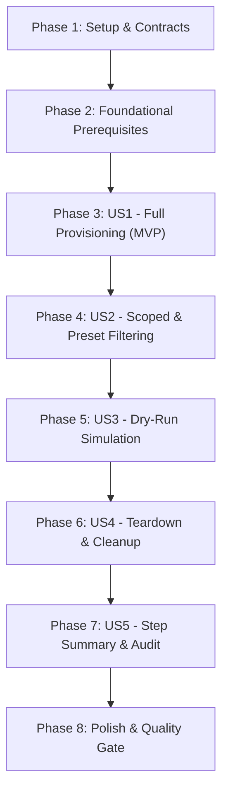

# Implementation Tasks: Comprehensive Synthetic Demo Content Seeder

**Feature**: `002-seed-demo-content`
**Date**: 2026-10-14
**Spec**: [spec.md](./spec.md) | **Plan**: [plan.md](./plan.md)

---

## Phase 1: Setup (Shared Infrastructure & Contracts)

**Purpose**: Formalize data contracts, schemas, and public exports across `@ghec/contracts`.

- [x] T001 Define Zod schemas and TypeScript interfaces in `packages/contracts/src/seeder/schemas.ts` conforming to `contracts/seed-dispatch.contract.json`, `seed-manifest.contract.json`, and `seed-summary.contract.json` (quoting verbatim field constraints: `organization` minLength 1, maxLength 100, pattern `^[a-zA-Z0-9_-]+$`; `repository` optional, minLength 1, maxLength 100, pattern `^[a-zA-Z0-9_.-]+$`; `scopeLevel` enum `'both'`, `'organization'`, `'repository'`, default `'both'`; `contentType` string, default `'all'`; `patSecretName` string, default `'GHEC_SOURCE_TOKEN'`; `dryRun` boolean, default `false`; `cleanupExisting` boolean, default `false`; `resourcePrefix` string, default `'demo-'`; `schemaVersion` constant `'1.0.0'`).
- [x] T002 Export seeder schemas, validators, and TypeScript types from `packages/contracts/src/index.ts`.
- [x] T003 [P] Add offline schema validation unit tests in `packages/contracts/tests/seed-contracts.test.ts` verifying valid sample payloads and rejecting malformed inputs.

---

## Phase 2: Foundational (Blocking Prerequisites)

**Purpose**: Core client infrastructure, rate limiting, catalog definitions, and orchestrator framework.

**⚠️ CRITICAL**: Must complete before any user story implementation can begin.

- [x] T004 Implement resilient rate-limited GitHub client adapter and libsodium sealed-box encryption helper in `apps/cli/src/commands/seeder/client.ts` utilizing `AdaptiveRateLimiter` from `@ghec/github-client`, exponential backoff with jitter on HTTP 403 (`x-ratelimit-remaining: 0` or secondary rate limits) and HTTP 429, `sodium.crypto_box_seal` for write-only Actions secrets, and `sanitizeDiagnostics` for token scrubbing.
- [x] T005 [P] Implement the 32-item catalog registry and preset mapper in `apps/cli/src/commands/seeder/catalog.ts` indexing 13 organization-level items (`org-settings`, `actions-policies`, `actions-runners`, `org-variables`, `org-secrets`, `org-custom-properties`, `teams`, `custom-roles`, `ip-allow-lists`, `webhooks`, `projects-v2`, `apps-inventory`, `post-migration-mannequins`) and 19 repository-level items (`gei-repo`, `repo-variables`, `repo-secrets`, `repo-custom-properties`, `environments`, `branch-protection`, `rulesets`, `webhooks`, `autolinks`, `collaborators`, `deploy-keys`, `issues`, `pull-requests`, `discussions`, `releases`, `lfs`, `packages`, `post-migration-codeowners`, `security`), their category mappings (`core-governance`, `actions-and-security`, `collaboration`, `artifacts-and-code`), and topological dependencies.
- [x] T006 [P] Add unit tests for catalog registration and preset resolution in `apps/cli/tests/seed-catalog.test.ts` verifying correct item counts (32 for `all`, 8 for `core-governance`, 10 for `actions-and-security`, 7 for `collaboration`, 6 for `artifacts-and-code`).
- [x] T007 Implement the core seeding orchestrator in `apps/cli/src/commands/seeder/orchestrator.ts` resolving dependency graphs, executing item provisioners, tracking execution durations, and aggregating `SeedItemExecutionResult` records.

**Checkpoint**: Core client, catalog, and orchestrator framework ready. User story implementation can now proceed.

---

## Phase 3: User Story 1 - Full-Stack End-to-End Demo Provisioning (Priority: P1) 🎯 MVP

**Goal**: Provision synthetic demo resources across all 32 migration items (13 org-level and 19 repo-level), automatically creating and initializing the target repository if missing, with full idempotency and zero manual setup.

**Independent Test**: Execute full seeding against an organization and repository with `scope_level: both` and `content_type: all`, verifying all 32 items succeed with zero 409 Conflict errors.

### Tests for User Story 1

- [x] T008 [P] [US1] Unit test for repository auto-creation and basic resource provisioning against mock GitHub adapter in `apps/cli/tests/seed-demo-provisioning.test.ts`.

### Implementation for User Story 1

- [x] T009 [P] [US1] Implement 13 Organization-level provisioners in `apps/cli/src/commands/seeder/org/` (`org-settings.ts`, `actions-policies.ts`, `actions-runners.ts`, `org-variables.ts`, `org-secrets.ts`, `org-custom-properties.ts`, `teams.ts`, `custom-roles.ts`, `ip-allow-lists.ts`, `webhooks.ts`, `projects-v2.ts`, `apps-inventory.ts`, `post-migration-mannequins.ts`) implementing check-or-create idempotency and non-fatal degradation for enterprise-only features.
- [x] T010 [P] [US1] Implement 19 Repository-level provisioners in `apps/cli/src/commands/seeder/repo/` (`gei-repo.ts`, `repo-variables.ts`, `repo-secrets.ts`, `repo-custom-properties.ts`, `environments.ts`, `branch-protection.ts`, `rulesets.ts`, `webhooks.ts`, `autolinks.ts`, `collaborators.ts`, `deploy-keys.ts`, `issues.ts`, `pull-requests.ts`, `discussions.ts`, `releases.ts`, `lfs.ts`, `packages.ts`, `post-migration-codeowners.ts`, `security.ts`) implementing auto-initialization (`auto_init: true`) for missing repos and check-or-create idempotency.
- [x] T011 [US1] Implement CLI command entry point in `apps/cli/src/commands/seed-demo.ts` and register the `seed-demo` subcommand in `apps/cli/src/index.ts` supporting `--org`, `--repo`, `--scope`, `--preset`, and `--prefix`.
- [x] T012 [US1] Implement the standalone automation script `scripts/seed-demo-content.ts` wrapping the seeder orchestrator with environment variable support (`GHEC_TOKEN`, `GHEC_ORG`, `GHEC_REPO`).
- [x] T013 [US1] Implement GitHub Actions workflow dispatch in `.github/workflows/seed-demo-content.yml` with inputs (`organization`, `repository`, `scope_level`, `content_type`, `pat_secret_name`, `dry_run`, `cleanup_existing`), dynamic secret lookup `${{ secrets[inputs.pat_secret_name] }}`, and pre-flight validation.

**Checkpoint**: User Story 1 complete. Full-stack 32-item demo environment can be seeded from scratch via CLI, script, or GitHub Actions.

---

## Phase 4: User Story 2 - Scoped & Preset-Based Targeted Seeding (Priority: P2)

**Goal**: Support selective seeding runs filtered by `scope_level` (`both`, `organization`, `repository`) and content category presets (`core-governance`, `actions-and-security`, `collaboration`, `artifacts-and-code`, `all`) or custom comma-separated module IDs.

**Independent Test**: Execute seeder with `scope_level: organization` or preset `core-governance`, verifying only matching items run and unselected scopes/modules remain untouched.

### Tests for User Story 2

- [x] T014 [P] [US2] Unit test for scoped filtering and custom module list resolution in `apps/cli/tests/seed-filtering.test.ts`.

### Implementation for User Story 2

- [x] T015 [US2] Implement scope filtering and dependency-aware module filtering in `apps/cli/src/commands/seeder/catalog.ts` ensuring that selecting custom module IDs (e.g. `teams,rulesets,environments`) automatically resolves and includes required parent dependencies.
- [x] T016 [US2] Connect `--scope`, `--preset`, and `--modules` flags in `apps/cli/src/commands/seed-demo.ts` and wire `scope_level` and `content_type` options in `.github/workflows/seed-demo-content.yml`.

**Checkpoint**: User Stories 1 and 2 functional. Targeted and preset-based provisioning fully operational.

---

## Phase 5: User Story 3 - Dry-Run Simulation & Permission Validation (Priority: P3)

**Goal**: Execute a simulated provisioning run (`dry_run: true`) that evaluates remote state and previews changes without making any mutating API calls (`POST`, `PUT`, `PATCH`, `DELETE`), while performing pre-flight token permission checks.

**Independent Test**: Execute with `dry_run: true` against mock GitHub adapter, verifying exactly zero mutating requests are issued and all planned operations are summarized.

### Tests for User Story 3

- [x] T017 [P] [US3] Unit test for dry-run simulation against mock GitHub API adapter in `apps/cli/tests/seed-demo-dry-run.test.ts`.

### Implementation for User Story 3

- [x] T018 [US3] Implement dry-run execution interception in `apps/cli/src/commands/seeder/client.ts` and `apps/cli/src/commands/seeder/orchestrator.ts` ensuring that mutating HTTP requests are bypassed and logged as `dry-run-create`, `dry-run-update`, or `dry-run-skip`.
- [x] T019 [US3] Implement pre-flight token permission validation in `apps/cli/src/commands/seeder/preflight.ts` verifying OAuth scopes (`admin:org`, `repo`, `delete_repo`, `workflow`) and plan compatibility, producing clear diagnostic advice when scopes are missing.

**Checkpoint**: User Stories 1, 2, and 3 functional. Non-mutating simulations and pre-flight checks verified.

---

## Phase 6: User Story 4 - Resource Teardown & Clean Baseline Re-seeding (Priority: P4)

**Goal**: Cleanly reset or delete existing demo assets matching the designated prefix (`demo-`) in reverse topological dependency order prior to seeding when `cleanup_existing: true` is requested.

**Independent Test**: Seed a demo environment, run cleanup mode, and verify that only prefixed demo resources are removed while non-demo resources are preserved.

### Tests for User Story 4

- [x] T020 [P] [US4] Unit test for teardown routines and prefix matching in `apps/cli/tests/seed-teardown.test.ts`.

### Implementation for User Story 4

- [x] T021 [US4] Implement reverse topological cleanup routines for all 32 items in `apps/cli/src/commands/seeder/cleanup.ts` enumerating and removing demo-prefixed resources (e.g. child teams before parent teams, repo webhooks and rulesets before deleting repos) with strict prefix validation to protect non-demo resources.
- [x] T022 [US4] Connect the `--cleanup` CLI flag in `apps/cli/src/commands/seed-demo.ts` and the `cleanup_existing` input in `.github/workflows/seed-demo-content.yml`.

**Checkpoint**: User Stories 1 through 4 functional. Clean teardown and repeatable test resets verified.

---

## Phase 7: User Story 5 - Comprehensive Auditability & Actions Step Summary (Priority: P5)

**Goal**: Generate a formatted Markdown execution summary written to `$GITHUB_STEP_SUMMARY` and rendered in the terminal, detailing item statuses, timings, and diagnostic warnings.

**Independent Test**: Verify that `$GITHUB_STEP_SUMMARY` and stdout contain an organized Markdown report conforming to `seed-summary.contract.json`.

### Tests for User Story 5

- [x] T023 [P] [US5] Unit test for Markdown step summary rendering in `apps/cli/tests/seed-summary.test.ts`.

### Implementation for User Story 5

- [x] T024 [US5] Implement the summary generator in `apps/cli/src/commands/seeder/summary.ts` assembling the `SeedExecutionSummary` JSON payload and formatting the GitHub Actions Markdown step summary table with status icons, resource identifiers, execution duration, and warnings.
- [x] T025 [US5] Integrate `$GITHUB_STEP_SUMMARY` file output in `.github/workflows/seed-demo-content.yml` and formatted stdout table in `apps/cli/src/commands/seed-demo.ts`.

**Checkpoint**: All 5 User Stories fully implemented, independently testable, and audited.

---

## Phase 8: Polish & Cross-Cutting Concerns

**Purpose**: Security hardening, end-to-end documentation, and quality gate verification.

- [x] T026 [P] Execute security audit test in `apps/cli/tests/seed-demo-security.test.ts` verifying that libsodium sealed-box encryption is strictly enforced and that no plaintext secrets or unredacted tokens appear in logs, error objects, or step summaries.
- [x] T027 [P] Author comprehensive user and consultant documentation in `docs/guides/seed-demo-content.md` explaining workflow dispatch inputs, local CLI execution, preset definitions, and demo organization prerequisites.
- [x] T028 Execute full monorepo quality gate `npm run check` verifying linting, formatting, TypeScript compilation across packages and apps, and the complete offline test suite.

---

## Dependencies & Execution Order

### Phase Dependencies

### User Story Dependencies

- **User Story 1 (P1)**: Depends on Phase 1 (Contracts) and Phase 2 (Foundational Client & Catalog). Delivers the core MVP.
- **User Story 2 (P2)**: Builds upon US1 provisioners by adding selective filtering and preset expansion.
- **User Story 3 (P3)**: Adds simulation interception and permission checking across the US1/US2 client and provisioners.
- **User Story 4 (P4)**: Adds reverse teardown operations corresponding to the US1 provisioners.
- **User Story 5 (P5)**: Aggregates execution results from US1-US4 into rich Markdown summaries.

---

## Parallel Opportunities

1. **Phase 1**:
   - `T003` (Contract tests) can run in parallel with `T002` once schemas in `T001` are defined.
2. **Phase 2**:
   - `T004` (Client & encryption) and `T005` (Catalog & presets) can be implemented in parallel.
   - `T006` (Catalog unit tests) can run in parallel with `T007` (Orchestrator).
3. **Phase 3 (US1)**:
   - `T009` (13 Org provisioners) and `T010` (19 Repo provisioners) can be developed concurrently across separate files.
   - `T008` (Provisioning unit tests) can be authored in parallel with provisioner implementations.
4. **Phase 4-7**:
   - Each story's unit test (`T014`, `T017`, `T020`, `T023`) can be authored in parallel with feature logic.
5. **Phase 8**:
   - `T026` (Security audit test) and `T027` (Documentation) can run completely in parallel.

---

## Implementation Strategy

### MVP First (User Story 1)

1. Complete **Phase 1 (Setup & Contracts)** and **Phase 2 (Foundational Client & Catalog)**.
2. Complete **Phase 3 (User Story 1)**: Implement 32 provisioners, CLI subcommand, script, and workflow dispatch.
3. Validate User Story 1 independently using `apps/cli/tests/seed-demo-provisioning.test.ts` and dry-run CLI execution.
4. Demo the push-button provisioning MVP!

### Incremental Delivery

1. Add **Phase 4 (US2)**: Enable presets (`core-governance`, `actions-and-security`, etc.) for faster feedback loops.
2. Add **Phase 5 (US3)**: Enable safe dry-run preview mode for customer demonstrations.
3. Add **Phase 6 (US4)**: Enable automated teardown for repeatable rehearsal resets.
4. Add **Phase 7 (US5)**: Deliver rich Markdown step summaries in GitHub Actions.
5. Finish with **Phase 8 (Polish)**: Verify zero-exposure security and run `npm run check`.
