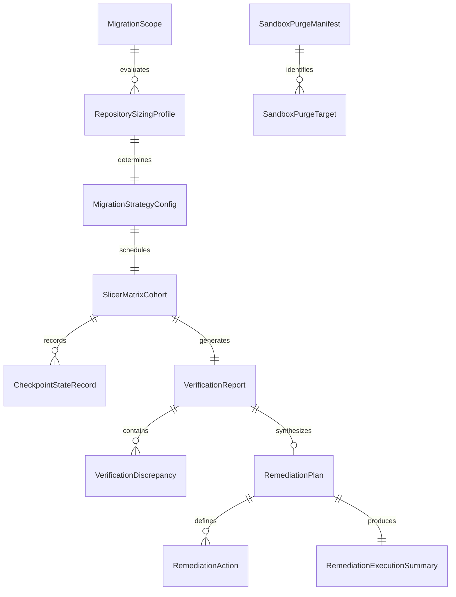
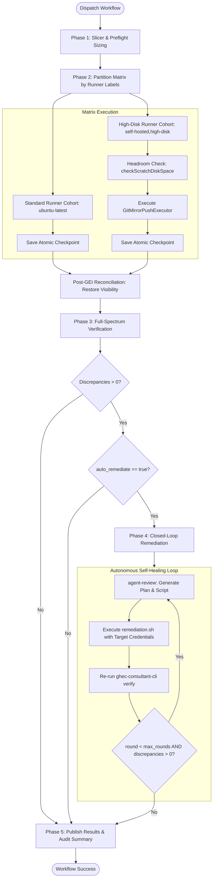

# Data Model: Autonomous Scale-Adaptive Migration Orchestration & Remediation

**Feature**: `003-autonomous-migration-orchestration`
**Date**: 2026-10-14
**Status**: Completed

---

## 1. Entity Architecture Overview

The autonomous migration orchestration system processes, transforms, and produces data across five operational domains:

1. **Preflight Sizing & Classification**: Diagnoses repository footprint and assigns strategy configurations.
2. **Matrix Cohort Execution**: Partitions migration cohorts by runner labels and schedules execution.
3. **Checkpoint & Resumption State**: Persists atomic step progress for zero-duplication recovery.
4. **Verification & Closed-Loop Remediation**: Ingests verification discrepancies, synthesizes remediation plans, and executes self-healing scripts.
5. **Target Sandbox Teardown**: Audits and purges test resources matching prefix filters.

---

## 2. Core Entities

### Entity 1: RepositorySizingProfile

Captured during the preflight sizing phase before cohort partitioning.

| Field                     | Type                                  | Description                                       | Validation / Constraints                                                                   |
| :------------------------ | :------------------------------------ | :------------------------------------------------ | :----------------------------------------------------------------------------------------- |
| `repositoryName`          | `string`                              | Simple repository name within source organization | Non-empty GitHub repo name format                                                          |
| `gitDiskUsageBytes`       | `number`                              | Git tree disk footprint reported by GitHub API    | Non-negative integer                                                                       |
| `gitLfsObjectCount`       | `number`                              | Count of Git LFS tracked objects                  | Non-negative integer                                                                       |
| `gitLfsTotalBytes`        | `number`                              | Aggregate size of Git LFS objects in bytes        | Non-negative integer                                                                       |
| `releaseCount`            | `number`                              | Total count of releases                           | Non-negative integer                                                                       |
| `releaseAssetsTotalBytes` | `number`                              | Aggregate byte volume of all release assets       | Non-negative integer                                                                       |
| `estimatedScratchBytes`   | `number`                              | Total estimated scratch disk required on runner   | `gitDiskUsageBytes * 1.5 + (releaseAssetsTotalBytes > 10GB ? 0 : releaseAssetsTotalBytes)` |
| `sourceVisibility`        | `'public' \| 'internal' \| 'private'` | Original visibility in source organization        | Must be valid GitHub visibility                                                            |

---

### Entity 2: MigrationStrategyConfig

Generated per repository based on its sizing profile to dictate execution mechanisms.

| Field                        | Type                                                              | Description                                    | Constraints & Invariants                                        |
| :--------------------------- | :---------------------------------------------------------------- | :--------------------------------------------- | :-------------------------------------------------------------- |
| `repositoryName`             | `string`                                                          | Target repository identifier                   | Matches `RepositorySizingProfile.repositoryName`                |
| `tier`                       | `'standard' \| 'large-releases' \| 'git-lfs' \| 'massive-mirror'` | Classification tier                            | Determined deterministically by size thresholds                 |
| `useGei`                     | `boolean`                                                         | Whether to use GitHub Enterprise Importer      | `false` if `gitDiskUsageBytes > 40GB` or metadata >40GB         |
| `skipReleasesInGei`          | `boolean`                                                         | Whether to append `--skip-releases` to GEI     | `true` if `releaseAssetsTotalBytes > 10GB` or `useGei == false` |
| `useReleaseFallbackStreamer` | `boolean`                                                         | Stream releases chunk-by-chunk via REST        | `true` if `releaseAssetsTotalBytes > 10GB`                      |
| `useDualRemoteLfsStreamer`   | `boolean`                                                         | Stream LFS objects via dual-remote batch API   | `true` if `gitLfsObjectCount > 0`                               |
| `useMirrorPush`              | `boolean`                                                         | Execute bare mirror-push directly              | `true` if `useGei == false`                                     |
| `assignedRunnerLabels`       | `string[]`                                                        | Labels determining runner dispatch pool        | `['ubuntu-latest']` or `['self-hosted', 'high-disk']`           |
| `requiresHeadroomCheck`      | `boolean`                                                         | Enforce `checkScratchDiskSpace` before git ops | `true` if `useMirrorPush == true`                               |

---

### Entity 3: SlicerMatrixCohort

Generated by the slicer job to populate the GitHub Actions matrix.

| Field          | Type                                      | Description                                                               |
| :------------- | :---------------------------------------- | :------------------------------------------------------------------------ |
| `cohortId`     | `string`                                  | Unique cohort identifier (e.g. `cohort-standard-01`, `cohort-massive-01`) |
| `runnerLabels` | `string[]`                                | Array of labels for the GitHub Actions runner `runs-on` expression        |
| `repositories` | `string[]`                                | List of repository names assigned to this parallel runner                 |
| `strategies`   | `Record<string, MigrationStrategyConfig>` | Map of repository name to strategy configuration                          |
| `batchIndex`   | `number`                                  | Zero-based index within the wave                                          |
| `totalCohorts` | `number`                                  | Total number of parallel cohorts in this wave                             |

---

### Entity 4: CheckpointStateRecord

Maintained by `MigrationCheckpointManager` in `./migrations/.checkpoint-<cohort>-<module>.json`.

| Field             | Type                                                                 | Description                                                           |
| :---------------- | :------------------------------------------------------------------- | :-------------------------------------------------------------------- |
| `schemaVersion`   | `string`                                                             | Contract schema version (`"1.0.0"`)                                   |
| `cohortId`        | `string`                                                             | Associated matrix cohort                                              |
| `moduleId`        | `string`                                                             | Migration module identifier (e.g. `gei-repo`, `releases`, `rulesets`) |
| `stage`           | `'discover' \| 'plan' \| 'apply' \| 'verify'`                        | Lifecycle stage                                                       |
| `status`          | `'pending' \| 'in_progress' \| 'completed' \| 'failed' \| 'skipped'` | Execution status                                                      |
| `updatedAt`       | `string`                                                             | ISO 8601 timestamp of last checkpoint transition                      |
| `resumptionToken` | `string \| null`                                                     | Opaque cursor or stage artifact hash for resumption                   |
| `metrics`         | `Record<string, number>`                                             | Granular progress counters (e.g. items migrated, bytes transferred)   |

---

### Entity 5: VerificationDiscrepancy & VerificationReport

Conforms to `@ghec/contracts` authoritative schema.

| Field                 | Type                                | Description                                                                   |
| :-------------------- | :---------------------------------- | :---------------------------------------------------------------------------- |
| `id`                  | `string`                            | Unique discrepancy identifier                                                 |
| `moduleId`            | `string`                            | Migration module reporting discrepancy                                        |
| `resourceIdentifier`  | `string`                            | Target resource identifier (e.g. `repo:frontend/ruleset:main-protection`)     |
| `severity`            | `'info' \| 'warning' \| 'critical'` | Discrepancy severity                                                          |
| `expected`            | `unknown`                           | Expected source state representation                                          |
| `actual`              | `unknown`                           | Observed target state representation                                          |
| `remediable`          | `boolean`                           | Flag indicating whether an automated fix exists                               |
| `remediationCategory` | `string`                            | Category grouping (e.g. `secrets-and-variables`, `webhooks-and-integrations`) |

---

### Entity 6: RemediationPlan & RemediationAction

Produced by `ghec-consultant-cli agent-review` to drive Phase 4 self-healing.

| Field                | Type                  | Description                                        |
| :------------------- | :-------------------- | :------------------------------------------------- |
| `schemaVersion`      | `string`              | Contract version (`"1.0.0"`)                       |
| `planId`             | `string`              | Unique remediation plan UUID                       |
| `generatedAt`        | `string`              | ISO 8601 creation timestamp                        |
| `reportId`           | `string`              | Verification report ID driving this remediation    |
| `totalDiscrepancies` | `number`              | Count of total input discrepancies                 |
| `actionableCount`    | `number`              | Count of actionable, auto-remediable items         |
| `actions`            | `RemediationAction[]` | Array of concrete, ordered remediation operations  |
| `script`             | `string`              | Complete executable bash script (`remediation.sh`) |

**RemediationAction Structure**:

- `id`: Action identifier (e.g. `ACT-001`).
- `moduleId`: Associated module ID.
- `resourceName`: Target entity being fixed.
- `command`: Idempotent shell command utilizing CLI or Octokit API with target token.
- `description`: Plain-language explanation of corrective action.
- `severity`: Discrepancy severity level.

---

### Entity 7: SandboxPurgeManifest & SandboxPurgeTarget

Tracks target cleanup targets discovered during `teardown-target-sandbox.yml`.

| Field           | Type                   | Description                                             |
| :-------------- | :--------------------- | :------------------------------------------------------ |
| `targetOrg`     | `string`               | Target organization subject to teardown                 |
| `prefixFilter`  | `string`               | Strict prefix filter applied (e.g. `dummy-`)            |
| `discoveredAt`  | `string`               | Timestamp of preflight scan                             |
| `dryRun`        | `boolean`              | Whether operations were simulated or applied            |
| `targets`       | `SandboxPurgeTarget[]` | Catalog of discovered resources to be deleted           |
| `purgedCount`   | `number`               | Count of successfully deleted resources                 |
| `retainedCount` | `number`               | Count of resources untouched due to non-matching prefix |

**SandboxPurgeTarget Structure**:

- `type`: `'repository' \| 'team' \| 'custom-role' \| 'ruleset'`
- `identifier`: Resource name or numeric ID
- `status`: `'pending' \| 'deleted' \| 'skipped' \| 'failed'`
- `error`: Diagnostic error if deletion failed

---

## 3. State Machines & Lifecycles

### Pipeline Execution Lifecycle

---

## 4. Contract Schema Files

The corresponding JSON Schema contracts are persisted in the `contracts/` directory:

- [`contracts/slicer-matrix.contract.json`](./contracts/slicer-matrix.contract.json): Validates the partitioned cohort matrix output.
- [`contracts/checkpoint-state.contract.json`](./contracts/checkpoint-state.contract.json): Validates `.checkpoint-*` and resumption manifest state.
- [`contracts/remediation-execution.contract.json`](./contracts/remediation-execution.contract.json): Validates remediation plan execution outcomes and discrepancy delta.
- [`contracts/teardown-manifest.contract.json`](./contracts/teardown-manifest.contract.json): Validates target sandbox purge manifests and deletion logs.
