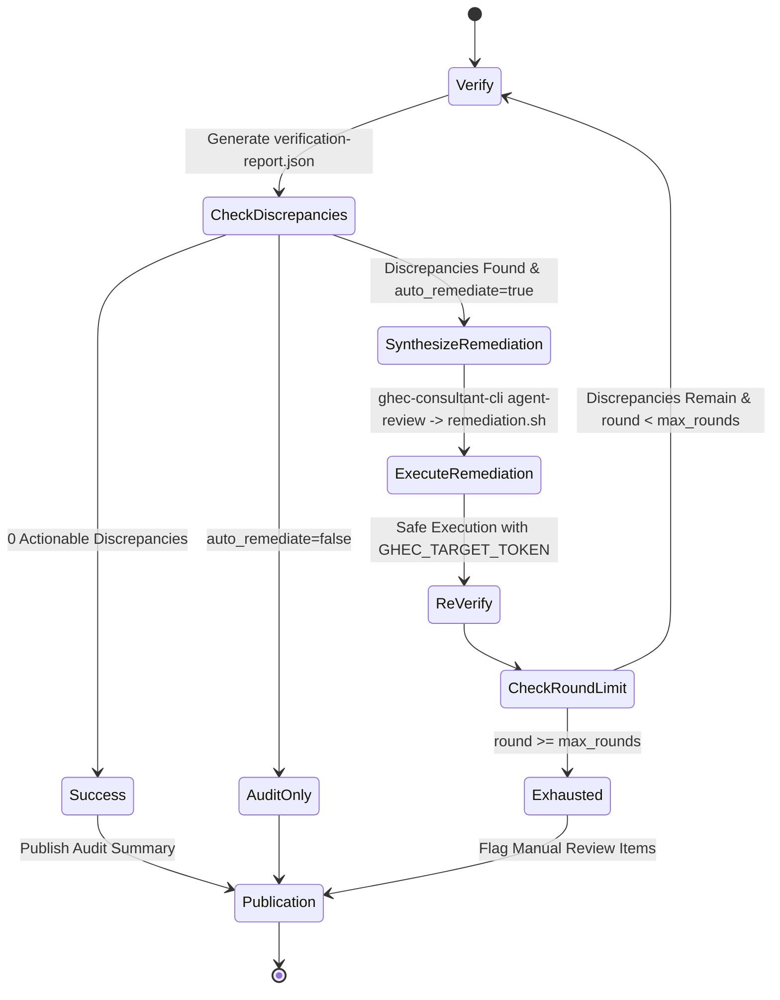

# Technical Research: Autonomous Scale-Adaptive Migration Orchestration & Remediation

**Feature**: `003-autonomous-migration-orchestration`
**Date**: 2026-10-14
**Status**: Completed

---

## 1. Executive Summary

This research document analyzes the technical architecture, operational mechanics, and integration points required to build an autonomous, scale-adaptive migration orchestration and automated self-healing remediation system for the GHEC Consultant Suite.

The system enables continuous, zero-touch migration of GitHub Enterprise Cloud organizations to GHEC with Enterprise Managed Users (GHEC-EMU) across all 32 migration modules. It accommodates repositories ranging from small codebases (<1 GiB) to massive monolithic repositories (>40 GiB) and multi-gigabyte binary release repositories, automatically routing workloads to appropriate runner capacities, applying specialized fallback strategies, capturing atomic checkpoints, and running an iterative closed-loop self-healing remediation cycle until zero actionable discrepancies remain.

---

## 2. Research Decisions & Design Choices

### Decision 1: Sizing Metrics Collection & Preflight Repository Classification

- **Context**: Autonomous routing requires knowing repository characteristics (disk footprint, Git LFS object count/volume, and release asset sizes) _before_ assigning runner pools or initiating transfers.
- **Decision**: Query repository metrics during Phase 1 (Slicer) using a combination of GitHub GraphQL and REST endpoints:
  1. Repository Git footprint: GraphQL `repository.diskUsage` (reported in KiB).
  2. Release asset volume: REST `GET /repos/{owner}/{repo}/releases` aggregating `assets[].size`.
  3. Git LFS object counts: Probing LFS pointers or GraphQL Git trees, or checking repository LFS enablement.
- **Rationale**:
  - Remote API queries execute in seconds without transferring raw repository data or consuming runner scratch space.
  - Sizing calculations can be executed on standard runners (`ubuntu-latest`) during the partitioning phase before matrix fan-out.
- **Alternatives Considered**:
  - _Full shallow clone and `git-sizer`_: Rejected because cloning multi-gigabyte repositories during the preflight partitioning step would exhaust runner disk space and defeat the purpose of scale-adaptive slicing.
  - _Relying solely on `diskUsage` from the REST repo endpoint_: Rejected because GitHub's `diskUsage` includes Git objects but excludes external release binaries and offloaded Git LFS storage.

---

### Decision 2: Scale-Adaptive Strategy Selection & Runner Label Routing

- **Context**: Standard GitHub Enterprise Importer (GEI) fails when a repository archive exceeds 40 GiB. Standard GitHub-hosted runners (`ubuntu-latest`) provide approximately 14 GiB of usable scratch space, leading to `ENOSPC` failures on repositories with large release binaries (>10 GiB) or large working trees.
- **Decision**: Implement a 4-tier strategy selection and runner label allocation matrix:

| Repository Profile      | Criteria                                              | Execution Strategy                                                      | Runner Label Assignment                                                        | Rationale                                                                                                                           |
| :---------------------- | :---------------------------------------------------- | :---------------------------------------------------------------------- | :----------------------------------------------------------------------------- | :---------------------------------------------------------------------------------------------------------------------------------- |
| **Standard Repo**       | Git size <10 GiB, metadata <40 GiB, releases <=10 GiB | Standard GEI (`gei-repo`) + API rehydration                             | `default_runner_labels` (`ubuntu-latest`)                                      | Optimal speed, preserves pull request and commit history via GEI importer.                                                          |
| **Large Releases Repo** | Release assets >10 GiB                                | GEI with `--skip-releases` + `LargeReleasesMigrationStrategy`           | `default_runner_labels` (or `large_repo_runner_labels` if Git size also large) | Prevents runner disk exhaustion by streaming releases chunk-by-chunk via REST without buffering entire releases on disk.            |
| **Git LFS Repo**        | Has LFS tracking/objects                              | Dual-Remote LFS Streamer (`GitLfsMigrationStrategy`)                    | `default_runner_labels` (or `large_repo_runner_labels` based on volume)        | Streams LFS blobs directly between source and target LFS endpoints via Batch API without working tree checkout.                     |
| **Massive Repo**        | Git size >40 GiB or total metadata >40 GiB            | GEI Bypass (`useGei: false`), `GitMirrorPushExecutor` + API rehydration | `large_repo_runner_labels` (`self-hosted,high-disk` >=100 GB scratch disk)     | Bypasses the 40 GiB GEI archive threshold. Executes bare mirror-push directly to target bare repository with 1.5x disk space check. |

- **Rationale**:
  - Matching runner capacity and transfer mechanics to repository characteristics prevents both runner disk exhaustion (`ENOSPC`) and GEI archive generation failures.
  - The repository already contains tested implementations for `GitMirrorPushExecutor`, `LargeReleasesMigrationStrategy`, and `GitLfsMigrationStrategy` in `packages/migration/src/strategies/`.
- **Alternatives Considered**:
  - _Always use `self-hosted,high-disk` runners for all repos_: Rejected because self-hosted high-capacity runners are expensive and limited in enterprise environments; standard repos should utilize cloud runners.
  - _Force GEI for repos >40 GiB_: Rejected because GEI fundamentally rejects or terminates archive generation for repositories exceeding the 40 GiB boundary.

---

### Decision 3: Runner Scratch Disk Headroom Verification (`checkScratchDiskSpace`)

- **Context**: When executing bare mirror-pushes on large repositories, disk exhaustion midway through a 40 GiB transfer leads to locked git files, runner crashes, and broken target states.
- **Decision**: Integrate `checkScratchDiskSpace(dir, estimatedBytes, 1.5)` from `packages/migration/src/strategies/mirror-push/executor.ts` as a mandatory preflight validation gate on the target runner before any Git process is spawned.
- **Rationale**:
  - Evaluates `statfs` on the scratch mount point.
  - Enforces a 1.5x safety multiplier to account for temporary packfiles and loose object expansion during `git clone --bare` and `git push --mirror`.
  - Fails fast in milliseconds if capacity is insufficient, emitting actionable diagnostics.
- **Alternatives Considered**:
  - _Catching `ENOSPC` during `git clone`_: Rejected because catching mid-stream errors leaves corrupt partial directories on disk and wastes hours of transfer time.

---

### Decision 4: Post-GEI Target Repository Visibility Restoration

- **Context**: GitHub Enterprise Importer (GEI) mandates that target repositories are initialized with `private` visibility regardless of whether the source repository was `public` or `internal`.
- **Decision**: In Phase 2 (Matrix Execution), after GEI completes, execute a post-GEI reconciliation step. The engine reads the source repository's visibility from the migration scope and calls Octokit `PATCH /repos/{owner}/{repo}` with `{ visibility: sourceVisibility }` to restore original visibility (`internal` or `public`).
- **Rationale**:
  - Ensures semantic parity between source and destination.
  - Prevents verification failures where `repo-settings` flags a visibility discrepancy.
- **Alternatives Considered**:
  - _Leaving target private and flagging it in verification_: Rejected because autonomous orchestration should remediate expected tool behaviors without raising false-positive discrepancies.

---

### Decision 5: Atomic Resumption & Checkpointing Architecture

- **Context**: A multi-gigabyte migration wave can take hours. If a transient network glitch or rate-limit throttle interrupts a downstream module (e.g. `rulesets` or `webhooks`), re-running the workflow should not re-clone or re-push 40 GiB Git trees.
- **Decision**: Leverage `MigrationCheckpointManager` (`packages/migration/src/checkpoint/manager.ts`):
  1. Checkpoint files (`./migrations/.checkpoint-<cohort>-<module>.json`) record completed stages (`discover`, `plan`, `apply`, `verify`).
  2. Each matrix runner uploads its `./migrations/` directory as a workflow artifact upon job completion or failure.
  3. When resuming or retrying, the workflow downloads existing checkpoints and passes them to the migration runner. Completed modules and transfer stages are cleanly skipped.
- **Rationale**:
  - Eliminates redundant data transfer.
  - Checkpoint manager is already tested and supports atomic rename semantics (`.tmp` to final).
- **Alternatives Considered**:
  - _External Redis or database for state_: Rejected to maintain offline testability and avoid external infrastructure dependencies for GitHub Actions runs.

---

### Decision 6: Closed-Loop Autonomous Self-Healing Remediation

- **Context**: Autonomous agents require a self-contained feedback loop that discovers post-migration discrepancies, plans fixes, executes them, and validates resolution without human intervention.
- **Decision**: Phase 4 in `.github/workflows/migration-e2e-autonomous.yml` executes the following closed loop:

- **Loop Invariants**:
  1. `max_remediation_rounds` (default: 3) prevents infinite execution on non-remediable errors.
  2. Synthesized remediation commands (`remediation.sh`) use idempotent APIs (upsert, check-before-create).
  3. Diagnostic scrubbing redacts credentials from all output streams.
- **Rationale**:
  - Automates resolution of common migration drift: placeholder secrets creation, webhook reactivation, branch protection/ruleset adjustments, and collaborator re-linking.
  - `agent-review` command already exists in `apps/cli/src/commands/agent-review.ts` and parses `VerificationReport` into structured actions and bash commands.
- **Alternatives Considered**:
  - _Arbitrary LLM-generated shell commands without validation_: Rejected because unconstrained agent execution poses security risks and can cause destructive operations on target organizations.

---

### Decision 7: Standalone Remediation Workflow (`migration-apply-remediation.yml`)

- **Context**: Operators or automation agents often encounter existing runs that completed with discrepancies. Re-running the entire E2E pipeline (which re-evaluates all 32 modules and data transfers) is inefficient.
- **Decision**: Build `.github/workflows/migration-apply-remediation.yml`:
  - Inputs: `remediation_plan_path` (or `workflow_run_id`), `dry_run`, `target_environment`.
  - Downloads or reads `remediation-plan.json`.
  - Executes remediation script against target organization.
  - Re-runs `ghec-consultant-cli verify` and generates a diff report (`remediation-diff.json` and Markdown summary) comparing pre-remediation and post-remediation discrepancies.
- **Rationale**:
  - Decoupled, on-demand remediation reduces MTTR and allows targeted auditing.
- **Alternatives Considered**:
  - _Manually running scripts via SSH or local CLI_: Rejected because enterprise consulting requires an auditable CI/CD execution record with encrypted target credentials.

---

### Decision 8: Target Sandbox Teardown (`teardown-target-sandbox.yml`)

- **Context**: Repetitive agent testing and migration rehearsals frequently fail with HTTP 409 Conflict when attempting to create repositories, teams, roles, or rulesets that exist from prior test runs.
- **Decision**: Create a dedicated safety-guarded teardown workflow (`teardown-target-sandbox.yml`):
  - Inputs: `target_org`, `prefix_filter` (e.g. `dummy-`, `demo-`), `confirm_teardown` (boolean), `dry_run` (boolean).
  - Safety guards:
    1. `confirm_teardown` must be explicitly `true`.
    2. `prefix_filter` must be at least 3 characters long (rejects `*`, `""`, `a-`, `all`).
    3. Requires target admin token with `delete_repo` scope.
  - Targets for cleanup: Repositories matching prefix, Teams matching prefix, Custom repository roles matching prefix, Organization rulesets matching prefix.
- **Rationale**:
  - Enables clean test cycles while preventing catastrophic accidental deletion of production assets.
- **Alternatives Considered**:
  - _Purging entire organization_: Rejected as unacceptably hazardous.

---

## 3. Risk & Mitigation Matrix

| Risk                                                     | Likelihood |    Impact    | Architectural Mitigation                                                                                                                                |
| :------------------------------------------------------- | :--------: | :----------: | :------------------------------------------------------------------------------------------------------------------------------------------------------ |
| **Runner disk runs out of space (`ENOSPC`)**             |    High    |     High     | Preflight sizing queries repo size; slicer diverts >40 GiB to high-disk runners; `checkScratchDiskSpace` enforces 1.5x free space check before cloning. |
| **GEI aborts on repository archive >40 GiB**             |    High    |   Critical   | Slicer automatically flags `useGei: false` and routes to `GitMirrorPushExecutor` with API rehydration.                                                  |
| **Large release binaries flood runner disk**             |    High    |     High     | Repos with >10 GiB releases are configured with `--skip-releases` in GEI and streamed in chunks via REST transport.                                     |
| **Secondary rate limits during API rehydration**         |   Medium   |    Medium    | AdaptiveRateLimiter with exponential backoff and dynamic concurrency throttling when `retry-after` is encountered.                                      |
| **Target repository forced to private by GEI**           |  Certain   |    Medium    | Post-GEI reconciliation automatically inspects source scope visibility and restores `internal` or `public` on target.                                   |
| **Infinite loop during remediation**                     |    Low     |     High     | Strict `max_remediation_rounds` counter (default: 3); classification of discrepancies into `auto-remediable` vs `manual-review-required`.               |
| **Accidental deletion of production assets in teardown** |    Low     | Catastrophic | Prefix filter validation (>=3 chars, no wildcard), explicit boolean confirmation flag, dry-run default.                                                 |
| **Credential leakage in remediation scripts or logs**    |   Medium   |   Critical   | Zero-Exposure Secret Boundary (DEC-004): write-only source secrets, sealed placeholders, and automated log scrubbers.                                   |
