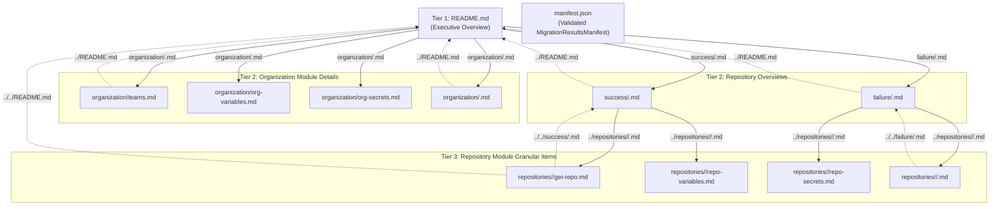

# Data Model & Hierarchy Architecture: 3-Tier Navigable Audit Results Hierarchy

**Feature**: `004-granular-results-hierarchy`
**Created**: 2026-10-14
**Schema Version**: `MIGRATION_SCHEMA_VERSION` (`1.0.0`)

---

## 1. 3-Tier Navigation & File Topology

---

## 2. Authoritative Contract Entities (`@ghec/contracts`)

### 2.1 `OperationExecutionResult` (`packages/contracts/src/results/execution-result.ts`)

Represents a single atomic operation executed by a migration module during the `apply` stage.

| Field              | Type                                                 | Required | Validation / Notes                                                                  |
| :----------------- | :--------------------------------------------------- | :------: | :---------------------------------------------------------------------------------- |
| `operationId`      | `string` (`NonEmptyStringSchema`)                    |   Yes    | Unique operation identifier within the module execution result.                     |
| `status`           | `'succeeded' \| 'failed' \| 'skipped'`               |   Yes    | Execution outcome of the operation.                                                 |
| `httpStatus`       | `number` (`100..599`)                                |    No    | Optional HTTP status code returned by GitHub REST/GraphQL API.                      |
| `error`            | `string` (`1..2048`)                                 |    No    | Required when `status === 'failed'`; prohibited when `status !== 'failed'`.         |
| `completedAt`      | `string` (ISO-8601 `TimestampSchema`)                |   Yes    | Timestamp when the operation completed.                                             |
| `resourceType`     | `string` (`NonEmptyStringSchema`)                    |    No    | Enriched from `PlannedOperation.resourceType` (e.g., `'org-variable'`, `'secret'`). |
| `resourceName`     | `string` (`NonEmptyStringSchema`)                    |    No    | Enriched from `PlannedOperation.resourceName` (e.g., `'CI_ENV'`, `'main'`).         |
| `operationType`    | `'create' \| 'update' \| 'noop' \| 'skip' \| 'warn'` |    No    | Enriched from `PlannedOperation.operation`.                                         |
| `reason`           | `string` (`max 2048`)                                |    No    | Enriched from `PlannedOperation.reason`.                                            |
| `targetIdentifier` | `string` (`NonEmptyStringSchema`)                    |    No    | Enriched from `ModulePlan.targetIdentifier`.                                        |

### 2.2 `ModuleExecutionResult` (`packages/contracts/src/results/execution-result.ts`)

Represents the execution result of a single migration module for a specific target (an organization or a repository).

| Field                      | Type                                               | Required | Validation / Notes                                                         |
| :------------------------- | :------------------------------------------------- | :------: | :------------------------------------------------------------------------- |
| `schemaVersion`            | `'1.0.0'` (`MIGRATION_SCHEMA_VERSION`)             |   Yes    | Contract version literal.                                                  |
| `moduleId`                 | `string` (`MigrationModuleIdSchema`)               |   Yes    | Registered module identifier (e.g., `'teams'`, `'repo-variables'`).        |
| `status`                   | `'complete' \| 'partial' \| 'failed' \| 'skipped'` |   Yes    | Aggregate module status.                                                   |
| `results`                  | `OperationExecutionResult[]`                       |   Yes    | Ordered list of operation execution results.                               |
| `durationMs`               | `number` (`NonNegativeIntegerSchema`)              |   Yes    | Execution duration in milliseconds.                                        |
| `metadataState`            | `'complete' \| 'partial' \| 'failed' \| 'skipped'` |    No    | Optional GEI metadata transfer state.                                      |
| `failedMetadataCategories` | `string[]`                                         |    No    | Optional list of omitted GEI metadata categories.                          |
| `targetIdentifier`         | `string` (`NonEmptyStringSchema`)                  |    No    | Enriched from `ModulePlan.targetIdentifier` (e.g., `'target-org/repo-a'`). |
| `scopeLevel`               | `'organization' \| 'repository'`                   |    No    | Enriched from `ModulePlan.scopeLevel` or module definition.                |

### 2.3 `OrgModuleResultSummary` (`packages/contracts/src/results/results-repo-manifest.ts`)

Summary entry in `MigrationResultsSummary.orgModulesSummary[moduleId]`.

| Field                 | Type                                               | Required | Validation / Notes                                                          |
| :-------------------- | :------------------------------------------------- | :------: | :-------------------------------------------------------------------------- |
| `status`              | `'complete' \| 'partial' \| 'failed' \| 'skipped'` |   Yes    | Execution status of the organization module.                                |
| `totalOperations`     | `number` (`NonNegativeIntegerSchema`)              |   Yes    | Total items/operations processed.                                           |
| `succeededOperations` | `number` (`NonNegativeIntegerSchema`)              |   Yes    | Count of succeeded operations.                                              |
| `failedOperations`    | `number` (`NonNegativeIntegerSchema`)              |   Yes    | Count of failed operations.                                                 |
| `skippedOperations`   | `number` (`NonNegativeIntegerSchema`, default `0`) |   Yes    | Count of skipped operations.                                                |
| `discrepancyCount`    | `number` (`NonNegativeIntegerSchema`, default `0`) |    No    | Count of verification discrepancies attributed to this organization module. |
| `durationMs`          | `number` (`NonNegativeIntegerSchema`)              |    No    | Execution duration in milliseconds.                                         |
| `relativeFilePath`    | `string` (`organization/<moduleId>.md`)            |    No    | Relative path to Tier 2 organization module detail Markdown page.           |
| `error`               | `string` (`1..2048`)                               |    No    | Optional sanitized module-level error summary.                              |

### 2.4 `RepoModuleResultSummary` (`packages/contracts/src/results/results-repo-manifest.ts`)

Summary entry in `RepositoryMigrationRecord.moduleSummaries[moduleId]` representing one row in a repository's Tier 2 **Migrated Items Summary** table and pointing to its Tier 3 detail page.

| Field                 | Type                                               | Required | Validation / Notes                                                   |
| :-------------------- | :------------------------------------------------- | :------: | :------------------------------------------------------------------- |
| `moduleId`            | `string` (`MigrationModuleIdSchema`)               |   Yes    | Repository module identifier (e.g., `'gei-repo'`, `'repo-secrets'`). |
| `status`              | `'complete' \| 'partial' \| 'failed' \| 'skipped'` |   Yes    | Execution/verification status of the module for this repository.     |
| `totalOperations`     | `number` (`NonNegativeIntegerSchema`)              |   Yes    | Total items processed for this module in this repository.            |
| `succeededOperations` | `number` (`NonNegativeIntegerSchema`)              |   Yes    | Succeeded items count.                                               |
| `failedOperations`    | `number` (`NonNegativeIntegerSchema`)              |   Yes    | Failed items count.                                                  |
| `skippedOperations`   | `number` (`NonNegativeIntegerSchema`, default `0`) |   Yes    | Skipped items count.                                                 |
| `discrepancyCount`    | `number` (`NonNegativeIntegerSchema`, default `0`) |   Yes    | Verification discrepancies count for this repository and module.     |
| `durationMs`          | `number` (`NonNegativeIntegerSchema`)              |    No    | Execution duration in milliseconds.                                  |
| `relativeFilePath`    | `string` (`repositories/<repo>/<moduleId>.md`)     |   Yes    | Must start with `"repositories/"` and end with `".md"`.              |
| `error`               | `string` (`1..2048`)                               |    No    | Optional sanitized error summary.                                    |

### 2.5 `RepositoryMigrationRecord` (`packages/contracts/src/results/results-repo-manifest.ts`)

| Field                      | Type                                      | Required | Validation / Notes                                                            |
| :------------------------- | :---------------------------------------- | :------: | :---------------------------------------------------------------------------- |
| `sourceRepo`               | `string` (`NonEmptyStringSchema`)         |   Yes    | Source repository name.                                                       |
| `targetRepo`               | `string` (`NonEmptyStringSchema`)         |   Yes    | Target repository name (unique case-insensitively across `repositories`).     |
| `status`                   | `'succeeded' \| 'failed'`                 |   Yes    | Overall repository status.                                                    |
| `relativeFilePath`         | `string`                                  |   Yes    | `success/<targetRepo>.md` or `failure/<targetRepo>.md`.                       |
| `durationMs`               | `number` (`NonNegativeIntegerSchema`)     |   Yes    | Total duration across repository stages/modules.                              |
| `stagesRun`                | `string[]`                                |   Yes    | List of stages or module IDs executed for this repository.                    |
| `verified`                 | `boolean`                                 |   Yes    | `true` for succeeded repositories with 0 discrepancies.                       |
| `discrepancyCount`         | `number` (`NonNegativeIntegerSchema`)     |   Yes    | Total discrepancies across all modules for this repository.                   |
| `failureReason`            | `string` (`1..2048`)                      |    No    | Required when `status === 'failed'`; prohibited when `'succeeded'`.           |
| `failedStage`              | `string` (`1..128`)                       |    No    | Prohibited when `status === 'succeeded'`.                                     |
| `failedMetadataCategories` | `string[]`                                |    No    | Optional list of failed metadata categories.                                  |
| `warnings`                 | `string[]`                                |   Yes    | Warnings emitted during migration.                                            |
| `remediationCommands`      | `string[]`                                |    No    | Actionable CLI remediation commands.                                          |
| `moduleSummaries`          | `Record<string, RepoModuleResultSummary>` |    No    | Per-module breakdown with links to `repositories/<targetRepo>/<moduleId>.md`. |

---

## 3. View-Model Entities (`@ghec/migration/src/reporting/`)

### 3.1 `GranularMigrationItemRow`

Internal formatting view-model used by both Tier 2 Organization Module pages (`organization/<module>.md`) and Tier 3 Repository Module pages (`repositories/<repo>/<module>.md`):

- `resourceName: string` (e.g., `'engineering-team'`, `'DEPLOY_TOKEN [SEALED]'`, `'main'`)
- `resourceType: string` (e.g., `'team'`, `'org-secret'`, `'branch-protection'`)
- `operationType: 'create' | 'update' | 'noop' | 'skip' | 'warn' | 'verify'`
- `status: 'succeeded' | 'failed' | 'skipped'`
- `completedAt?: string | undefined`
- `verificationStatus: 'verified' | 'discrepancy' | 'not-verified'`
- `notes?: string | undefined` (sanitized reason, HTTP status, error message, or `expected` vs `actual` discrepancy summary)
