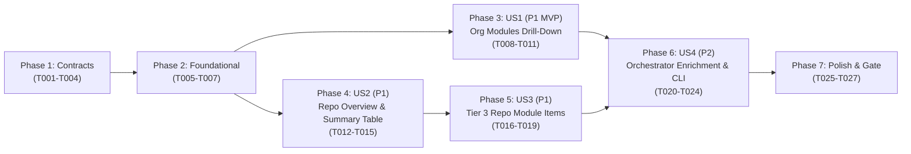

# Implementation Tasks: 3-Tier Navigable Audit Results Hierarchy & Granular Item Reporting

**Feature**: `004-granular-results-hierarchy`
**Date**: 2026-10-15
**Spec**: [spec.md](./spec.md) | **Plan**: [plan.md](./plan.md) | **Data Model**: [data-model.md](./data-model.md)

---

## Phase 1: Setup (Shared Infrastructure & Contracts)

**Purpose**: Enrich `@ghec/contracts` Zod schemas (`OperationExecutionResultSchema`, `ModuleExecutionResultSchema`, `OrgModuleResultSummarySchema`, `RepoModuleResultSummarySchema`, `RepositoryMigrationRecordSchema`) while maintaining 100% backward compatibility.

- [x] T001 Enrich `OperationExecutionResultSchema` and `ModuleExecutionResultSchema` in `packages/contracts/src/results/execution-result.ts` conforming to `contracts/execution-result-enriched.contract.json` and `data-model.md` (quoting verbatim field constraints: on `OperationExecutionResultSchema`: `operationId` required `NonEmptyStringSchema` min 1 max 256, `status` required enum `'succeeded' | 'failed' | 'skipped'`, `httpStatus` optional integer `100..599`, `error` optional string `1..2048` required when `status === 'failed'` and prohibited when `status !== 'failed'`, `completedAt` required ISO-8601 `TimestampSchema`, `resourceType` optional `NonEmptyStringSchema`, `resourceName` optional `NonEmptyStringSchema`, `operationType` optional `PlannedOperationTypeSchema` enum `'create' | 'update' | 'noop' | 'skip' | 'warn'`, `reason` optional string `max 2048`, `targetIdentifier` optional `NonEmptyStringSchema`; on `ModuleExecutionResultSchema`: `schemaVersion` required `'1.0.0'`, `moduleId` required `MigrationModuleIdSchema`, `status` required enum `'complete' | 'partial' | 'failed' | 'skipped'`, `results` required array of `OperationExecutionResultSchema`, `durationMs` required `NonNegativeIntegerSchema`, `metadataState` optional enum `'complete' | 'partial' | 'failed' | 'skipped'`, `failedMetadataCategories` optional `string[]`, `targetIdentifier` optional `NonEmptyStringSchema`, `scopeLevel` optional `MigrationScopeLevelSchema` enum `'organization' | 'repository'`).
- [x] T002 Update `OrgModuleResultSummarySchema`, define `RepoModuleResultSummarySchema`, and extend `RepositoryMigrationRecordSchema` in `packages/contracts/src/results/results-repo-manifest.ts` conforming to `contracts/results-repo-manifest-v1.contract.json` and `data-model.md` (quoting verbatim field constraints: on `OrgModuleResultSummarySchema`: `status` required enum `'complete' | 'partial' | 'failed' | 'skipped'`, `totalOperations` required `NonNegativeIntegerSchema`, `succeededOperations` required `NonNegativeIntegerSchema`, `failedOperations` required `NonNegativeIntegerSchema`, `skippedOperations` `NonNegativeIntegerSchema` default `0`, `discrepancyCount` optional `NonNegativeIntegerSchema` default `0`, `durationMs` optional `NonNegativeIntegerSchema`, `relativeFilePath` optional `NonEmptyStringSchema` starting with `"organization/"` and ending with `".md"`, `error` optional string `1..2048`; on `RepoModuleResultSummarySchema`: `moduleId` required `MigrationModuleIdSchema`, `status` required enum `'complete' | 'partial' | 'failed' | 'skipped'`, `totalOperations` required `NonNegativeIntegerSchema`, `succeededOperations` required `NonNegativeIntegerSchema`, `failedOperations` required `NonNegativeIntegerSchema`, `skippedOperations` `NonNegativeIntegerSchema` default `0`, `discrepancyCount` `NonNegativeIntegerSchema` default `0`, `durationMs` optional `NonNegativeIntegerSchema`, `relativeFilePath` required `NonEmptyStringSchema` starting with `"repositories/"` and ending with `".md"`, `error` optional string `1..2048`; on `RepositoryMigrationRecordSchema`: add optional `moduleSummaries: z.record(z.string(), RepoModuleResultSummarySchema).optional()`).
- [x] T003 Export `RepoModuleResultSummarySchema` and `type RepoModuleResultSummary` from `packages/contracts/src/index.ts`.
- [x] T004 [P] Add unit tests in `packages/contracts/tests/results-repo-manifest.test.ts` verifying backward compatibility of unenriched `ModuleExecutionResult` and `MigrationResultsManifest` payloads as well as validation of enriched `OperationExecutionResult`, `OrgModuleResultSummary.relativeFilePath`, and `RepositoryMigrationRecord.moduleSummaries`.

---

## Phase 2: Foundational (Blocking Prerequisites)

**Purpose**: Build the shared execution enrichment helper, GFM table sanitization/escaping helpers, and view-model data structures required by all 3 tiers.

**⚠️ CRITICAL**: No user story work can begin until this phase is complete.

- [x] T005 Create `enrichModuleExecutionResult` helper in `packages/migration/src/orchestrator/execution-enricher.ts` that accepts a `ModuleExecutionResult` and its corresponding `ModulePlan` (plus optional fallback `targetIdentifier` and `scopeLevel`), correlates each `OperationExecutionResult.operationId` with `ModulePlan.operations`, and populates `targetIdentifier`, `scopeLevel`, `resourceType`, `resourceName`, `operationType`, and `reason`.
- [x] T006 [P] Define `GranularMigrationItemRow`, `OrgModuleDetailModel`, and `RepositoryModuleDetailModel` interfaces plus `escapeMarkdownTableCell` and secret placeholder formatting (`[SEALED]` badge enforcement per `DEC-004`) in `packages/migration/src/reporting/results-markdown-formatter.ts`.
- [x] T007 [P] Implement fallback `operationId` parser and module scope classifier (`isOrganizationScopedModuleResult`) in `packages/migration/src/reporting/results-generator.ts` recognizing all 13 modules in `ALL_ORGANIZATION_MODULES`, legacy `org-*` / `custom-properties` / `rulesets-org` IDs, and dual-scoped `rulesets` based on `scopeLevel` and `targetIdentifier`.

**Checkpoint**: Foundational contracts, execution enricher, table sanitizer, and module scope classifier are ready.

---

## Phase 3: User Story 1 - Executive Overview & Organization-Level Granular Drill-Down (Priority: P1) 🎯 MVP

**Goal**: Display all executed organization-level modules in Tier 1 (`README.md`) with clickable `[View Details](organization/<module>.md)` links and generate Tier 2 `organization/<module>.md` pages with `[← Back to Overview](../README.md)` breadcrumbs and a **Granular Organization Items** table.

**Independent Test**: Run `generateMigrationResults` with synthetic execution and verification reports containing multiple organization modules (`teams`, `org-variables`, `org-secrets`, `custom-roles`, `projects-v2`, `actions-runners`, and org-scoped `rulesets`); verify `README.md` links to `organization/<module>.md` for every module, `organization/org-secrets.md` displays `[SEALED]`, and all Tier 2 org pages contain `[← Back to Overview](../README.md)` and granular item rows.

### Tests for User Story 1

- [x] T008 [P] [US1] Add offline unit tests in `packages/migration/tests/reporting/results-generator.test.ts` verifying full `ALL_ORGANIZATION_MODULES` recognition, `organization/<module>.md` file generation, `[← Back to Overview](../README.md)` breadcrumbs, and `[SEALED]` secret redaction on `org-secrets`.

### Implementation for User Story 1

- [x] T009 [P] [US1] Implement `formatOrgModuleDetailMarkdown` in `packages/migration/src/reporting/results-markdown-formatter.ts` rendering `[← Back to Overview](../README.md)`, module execution summary metrics (`Status`, `Total Items`, `Succeeded`, `Failed`, `Skipped`, `Discrepancies`, `Duration`), module warnings/errors, and the **Granular Organization Items** table (`Resource Name`, `Resource Type`, `Operation`, `Status`, `Verification`, `Notes / Discrepancy`).
- [x] T010 [US1] Update `formatResultsReadmeMarkdown` in `packages/migration/src/reporting/results-markdown-formatter.ts` to include `Discrepancies` and a `Details` column with `[View Details](organization/<moduleId>.md)` in the **Organization-Level Modules** table.
- [x] T011 [US1] Update `generateMigrationResults` in `packages/migration/src/reporting/results-generator.ts` to correlate organization-level `ModuleExecutionResult` entries and `VerificationReport` discrepancies across all organization modules, populate `relativeFilePath: "organization/<moduleId>.md"` and `discrepancyCount` in `manifest.summary.orgModulesSummary`, and emit `files["organization/<moduleId>.md"]`.

**Checkpoint**: User Story 1 is complete and independently testable. Tier 1 `README.md` and Tier 2 `organization/<module>.md` drill-down pages work end-to-end.

---

## Phase 4: User Story 2 - Repository Overview & Per-Category Item Summary Table (Priority: P1)

**Goal**: Enhance Tier 1 (`README.md`) **Repositories Index** with migrated category/item counts and upgrade Tier 2 repository overview pages (`success/<repo>.md` and `failure/<repo>.md`) with `[← Back to Overview](../README.md)` breadcrumbs and a **Migrated Items Summary** table linking each executed category to `../repositories/<repo>/<module>.md`.

**Independent Test**: Run `generateMigrationResults` with succeeded and failed repositories having multiple executed modules (`gei-repo`, `repo-settings`, `repo-variables`, `repo-secrets`, `rulesets`, `webhooks`, `releases`); verify `README.md`, `success/<repo>.md`, and `failure/<repo>.md` render the **Migrated Items Summary** table with accurate counts and `[View Items](../repositories/<repo>/<module>.md)` links.

### Tests for User Story 2

- [x] T012 [P] [US2] Add offline unit tests in `packages/migration/tests/reporting/results-generator.test.ts` verifying `[← Back to Overview](../README.md)` breadcrumbs and the **Migrated Items Summary** table with `[View Items](../repositories/<repo>/<module>.md)` links in both `success/<repo>.md` and `failure/<repo>.md`.

### Implementation for User Story 2

- [x] T013 [P] [US2] Update `formatResultsReadmeMarkdown`, `formatSuccessRepoMarkdown`, and `formatFailureRepoMarkdown` in `packages/migration/src/reporting/results-markdown-formatter.ts` to render `[← Back to Overview](../README.md)` breadcrumbs on Tier 2 repo pages, show migrated categories/items summary in the Tier 1 **Repositories Index** table, and render the **Migrated Items Summary** table (`Module / Category`, `Status`, `Total`, `Succeeded`, `Failed`, `Skipped`, `Discrepancies`, `Duration`, `Items` link `[View Items](../repositories/<repo>/<moduleId>.md)`) on both `success/<repo>.md` and `failure/<repo>.md`.
- [x] T014 [US2] Update `generateMigrationResults` in `packages/migration/src/reporting/results-generator.ts` to build `moduleSummaries` (`Record<string, RepoModuleResultSummary>`) for each `RepositoryMigrationRecord` (including synthesized `gei-repo` transfer summary when executed via pipeline or orchestrator) and pass `moduleSummaries` to `formatSuccessRepoMarkdown` and `formatFailureRepoMarkdown`.
- [x] T015 [US2] Export any new formatter types and functions from `packages/migration/src/index.ts`.

**Checkpoint**: User Stories 1 and 2 are complete. Tier 1 `README.md` and Tier 2 `success/<repo>.md` / `failure/<repo>.md` pages display per-category summaries and navigation links.

---

## Phase 5: User Story 3 - Granular Per-Repository Category Item Drill-Down (Priority: P1)

**Goal**: Generate Tier 3 `repositories/<repo>/<module>.md` pages for every repository and executed/verified module, complete with bidirectional breadcrumbs (`[← Back to <repo>](../../success/<repo>.md)` or `../../failure/<repo>.md` and `[Overview](../../README.md)`) and a **Granular Repository Items** table.

**Independent Test**: Generate results for a multi-module repository migration and verify that every `repositories/<repo>/<module>.md` file exists in `GeneratedResults.files`, has valid breadcrumbs, lists every individual operation and verification discrepancy, masks secrets as `[SEALED]`, and produces zero broken links across all 3 tiers.

### Tests for User Story 3

- [x] T016 [P] [US3] Add offline unit tests in `packages/migration/tests/reporting/results-generator.test.ts` and `packages/migration/tests/reporting/results-repo-publisher.test.ts` verifying Tier 3 `repositories/<repo>/<module>.md` generation, breadcrumb links (`../../success/<repo>.md` vs `../../failure/<repo>.md` and `../../README.md`), item-level discrepancy diff formatting, and atomic Git tree blob creation for nested Tier 3 paths.

### Implementation for User Story 3

- [x] T017 [P] [US3] Implement `formatRepoModuleDetailMarkdown` in `packages/migration/src/reporting/results-markdown-formatter.ts` rendering `[← Back to <repo>](../../success/<repo>.md)` (or `../../failure/<repo>.md`) and `[Overview](../../README.md)` breadcrumbs, module summary metrics for `<repo>`, and the **Granular Repository Items** table (`Resource Name`, `Resource Type`, `Operation`, `Status`, `Completed At`, `Verification`, `Notes / Discrepancy Diff`).
- [x] T018 [US3] Update `generateMigrationResults` in `packages/migration/src/reporting/results-generator.ts` to correlate per-repository, per-module `OperationExecutionResult` items with `VerificationReport` discrepancies and emit `files["repositories/<repo>/<moduleId>.md"]` for every entry in `repo.moduleSummaries`.
- [x] T019 [US3] Ensure `generateMigrationResults` in `packages/migration/src/reporting/results-generator.ts` synthesizes Tier 3 `repositories/<repo>/<moduleId>.md` pages both when a module has 0 operations (rendering `_No items were processed for this module._`) and when verification-only discrepancies exist without execution operations.

**Checkpoint**: All 3 Markdown tiers (`README.md`, `organization/<module>.md` + `success|failure/<repo>.md`, and `repositories/<repo>/<module>.md`) are generated with 100% link integrity.

---

## Phase 6: User Story 4 - Self-Contained Execution Artifact Attribution & Standalone CLI Publishing (Priority: P2)

**Goal**: Populate enriched metadata on `ModuleExecutionResult` and `OperationExecutionResult` inside `MigrationOrchestrator` and `RepositoryMigrationPipeline` so `migration-execution.json` is self-contained, and ensure `ghec-consultant-cli publish-results` and `migrate --publish-results` reconstruct the full 3-tier hierarchy from disk artifacts.

**Independent Test**: Run `MigrationOrchestrator` / `RepositoryMigrationPipeline` to write `migration-execution.json`, then invoke `executePublishResultsCommand` with `--execution-report`, `--verification-report`, and `--scope` (without in-memory `pipelineResults`); verify all 3 tiers and `manifest.json` are accurately attributed and written to disk.

### Tests for User Story 4

- [x] T020 [P] [US4] Add integration tests in `apps/cli/tests/publish-results.test.ts` verifying standalone `publish-results --execution-report` (with both enriched and legacy execution reports) produces Tier 1, Tier 2 (`organization/<module>.md`, `success|failure/<repo>.md`), and Tier 3 (`repositories/<repo>/<module>.md`) files on disk with zero broken links.

### Implementation for User Story 4

- [x] T021 [P] [US4] Update `MigrationOrchestrator.run()` in `packages/migration/src/orchestrator/migration-orchestrator.ts` to call `enrichModuleExecutionResult` on every applied, skipped, and errored `ModulePlan` so `MigrationExecutionReport.results` carries `targetIdentifier`, `scopeLevel`, `resourceType`, `resourceName`, `operationType`, and `reason`.
- [x] T022 [P] [US4] Update `RepositoryMigrationPipeline.execute()` in `packages/migration/src/orchestrator/pipeline.ts` to record a `gei-repo` `ModuleExecutionResult` in `moduleResults` for Stage 3 transfer and enrich all Stage 5 and Stage 6 `ModuleExecutionResult` entries via `enrichModuleExecutionResult` with `targetIdentifier: `${targetOrg}/${targetRepo}`` and `scopeLevel`.
- [x] T023 [US4] Update `generateMigrationResults` in `packages/migration/src/reporting/results-generator.ts` to reconstruct per-repository `moduleSummaries` and Tier 3 item pages directly from `executionReport.results` when `pipelineResults` is not provided, matching `targetIdentifier` (`<targetOrg>/<targetRepo>`, `<sourceOrg>/<sourceRepo>`, or `<repo>`) and falling back to `operationId` prefix/token correlation for legacy unenriched reports.
- [x] T024 [US4] Update `apps/cli/src/commands/publish-results.ts` and `apps/cli/src/commands/migrate.ts` to support optional `--plan` enrichment in `publish-results` and pass full execution/scope context into `generateMigrationResults`.

**Checkpoint**: User Story 4 is complete. Standalone `publish-results` and `migrate --publish-results` produce identical 3-tier hierarchies from serialized `migration-execution.json` artifacts.

---

## Phase 7: Polish & Cross-Cutting Concerns

**Purpose**: End-to-end link integrity verification, DEC-004 secret boundary audit, formatting, and full monorepo quality gate validation.

- [x] T025 [P] Add a comprehensive relative-link crawler assertion and `DEC-004` secret/token redaction assertion across all generated Tier 1, Tier 2, and Tier 3 Markdown files in `packages/migration/tests/reporting/results-generator.test.ts`.
- [x] T026 Run `npm run format` and `npm run lint` across the workspace to ensure Prettier and ESLint compliance.
- [x] T027 Execute the primary quality gate `npm run check` (`lint`, `typecheck`, `build:apps`, and `test:unit`) and verify 100% pass rate offline.

---

## Dependencies & Execution Order

### Phase Dependencies

- **Phase 1: Setup (`T001`–`T004`)**: No dependencies — starts immediately in `@ghec/contracts`.
- **Phase 2: Foundational (`T005`–`T007`)**: Depends on Phase 1 (`@ghec/contracts` build) — blocks all user story phases.
- **Phase 3: User Story 1 (`T008`–`T011`, P1 MVP)**: Depends on Phase 2.
- **Phase 4: User Story 2 (`T012`–`T015`, P1)**: Depends on Phase 2 and integrates cleanly with Phase 3 in `results-generator.ts` / `results-markdown-formatter.ts`.
- **Phase 5: User Story 3 (`T016`–`T019`, P1)**: Depends on Phase 4 (`moduleSummaries` on `RepositoryMigrationRecord`).
- **Phase 6: User Story 4 (`T020`–`T024`, P2)**: Depends on Phases 2–5.
- **Phase 7: Polish (`T025`–`T027`)**: Depends on all user stories being complete.

### User Story Dependencies



### Parallel Opportunities

- **Phase 1**: `T001` (`execution-result.ts`) and `T002` (`results-repo-manifest.ts`) touch separate files and can be implemented in parallel before `T003` and `T004`.
- **Phase 2**: `T005` (`execution-enricher.ts`), `T006` (`results-markdown-formatter.ts`), and `T007` (`results-generator.ts`) touch separate files and can run in parallel.
- **Phase 6**: `T021` (`migration-orchestrator.ts`) and `T022` (`pipeline.ts`) touch separate orchestrator files and can be implemented in parallel.

---

## Parallel Example: Foundational & Orchestrator Enrichment

```bash
# Phase 2 parallel tasks across distinct files:
Task T005: "Create enrichModuleExecutionResult helper in packages/migration/src/orchestrator/execution-enricher.ts"
Task T006: "Define GranularMigrationItemRow and escapeMarkdownTableCell in packages/migration/src/reporting/results-markdown-formatter.ts"
Task T007: "Implement fallback operationId parser and isOrganizationScopedModuleResult in packages/migration/src/reporting/results-generator.ts"

# Phase 6 parallel orchestrator tasks:
Task T021: "Update MigrationOrchestrator.run() in packages/migration/src/orchestrator/migration-orchestrator.ts"
Task T022: "Update RepositoryMigrationPipeline.execute() in packages/migration/src/orchestrator/pipeline.ts"
```

---

## Implementation Strategy

### MVP First (User Story 1)

1. Complete Phase 1 (`@ghec/contracts` schema enrichments) and Phase 2 (foundational enricher, table sanitizer, and module classifier).
2. Complete Phase 3 (User Story 1: Tier 1 `README.md` full org module table + Tier 2 `organization/<module>.md` granular pages).
3. Validate organization drill-down independently via `results-generator.test.ts`.

### Incremental Delivery

1. Add Phase 4 (User Story 2: Tier 2 `success/<repo>.md` and `failure/<repo>.md` **Migrated Items Summary** tables) and Phase 5 (User Story 3: Tier 3 `repositories/<repo>/<module>.md` granular item pages).
2. Add Phase 6 (User Story 4: `MigrationOrchestrator` / `RepositoryMigrationPipeline` metadata propagation and standalone `publish-results` correlation).
3. Complete Phase 7 (`npm run check` quality gate).
