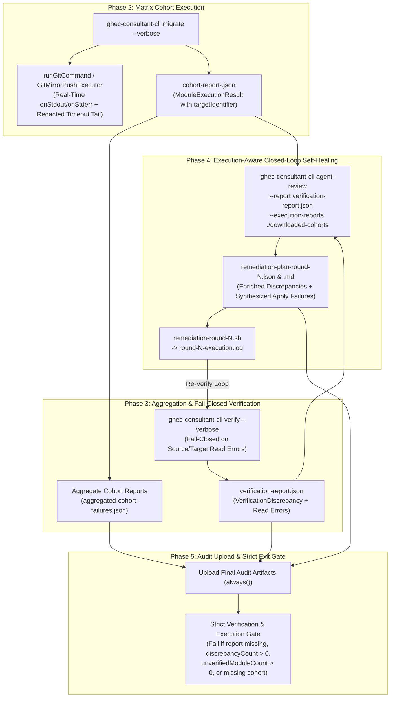

# Data Model & Observability Architecture: End-to-End Failure Observability, Execution-Aware Remediation & Strict Exit-Gate Enforcement

**Feature**: `005-failure-observability-gates`
**Created**: 2026-10-15
**Schema Version**: `MIGRATION_SCHEMA_VERSION` (`1.0.0`)

---

## 1. End-to-End Failure Observability & Remediation Pipeline Flow

---

## 2. Contract & Reporting Data Structures

### 2.1 `ModuleExecutionResult` (`packages/contracts/src/results/execution-result.ts`)

Carries explicit target attribution (`targetIdentifier`) so every organization-level or repository-level module execution result is self-identifying across cohort reports, summary reports, and `agent-review`.

| Field                      | Type                                               | Required | Validation / Notes                                                                  |
| :------------------------- | :------------------------------------------------- | :------: | :---------------------------------------------------------------------------------- |
| `schemaVersion`            | `'1.0.0'` (`MIGRATION_SCHEMA_VERSION`)             |   Yes    | Authoritative schema version literal.                                               |
| `moduleId`                 | `string` (`MigrationModuleIdSchema`)               |   Yes    | Registered module identifier (1 of 32 modules).                                     |
| `status`                   | `'complete' \| 'partial' \| 'failed' \| 'skipped'` |   Yes    | Execution outcome of the module.                                                    |
| `results`                  | `OperationExecutionResult[]`                       |   Yes    | Individual operation results (`operationId`, `status`, `error`, `httpStatus`).      |
| `durationMs`               | `number` (`NonNegativeIntegerSchema`)              |   Yes    | Elapsed execution time in milliseconds.                                             |
| `targetIdentifier`         | `string` (`NonEmptyStringSchema`)                  |    No    | `<targetOrg>` for org-scoped runs or `<targetOrg>/<targetRepo>` for repo-scoped.    |
| `scopeLevel`               | `'organization' \| 'repository'`                   |    No    | Scope level of the module execution.                                                |
| `metadataState`            | `'complete' \| 'partial' \| 'failed' \| 'skipped'` |    No    | Optional GEI metadata migration state.                                              |
| `failedMetadataCategories` | `string[]`                                         |    No    | Optional list of omitted GEI metadata categories (`issues`, `pull-requests`, etc.). |

---

### 2.2 `RemediationAction` & `RemediationPlan` (`apps/cli/src/commands/agent-review.ts`)

Enhanced to correlate `VerificationReport` discrepancies with `MigrationExecutionReport` (`cohort-report-*.json`) failures and synthesize actions for unverified `apply()` failures.

#### `RemediationAction`

| Field                      | Type                                                        | Required | Description                                                                                       |
| :------------------------- | :---------------------------------------------------------- | :------: | :------------------------------------------------------------------------------------------------ |
| `id`                       | `string`                                                    |   Yes    | Unique action identifier (`action-1`, `action-2`, ...).                                           |
| `category`                 | `'secrets-and-variables' \| 'security-and-policies' \| ...` |   Yes    | Remediation domain category.                                                                      |
| `moduleId`                 | `string`                                                    |   Yes    | Target migration module ID.                                                                       |
| `resourceName`             | `string`                                                    |   Yes    | Target resource or `<repo>:<resource>` identifier.                                                |
| `description`              | `string`                                                    |   Yes    | Human-readable discrepancy + sanitized `apply()` root-cause error (`op.error`).                   |
| `command`                  | `string`                                                    |   Yes    | Idempotent CLI or `gh` remediation command.                                                       |
| `severity`                 | `'low' \| 'medium' \| 'high' \| 'critical'`                 |   Yes    | Action severity rating.                                                                           |
| `executionError`           | `string`                                                    |    No    | Sanitized `op.error` (and HTTP status) correlated from `cohort-report-*.json` / execution report. |
| `synthesizedFromExecution` | `boolean`                                                   |    No    | `true` when synthesized from an `apply()` failure that had 0 matching verification discrepancies. |

#### `RemediationPlan`

| Field                         | Type                           | Required | Description                                                                                 |
| :---------------------------- | :----------------------------- | :------: | :------------------------------------------------------------------------------------------ |
| `schemaVersion`               | `string` (`1.0.0`)             |   Yes    | Contract schema version.                                                                    |
| `planId`                      | `string`                       |   Yes    | Generated remediation plan identifier.                                                      |
| `generatedAt`                 | `string` (ISO-8601)            |   Yes    | Generation timestamp.                                                                       |
| `reportId`                    | `string`                       |   Yes    | Source `VerificationReport.reportId`.                                                       |
| `sourceOrg`                   | `string`                       |   Yes    | Source organization login.                                                                  |
| `targetOrg`                   | `string`                       |   Yes    | Target organization login.                                                                  |
| `totalDiscrepancies`          | `number`                       |   Yes    | Count of discrepancies in `VerificationReport`.                                             |
| `unverifiedExecutionFailures` | `number`                       |    No    | Count of `apply()` failures synthesized because `VerificationReport` had 0 discrepancies.   |
| `actionableCount`             | `number`                       |   Yes    | Total actionable remediation items (`actions.length`).                                      |
| `actions`                     | `readonly RemediationAction[]` |   Yes    | Ordered list of remediation actions.                                                        |
| `warnings`                    | `readonly string[]`            |    No    | Diagnostic warnings (e.g., silent `verify()` gap alerts or missing cohort report warnings). |
| `script`                      | `string`                       |   Yes    | Executable bash script (`remediation.sh`).                                                  |

---

### 2.3 `AggregatedCohortFailures` (`./scans/aggregated-cohort-failures.json`)

Generated in Phase 3 of `migration-e2e-autonomous.yml` and `migration-execute-wave.yml` after downloading cohort artifacts.

| Field                  | Type                              | Required | Description                                                                                                                |
| :--------------------- | :-------------------------------- | :------: | :------------------------------------------------------------------------------------------------------------------------- |
| `expectedCohortCount`  | `number`                          |   Yes    | Number of cohorts scheduled by the Phase 1 slicer.                                                                         |
| `observedCohortCount`  | `number`                          |   Yes    | Number of `cohort-report-*.json` files found in `./downloaded-cohorts`.                                                    |
| `missingCohortReports` | `number`                          |   Yes    | `Math.max(0, expectedCohortCount - observedCohortCount)`.                                                                  |
| `failedCohortCount`    | `number`                          |   Yes    | Number of cohorts with `status === 'failed'` or `'partial'`.                                                               |
| `failedModuleCount`    | `number`                          |   Yes    | Total number of failed or partial `ModuleExecutionResult` entries.                                                         |
| `failures`             | `AggregatedCohortModuleFailure[]` |   Yes    | Detailed list of failed/partial modules with `cohortId`, `moduleId`, `targetIdentifier`, `status`, and `failedOperations`. |

---

### 2.4 `MigrationRunSummary` & 32-Module Breakdown (`packages/migration/src/reporting/types.ts`)

Expanded so `buildSummaryFromExecutionReport` aggregates counts across all 32 registered modules (accumulating across repositories rather than overwriting) and formats errors with `[<moduleId> @ <targetIdentifier>]`:

- `MigrationRunSummary.moduleBreakdown?: Readonly<Record<string, ModuleOpCounts>> | undefined` — maps every executed `moduleId` (across all 32 registered modules) to its cumulative `{ planned, succeeded, failed }` operation counts.
- `MigrationRunSummary.rehydration` — expanded to include cumulative counts for all rehydration modules (`variables`, `secrets`, `environments`, `rulesets`, `branchProtection`, `teams`, `repoSettings`, `orgSettings`, `orgVariables`, `orgSecrets`, `customRoles`, `customProperties`, `repoCustomProperties`, `collaborators`, `deployKeys`, `autolinks`, `discussions`, `issues`, `pullRequests`, `projectsV2`, `actionsPolicies`, `actionsRunners`, `ipAllowLists`, `appsInventory`, `packages`, `codeowners`, `security`).
- `StepSummaryOptions` — supports rendering collapsible `
` blocks in `formatStepSummaryMarkdown` whenever `errors`, `warnings`, or `verification.discrepancySummaries` exceed 10 items, plus optional `diagnosticLogPath?: string` to write un-truncated diagnostics to disk.
