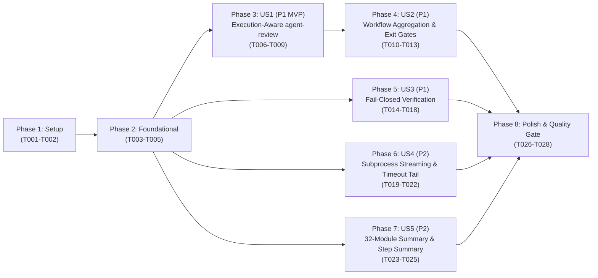

# Implementation Tasks: End-to-End Failure Observability, Execution-Aware Remediation & Strict Exit-Gate Enforcement

**Feature**: `005-failure-observability-gates`
**Date**: 2026-10-15
**Spec**: [spec.md](./spec.md) | **Plan**: [plan.md](./plan.md) | **Data Model**: [data-model.md](./data-model.md)

---

## Phase 1: Setup (Shared Contracts & Attribution Baseline)

**Purpose**: Ensure `ModuleExecutionResultSchema` in `@ghec/contracts` and `MigrationOrchestrator.run()` / `RepositoryMigrationPipeline.execute()` in `@ghec/migration` populate `targetIdentifier` across all execution paths.

- [x] T001 Verify and enforce `ModuleExecutionResultSchema` and `OperationExecutionResultSchema` in `packages/contracts/src/results/execution-result.ts` conforming to `data-model.md` (quoting verbatim field constraints: on `ModuleExecutionResult`: `schemaVersion` required `'1.0.0'` `MIGRATION_SCHEMA_VERSION`, `moduleId` required `MigrationModuleIdSchema`, `status` required enum `'complete' | 'partial' | 'failed' | 'skipped'`, `results` required `OperationExecutionResult[]`, `durationMs` required `NonNegativeIntegerSchema`, `targetIdentifier` optional `NonEmptyStringSchema` `<targetOrg>` for org-scoped runs or `<targetOrg>/<targetRepo>` for repo-scoped, `scopeLevel` optional `'organization' | 'repository'`, `metadataState` optional `'complete' | 'partial' | 'failed' | 'skipped'`, `failedMetadataCategories` optional `string[]`; on `OperationExecutionResult`: `operationId` required `NonEmptyStringSchema`, `status` required `'succeeded' | 'failed' | 'skipped'`, `httpStatus` optional `number` `100..599`, `error` optional `string` `1..2048` required when `status === 'failed'` and prohibited when `status !== 'failed'`, `completedAt` required ISO-8601 `TimestampSchema`, `targetIdentifier` optional `NonEmptyStringSchema`).
- [x] T002 [P] Ensure `MigrationOrchestrator.run()` in `packages/migration/src/orchestrator/migration-orchestrator.ts` and `enrichModuleExecutionResult` in `packages/migration/src/orchestrator/execution-enricher.ts` populate `targetIdentifier` (`<targetOrg>` or `<targetOrg>/<targetRepo>`) on every `ModuleExecutionResult` and child `OperationExecutionResult`, including applied, skipped, dynamically promoted fallback, and catch-fallback execution results.

---

## Phase 2: Foundational (Blocking Prerequisites)

**Purpose**: Establish shared read-error classification helpers, subprocess output tail formatting helpers, and expanded reporting type definitions required by the user story phases.

**⚠️ CRITICAL**: No user story work can begin until this phase is complete.

- [x] T003 [P] Create read-error classification helper in `packages/migration/src/core/read-error-classifier.ts` (and export from `packages/migration/src/index.ts`) that distinguishes expected HTTP 404/410 feature-disabled responses on optional sub-resource endpoints from unexpected read failures (HTTP 401, 403, 429, 5xx, network errors, or primary repository/organization read errors) and formats sanitized failure messages via `sanitizeDiagnostics`.
- [x] T004 [P] Add `onStdout?: ((line: string) => void) | undefined` and `onStderr?: ((line: string) => void) | undefined` to `GitCommandRunner` options in `packages/migration/src/strategies/mirror-push/types.ts`.
- [x] T005 [P] Expand `MigrationRunSummary`, `RehydrationSummary`, `PostMigrationSummary`, and `StepSummaryOptions` in `packages/migration/src/reporting/types.ts` conforming to `data-model.md` (adding `moduleBreakdown?: Readonly<Record<string, ModuleOpCounts>> | undefined` covering all 32 registered migration modules and `diagnosticLogPath?: string | undefined` on `StepSummaryOptions`).

**Checkpoint**: Foundational contracts, read-error classifier, subprocess runner types, and reporting types are ready.

---

## Phase 3: User Story 1 - Execution-Aware Self-Healing & Root-Cause Attribution in `agent-review` (Priority: P1) 🎯 MVP

**Goal**: Enable `agent-review` to ingest cohort execution reports (`--execution-reports <path-or-dir>`), enrich verification discrepancies with sanitized `apply()` root-cause errors (`op.error`, `httpStatus`), and synthesize actionable remediation items and warnings whenever a module failed during `apply()` but reported 0 verification discrepancies.

**Independent Test**: Run `node --import tsx --test apps/cli/tests/agent-review.test.ts` with a verification report and a synthetic directory of `cohort-report-*.json` files containing both matched discrepancy failures and unverified `apply()` failures; verify `remediation-plan.json` and `remediation-plan.md` include `executionError` on matched actions and synthesize `synthesizedFromExecution: true` actions + `warnings` for unverified execution failures.

### Tests for User Story 1

- [x] T006 [P] [US1] Add offline unit and integration tests in `apps/cli/tests/agent-review.test.ts` covering `--execution-reports` (single file, comma-separated files, directory scanning for `cohort-report-*.json` / `migration-execution.json`, and empty directory warning), root-cause `op.error` attribution on matching discrepancies, synthesized remediation actions when `VerificationReport` has 0 discrepancies for a failed `apply()` module, and DEC-004 token redaction.

### Implementation for User Story 1

- [x] T007 [US1] Update `AgentReviewOptions`, `RemediationAction`, `RemediationPlan`, and `parseAgentReviewOptions` in `apps/cli/src/commands/agent-review.ts` conforming to `contracts/remediation-plan-v1.contract.json` and `data-model.md` (quoting verbatim field constraints: on `RemediationAction`: required `id` string minLength 1, required `category` enum `'secrets-and-variables' | 'security-and-policies' | 'assets-and-storage' | 'identity-and-access' | 'webhooks-and-integrations' | 'metadata-and-content' | 'general'`, required `moduleId` string minLength 1, required `resourceName` string minLength 1, required `description` string minLength 1, required `command` string minLength 1, required `severity` enum `'low' | 'medium' | 'high' | 'critical'`, optional `executionError` string, optional `synthesizedFromExecution` boolean; on `RemediationPlan`: required `schemaVersion` `'1.0.0'`, required `planId` string minLength 1, required `generatedAt` ISO-8601 date-time, required `reportId` string minLength 1, required `sourceOrg` string minLength 1, required `targetOrg` string minLength 1, required `totalDiscrepancies` integer minimum 0, optional `unverifiedExecutionFailures` integer minimum 0, required `actionableCount` integer minimum 0, optional `warnings` `readonly string[]`, required `actions` `readonly RemediationAction[]`, required `script` string; on `parseAgentReviewOptions`: add `--execution-reports` string option).
- [x] T008 [US1] Implement execution report loader and cross-referencing logic in `generateRemediationPlan` and `executeAgentReviewCommand` in `apps/cli/src/commands/agent-review.ts` to resolve single files, comma-separated paths, or directories (`cohort-report-*.json` / `migration-execution.json`), attach sanitized `op.error` (`executionError`) to matching verification discrepancies, and synthesize explicit `RemediationAction` items (`synthesizedFromExecution: true`) and `warnings` when a module failed during `apply()` with 0 verification discrepancies.
- [x] T009 [US1] Update `formatRemediationMarkdown` in `apps/cli/src/commands/agent-review.ts` to render `plan.warnings`, display `executionError` root-cause details and `[SYNTHESIZED FROM APPLY FAILURE]` indicators in the remediation table, and include synthesized actions in `remediation.sh`.

**Checkpoint**: User Story 1 is complete and independently testable. `agent-review` has 100% visibility into Phase 2 cohort execution failures.

---

## Phase 4: User Story 2 - Strict Workflow Exit-Gate Enforcement & Cohort Failure Aggregation (Priority: P1)

**Goal**: Aggregate cohort execution reports in Phase 3, wire `--execution-reports ./downloaded-cohorts` and structured remediation execution logs into the self-healing loop, enable `--verbose` across all workflow CLI calls, and enforce a final **Strict Verification & Execution Gate** step after artifact uploads in all three workflows.

**Independent Test**: Validate workflow YAML syntax and test the cohort failure aggregation and final exit-gate logic against missing `verification-report.json`, `discrepancyCount > 0`, `unverifiedModuleCount > 0`, missing cohort reports, and clean pass states.

### Implementation for User Story 2

- [x] T010 [P] [US2] Update `.github/workflows/migration-e2e-autonomous.yml` to add a **Aggregate Cohort Execution Reports** step in `verification-and-remediation` (writing `./scans/aggregated-cohort-failures.json` conforming to `contracts/aggregated-cohort-failures-v1.contract.json` with required integer fields `expectedCohortCount`, `observedCohortCount`, `missingCohortReports`, `failedCohortCount`, `failedModuleCount`, and required array `failures`, and printing any cohort failures to the job log and `$GITHUB_STEP_SUMMARY`), pass `--execution-reports ./downloaded-cohorts` to `agent-review` (triggering the self-healing loop when either verification discrepancies OR cohort execution failures exist), capture `remediation-round-${ROUND}.sh` output and exit codes to `./remediations/round-${ROUND}-execution.log`, and add a final **Strict Verification & Execution Gate** step after `Upload Final Audit Artifacts` that exits `1` with `::error::` annotations if `./scans/verification-report.json` is missing (when `dry_run == false`), if `discrepancyCount > 0` or `unverifiedModuleCount > 0` remains, or if any expected cohort failed to produce a report.
- [x] T011 [P] [US2] Update `.github/workflows/migration-execute-wave.yml` to add `--verbose` to `plan`, `migrate`, `verify`, `agent-review`, and `publish-results` CLI invocations, pass `--execution-reports ./downloaded-cohorts` to `agent-review`, fix `Cohort Execution Breakdown` jq queries to inspect `.results[]` (as well as `.moduleResults[]`) and `.summary.discrepancyCount`, and add a final **Strict Verification & Execution Gate** step after `Upload Final Consolidated Artifacts` that exits `1` with `::error::` annotations if expected cohort reports or `verification-report.json` are missing or if `discrepancyCount > 0` or `unverifiedModuleCount > 0` remains.
- [x] T012 [P] [US2] Update `.github/workflows/migration-apply-remediation.yml` to capture remediation script output into `./remediations/apply-remediation-execution.log`, add `--verbose` to `verify`, and add a final **Strict Verification & Execution Gate** step after `Upload Remediation Results` that exits `1` with `::error::` annotations if `./scans/post-remediation-verification.json` is missing or if `discrepancyCount > 0` or `unverifiedModuleCount > 0` remains.
- [x] T013 [US2] Add offline workflow gate & cohort aggregation verification tests in `apps/cli/tests/workflow-gates.test.ts` validating that all 3 workflow YAML files include the final enforcement gate after artifact upload, `--verbose` flags, and `--execution-reports` wiring.

**Checkpoint**: User Story 2 is complete. Unresolved migration or verification failures can never finish as green GitHub Actions runs.

---

## Phase 5: User Story 3 - Fail-Closed Verification on Source or Target Read Errors (Priority: P1)

**Goal**: Prevent `MigrationPlanner` (`verificationMode: true`), `VerificationOrchestrator`, and module `verify()` implementations (including `gei-repo` / `RepositoryParityInspector`) from silently converting unexpected source or target read failures into empty state that passes as `verified: true`.

**Independent Test**: Run `node --import tsx --test packages/migration/tests/orchestrator/verification-orchestrator.test.ts packages/migration/tests/modules/gei-repo.test.ts` with mock source/target clients throwing HTTP 500, 403, 429, or network errors alongside expected 404/410 feature-disabled responses; verify unexpected read errors produce `verified: false` with a sanitized `VerificationDiscrepancy` while expected 404/410 feature-disabled responses pass cleanly.

### Tests for User Story 3

- [x] T014 [P] [US3] Add offline unit tests in `packages/migration/tests/orchestrator/verification-orchestrator.test.ts` and `packages/migration/tests/modules/gei-repo.test.ts` testing fail-closed verification when source or target read calls fail with HTTP 500/403/429 or network errors during `MigrationPlanner` (`verificationMode: true`), `VerificationOrchestrator.run()`, and `RepositoryParityInspector.inspect()`.

### Implementation for User Story 3

- [x] T015 [P] [US3] Update `RepositoryParityInspector` (`collectStats` and `synthesizeDiscrepancies`) in `packages/migration/src/modules/gei-repo/parity-inspector.ts` to distinguish HTTP 404 on target `/repos/{owner}/{repo}` (`exists: false`) from unexpected read errors on source or target (`/repos/{owner}/{repo}`, `/issues`, `/pulls`, `/releases`), record sanitized `readErrors: readonly string[]` on `RepositoryStats`, and emit a `VerificationDiscrepancy` (`expected: 'readable repository metadata'`, `actual: 'api_read_error'`) whenever any read error occurs.
- [x] T016 [US3] Update `MigrationPlanner.generatePlan()` in `packages/migration/src/planner/planner.ts` so that when `this.verificationMode === true` and `module.discover()` or `module.plan()` throws an unexpected error (or when a module records a `[VERIFY_READ_ERROR]` warning), it emits a fail-closed `ModulePlan` containing a `[VERIFY_READ_ERROR] <sanitized message>` warning rather than silently returning an empty plan or aborting the entire verification run.
- [x] T017 [US3] Update `VerificationOrchestrator.run()` in `packages/migration/src/orchestrator/verification-orchestrator.ts` to inspect `modulePlan.warnings` for `[VERIFY_READ_ERROR]` markers and wrap `await mod.verify(ctx, modulePlan)` in a fail-closed `try/catch` block that marks `verified: false` and appends a `VerificationDiscrepancy` (`expected: 'verifiable source and target state'`, `actual: 'read_error'`, `message: sanitizeDiagnostics(...)`) whenever discovery, planning, or verification throws an unexpected read error.
- [x] T018 [US3] Audit and update module `discover()` / `verify()` catch blocks in `packages/migration/src/modules/` (specifically checking modules that catch all errors and return empty lists during read calls) so unexpected non-404/410 errors rethrow or surface fail-closed read errors during verification while preserving graceful handling of expected 404/410 feature-disabled endpoints.

**Checkpoint**: User Story 3 is complete. Transient API, rate-limit, or permission errors during verification always fail closed with an explicit discrepancy.

---

## Phase 6: User Story 4 - Real-Time Subprocess Streaming & Redacted Timeout Diagnostics (Priority: P2)

**Goal**: Stream sanitized `stdout` and `stderr` lines in real time from `runGitCommand` and `GitMirrorPushExecutor.execute()` to caller logger hooks, and attach the bounded, redacted partial `stdout`/`stderr` tail whenever a Git subprocess times out or aborts.

**Independent Test**: Run `node --import tsx --test packages/migration/tests/strategies/mirror-push.test.ts` verifying real-time `onStdout`/`onStderr` callback invocation, secret redaction on streamed lines, and redacted partial `stdout`/`stderr` tail inclusion in timeout/abort error messages.

### Tests for User Story 4

- [x] T019 [P] [US4] Add offline unit tests in `packages/migration/tests/strategies/mirror-push.test.ts` verifying that `runGitCommand` invokes `options.onStdout` and `options.onStderr` per line with redacted tokens, `GitMirrorPushExecutor.execute()` forwards `onStdout`/`onStderr` to `this.runner`, and timed-out/aborted commands include the redacted partial `stdout` and `stderr` tail in the thrown `Error` message.

### Implementation for User Story 4

- [x] T020 [US4] Update `runGitCommand` and `GitMirrorPushExecutor.execute()` in `packages/migration/src/strategies/mirror-push/executor.ts` to pass `options.onStdout` and `options.onStderr` into `collectLines(options.onStdout, secrets)` and `collectLines(options.onStderr, secrets)`, forward `request.onStdout` and `request.onStderr` across all `this.runner('git', ...)` calls, and flush + append a bounded ($\le 1500$ chars), redacted partial `stdout`/`stderr` tail in the `timeout` and `onAbort` rejection `Error` messages.
- [x] T021 [P] [US4] Update `GeiRepoMigrationModule.apply()` in `packages/migration/src/modules/gei-repo/module.ts` to pass `onStdout: (line) => ctx.logger.info(\`[gei-repo][git] \${line}\`)`and`onStderr: (line) => ctx.logger.info(\`[gei-repo][git] \${line}\`)`into both primary and fallback`mirrorExecutor.execute(...)` calls.
- [x] T022 [P] [US4] Update `RepositoryMigrationPipeline.execute()` in `packages/migration/src/orchestrator/pipeline.ts` to pass `onStdout: (line) => this.logger.info(\`[Stage 3][git] \${line}\`)`and`onStderr: (line) => this.logger.info(\`[Stage 3][git] \${line}\`)`into both primary and fallback`mirrorExecutor.execute(...)` calls.

**Checkpoint**: User Story 4 is complete. All `git` mirror-push subprocesses stream redacted output in real time and preserve partial output on timeout.

---

## Phase 7: User Story 5 - Complete 32-Module Summary Attribution & Un-Truncated Diagnostic Logs (Priority: P2)

**Goal**: Prefix every error in `summary-reporter.ts` with `[<moduleId> @ <targetIdentifier>]`, fix `'git-lfs'` $\rightarrow$ `'lfs'`, accumulate operation counts across all 32 registered modules without overwriting multi-repo counts, and preserve all errors, warnings, and discrepancies beyond 10 items in `step-summary.ts`.

**Independent Test**: Run `node --import tsx --test packages/migration/tests/reporting/summary-reporter.test.ts packages/migration/tests/reporting/step-summary.test.ts` verifying `[<moduleId> @ <targetIdentifier>]` error prefixes, `'lfs'` mapping, cumulative counts across all 32 modules, and collapsible `<details>` rendering when items exceed 10.

### Tests for User Story 5

- [x] T023 [P] [US5] Add offline unit tests in `packages/migration/tests/reporting/summary-reporter.test.ts` and `packages/migration/tests/reporting/step-summary.test.ts` verifying `[<moduleId> @ <targetIdentifier>]` error attribution, `'lfs'` module ID mapping, cumulative multi-repo operation counts across all 32 modules in `moduleBreakdown` and `rehydration`, and collapsible `<details>` / diagnostic log preservation when errors, warnings, or discrepancies exceed 10 items.

### Implementation for User Story 5

- [x] T024 [US5] Update `buildSummaryFromExecutionReport` in `packages/migration/src/reporting/summary-reporter.ts` to prefix operation and module errors with `[${modResult.moduleId}${modResult.targetIdentifier ? ` @ ${modResult.targetIdentifier}` : ''}]`, handle both `case 'lfs':` and `case 'git-lfs':`, accumulate operation counts across multiple repository runs instead of overwriting, and populate `moduleBreakdown` and expanded `rehydration` / `postMigration` fields across all 32 registered modules.
- [x] T025 [US5] Update `formatStepSummaryMarkdown` in `packages/migration/src/reporting/step-summary.ts` to render all executed rehydration/module counts, display the first 10 errors, warnings, and verification discrepancies inline, and include a collapsible `<details><summary>Full Diagnostic List (...)</summary>...</details>` block for any items beyond 10 (plus optional file output when `options.diagnosticLogPath` is provided).

**Checkpoint**: User Story 5 is complete. Run summaries and step summaries cover all 32 modules with target attribution and zero lost diagnostics.

---

## Phase 8: Polish & Cross-Cutting Concerns

**Purpose**: End-to-end DEC-004 sanitization verification, code formatting, and full monorepo quality gate execution.

- [x] T026 [P] Verify DEC-004 secret scrubbing across all new diagnostic paths (`runGitCommand` timeout tails, `agent-review` execution error correlation, `VerificationOrchestrator` read-error discrepancies, and `summary-reporter` target-attributed errors).
- [x] T027 Run `npm run format` and `npm run lint` across the workspace to ensure Prettier and ESLint compliance.
- [x] T028 Execute the primary quality gate `npm run check` (`lint`, `typecheck`, `build:apps`, and `test:unit`) and verify 100% pass rate offline.

---

## Dependencies & Execution Order

### Phase Dependencies

- **Phase 1: Setup (`T001`–`T002`)**: Starts immediately — verifies `@ghec/contracts` and `MigrationOrchestrator` `targetIdentifier` attribution.
- **Phase 2: Foundational (`T003`–`T005`)**: Depends on Phase 1 — establishes shared read-error classifier, subprocess runner types, and reporting types.
- **Phase 3: User Story 1 (`T006`–`T009`, P1 MVP)**: Depends on Phase 1 & Phase 2 (`targetIdentifier` attribution).
- **Phase 4: User Story 2 (`T010`–`T013`, P1)**: Depends on Phase 3 (`--execution-reports` flag in `agent-review`).
- **Phase 5: User Story 3 (`T014`–`T018`, P1)**: Depends on Phase 2 (`read-error-classifier.ts`). Can run in parallel with Phases 3–4.
- **Phase 6: User Story 4 (`T019`–`T022`, P2)**: Depends on Phase 2 (`mirror-push/types.ts`). Can run in parallel with Phases 3–5.
- **Phase 7: User Story 5 (`T023`–`T025`, P2)**: Depends on Phase 1 & Phase 2 (`reporting/types.ts`). Can run in parallel with Phases 3–6.
- **Phase 8: Polish (`T026`–`T028`)**: Depends on all user stories (`US1`–`US5`) completing.

### User Story Dependency Graph



### Parallel Opportunities

- **Phase 2**: `T003` (`read-error-classifier.ts`), `T004` (`mirror-push/types.ts`), and `T005` (`reporting/types.ts`) touch completely separate files and can be implemented in parallel.
- **Cross-Story Parallelism**: Once Phase 2 completes, `US1` (`apps/cli/src/commands/agent-review.ts`), `US3` (`packages/migration/src/orchestrator/verification-orchestrator.ts` & `parity-inspector.ts`), `US4` (`packages/migration/src/strategies/mirror-push/executor.ts`), and `US5` (`packages/migration/src/reporting/summary-reporter.ts` & `step-summary.ts`) operate on disjoint files and can proceed concurrently.
- **Phase 4**: `T010` (`migration-e2e-autonomous.yml`), `T011` (`migration-execute-wave.yml`), and `T012` (`migration-apply-remediation.yml`) modify separate workflow files and can be executed in parallel.

---

## Parallel Example: Foundational & Story Phases

```bash
# Phase 2 parallel tasks across separate files:
Task T003: "Create read-error classification helper in packages/migration/src/core/read-error-classifier.ts"
Task T004: "Add onStdout and onStderr to GitCommandRunner options in packages/migration/src/strategies/mirror-push/types.ts"
Task T005: "Expand MigrationRunSummary and StepSummaryOptions in packages/migration/src/reporting/types.ts"

# Phase 4 parallel workflow updates:
Task T010: "Update .github/workflows/migration-e2e-autonomous.yml with cohort aggregation and Strict Verification & Execution Gate"
Task T011: "Update .github/workflows/migration-execute-wave.yml with --verbose and Strict Verification & Execution Gate"
Task T012: "Update .github/workflows/migration-apply-remediation.yml with --verbose and Strict Verification & Execution Gate"
```

---

## Implementation Strategy

### MVP First (User Story 1 + User Story 2)

1. Complete Phase 1 and Phase 2 (Attribution baseline and foundational types/classifiers).
2. Complete Phase 3 (User Story 1: Execution-aware `agent-review` with `--execution-reports`) and Phase 4 (User Story 2: Workflow cohort aggregation and Strict Final Exit Gates).
3. Validate that `agent-review` surfaces Phase 2 `apply()` failures and workflows fail closed after uploading artifacts.

### Incremental Delivery

1. Add Phase 5 (User Story 3: Fail-closed `verify()` and `MigrationPlanner` `verificationMode` on unexpected API read errors).
2. Add Phase 6 (User Story 4: Real-time `runGitCommand` streaming and redacted timeout tails).
3. Add Phase 7 (User Story 5: 32-module `summary-reporter` attribution and un-truncated `step-summary` collapsible details).
4. Complete Phase 8 (`npm run check` quality gate).
